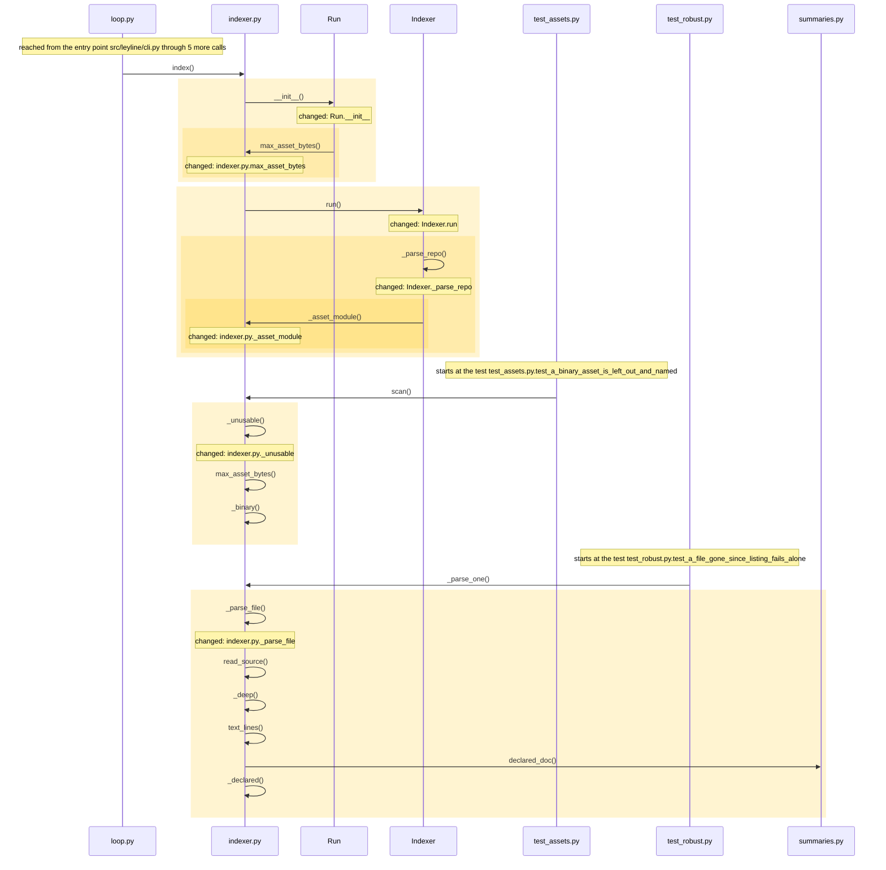
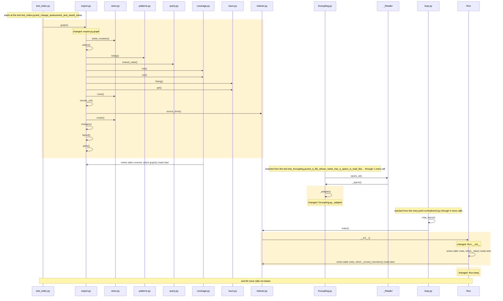
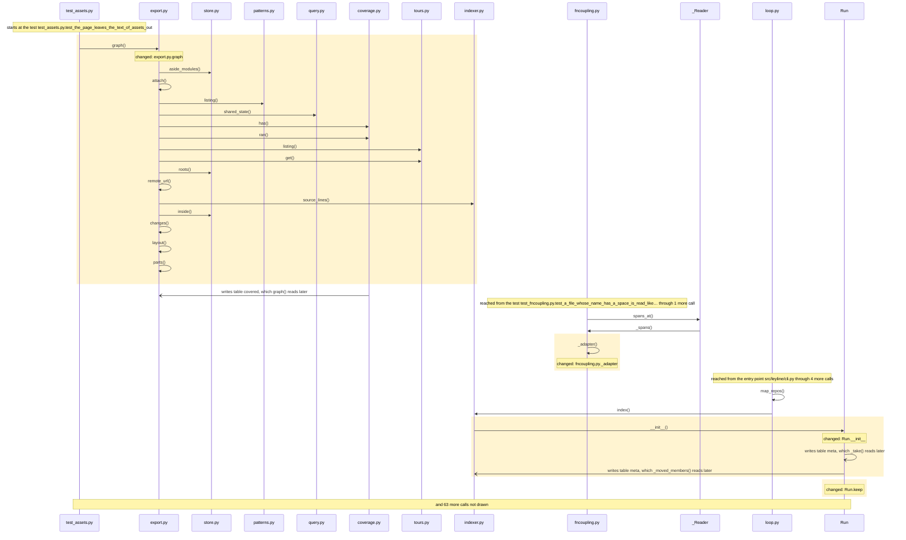

<!-- leyline:begin -->
# Links from Unity and Godot assets to the code they run

The one-page plan for the change in `openspec/changes/asset-edges/`, written by Leyline from the spec files beside it. `leyline plan` rewrites it; edit the spec, not this page.

**State: done as agreed.** Every task that names code is done, every scenario is proven, and nothing outside the spec changed. Task 1.36 is yours to check.

In a game project the link that matters most is often not in the code: a Unity prefab names a script by a GUID and an event on it names a method by a string, and a Godot scene names a script by a path and a signal connection names a method by a string. The plan has 57 tasks: it changes FileResult.assets, Indexer.__init__, Indexer._asset_scripts, Indexer._asset_target and 29 more and adds `_note` in indexer.py. Nothing else must be edited with it; 560 places in 2 modules run into the changed code and may behave differently; 509 existing tests already run through it. It is done when 21 scenarios pass: 21 already have a test.

## 1. What code will be written

| Task | Does | Code |
| --- | --- | --- |
| 1.1 | Add `src/leyline/adapters/godot.py` with `parse`, which reads a Godot scene or resource in a stream into the scripts it runs, the scenes it includes and the methods its signal connections call | in src/leyline/adapters/godot.py; mentions parse (could be 7 things) |
| 1.2 | Add `src/leyline/adapters/unity.py` with `parse`, which reads a Unity scene, prefab or asset in a stream into the GUIDs of the scripts and prefabs it names and the methods its persistent events call, following fileIDs inside the file | in src/leyline/adapters/unity.py; mentions parse (could be 7 things) |
| 1.3 | Add `src/leyline/model.py: AssetRef`, what an asset names: a script, an include, or a method on the script of a node or component, kept once however many times the asset names it | in AssetRef |
| 1.4 | Add `model.FileResult.assets`, the asset references of a file | FileResult.assets |
| 1.5 | Change the top level of `src/leyline/adapters/__init__.py` to register the two asset adapters whatever `LEYLINE_GENERIC` says, and to list their languages | src/leyline/adapters/__init__.py |
| 1.6 | Add `indexer.max_asset_bytes`, the size limit of an asset, 64 MB or what `LEYLINE_MAX_ASSET_MB` says | max_asset_bytes |
| 1.7 | Change `indexer._unusable` to apply the limit of an asset, and not the test for long lines, to a file of an asset adapter | _unusable |
| 1.8 | Change `indexer._parse_file` to read a file of an asset adapter in a stream, without the list of its lines, the decoded text or the hashes of its nodes | _parse_file |
| 1.9 | Add `src/leyline/indexer.py: _asset_module`, the module folder of an asset: the nearest folder at or above it that holds code the map reads | _asset_module |
| 1.10 | Change `Indexer._parse_repo` to put an asset in the module `Indexer._asset_module` gives | Indexer._parse_repo; mentions Indexer._asset_module (not on the map yet) |
| 1.11 | Add `src/leyline/indexer.py: read_meta`, the GUID in a Unity `.meta` file and a digest of its head, for a file that is not a link | read_meta |
| 1.12 | Add `Indexer._unity_guids`, which reads the `.meta` file beside each file the map holds, only when the repository holds a Unity asset, and counts the scripts that have none | Indexer._unity_guids |
| 1.13 | Add `src/leyline/indexer.py: _note`, which counts what an asset names and the map cannot tie to code by reason and keeps the first few | indexer.py: _note (new) |
| 1.14 | Add `Indexer._script_methods`, the methods of a script file with a name, of its class or a base class on the map, or its functions when it has no class | Indexer._script_methods |
| 1.15 | Add `Indexer._asset_target`, the file a reference names: a Godot `res://` path read from the folder of the `project.godot` above the scene, or a Unity GUID, with the reason when there is none | Indexer._asset_target |
| 1.16 | Add `Indexer._asset_scripts`, the script files an asset runs | Indexer._asset_scripts |
| 1.17 | Add `Indexer._link_asset`, which makes the `imports` edge (exact) of one asset to each script, scene or prefab it names, and one `communicates` edge on the channel `asset` (heuristic) to each method however many connections name it | Indexer._link_asset; mentions imports (could be 2 things) |
| 1.18 | Add `Indexer._resolve_assets`, which links every asset of each repository, and does nothing when there is none | Indexer._resolve_assets |
| 1.19 | Change `Indexer.run` to run `Indexer._resolve_assets` after the calls and endpoints are resolved and before the results are let go | Indexer.run; mentions Indexer._resolve_assets |
| 1.20 | Change `Indexer._write_coverage` to record the assets extractor's counts and the first names of what it could not link, to leave out the extractor of assets a repository has none of, and to keep the digests of the `.meta` files | Indexer._write_coverage |
| 1.21 | Add `Indexer.meta_digests`, the digests of the `.meta` files read, set in `Indexer.__init__` | Indexer.__init__, Indexer.meta_digests |
| 1.22 | Add `Indexer.asset_notes`, the notes on what could not be linked, set in `Indexer.__init__` | Indexer.__init__, Indexer.asset_notes |
| 1.23 | Change the top level of `src/leyline/indexer.py` to add the size limit of an asset and how many names of each reason are kept | src/leyline/indexer.py |
| 1.24 | Change `loop._changes` to count a `.meta` file beside a script or an asset as a changed file, only when the map holds Unity assets | _changes |
| 1.25 | Change `loop.map_text` to leave the asset languages out of the languages it lists | map_text |
| 1.26 | Change `fncoupling._adapter` to give no adapter for an asset, which has no functions to couple | _adapter |
| 1.27 | Add `src/leyline/incremental.py: _stat_key`, the size and modification time of a file old enough to be trusted | _stat_key |
| 1.28 | Change `Run.lookup` to take an unchanged asset from the cache by its size and modification time, without reading it again | Run.lookup |
| 1.29 | Change `Run.keep` to keep the size and modification time of an asset | Run.keep |
| 1.30 | Change `_Cache._open` to add the column for them to a cache made before | _Cache._open |
| 1.31 | Change the top level of `src/leyline/incremental.py` to raise the cache version | src/leyline/incremental.py |
| 1.32 | Change `Run.__init__` to put the size limit of an asset in `Run.key`, the cache's key | Run.__init__, Run.key |
| 1.33 | Add `src/leyline/query.py: _assets_run`, the reverse step from the contents of a script to the assets that run it, and from a scene or prefab to those that include it | _assets_run |
| 1.34 | Change `query._adjacency` to take that step in the reverse walk | _adjacency |
| 1.35 | Change `export.graph` to leave the text of asset files out of the page's sources | graph |
| 1.36 | Change docs/indexing.md to say which engine files are read, what they link to and what the limits are, and README.md to mention them | no code: checked by you |
| 2.1 | Add the test "A Godot scene is linked to the script it runs" | a test for the scenario |
| 2.2 | Add the test "A Godot project in a subfolder is resolved from its own root" | a test for the scenario |
| 2.3 | Add the test "A Godot signal connection is linked to its method" | a test for the scenario |
| 2.4 | Add the test "A Godot scene that includes another scene is linked to it" | a test for the scenario |
| 2.5 | Add the test "A Godot script missing its grammar is said so" | a test for the scenario |
| 2.6 | Add the test "A Unity prefab is linked to the script a component runs" | a test for the scenario |
| 2.7 | Add the test "A Unity event is linked to the method it calls" | a test for the scenario |
| 2.8 | Add the test "A method of a base class counts as a method of the script" | a test for the scenario |
| 2.9 | Add the test "A Unity scene that includes a prefab is linked to it" | a test for the scenario |
| 2.10 | Add the test "Impact of a script class lists the prefab that runs it" | a test for the scenario |
| 2.11 | Add the test "A reference to a script outside the repository is counted" | a test for the scenario |
| 2.12 | Add the test "A GUID that two files claim is not linked" | a test for the scenario |
| 2.13 | Add the test "A call on a built-in component is not counted as missing" | a test for the scenario |
| 2.14 | Add the test "A folder of assets alone is not a module" | a test for the scenario |
| 2.15 | Add the test "The page leaves the text of assets out" | a test for the scenario |
| 2.16 | Add the test "A large asset is read in a stream", measured with the standard library's memory tracer | a test for the scenario |
| 2.17 | Add the test "A binary asset is left out and named" | a test for the scenario |
| 2.18 | Add the test "A changed meta file links the assets again" | a test for the scenario |
| 2.19 | Add the test "An unchanged asset is not read again" | a test for the scenario |
| 2.20 | Add the test "Both engines map in one repository" | a test for the scenario |
| 2.21 | Add the test "A repository without assets maps as before" | a test for the scenario |

Not read as code (nothing to check on the map): task 1.5: `LEYLINE_GENERIC` is not on the map; read as a word, not code; task 1.6: `LEYLINE_MAX_ASSET_MB` is not on the map; read as a word, not code; task 1.15: `res://` is not on the map; read as a word, not code; task 1.15: `project.godot` is not on the map; read as a word, not code; task 1.17: `communicates` is not on the map; read as a word, not code; task 1.17: `asset` is not on the map; read as a word, not code.

### How it runs

How execution reaches the code the tasks change, and what that code calls, as the code is now:

Drawn from the map: every arrow is a call or a channel link found in the code, in the order the code makes them where that order is known. The code the tasks change is shaded. Not drawn, to keep it readable: indexer.py.read_meta, Indexer._unity_guids, Indexer._script_methods, Indexer._asset_target, Indexer._asset_scripts, Indexer._link_asset and 13 more.

## 2. What it will affect

34 things change, 0 more must be edited with them, and 560 are reached without needing an edit, across 2 modules. 509 existing tests run through the change.

*Must be edited*: code that breaks unless it changes too, such as the callers of a function whose parameters change. *Reached*: code that runs into the change, directly or through other calls; it needs no edit but may behave differently.

- leyline: 34 changed, 346 reached
- tests: 214 reached
- **medium risk:** 117 of 205 changed functions are on no test's path.
- **low risk:** 35 direct caller links are guesses by name, so the caller list may be wrong.
- **high risk:** Crosses a db boundary (views): export.py.graph, affected.py.change_code, affected.py.change_id_for, change.py.get_view and 9 more read what change.py.save_view writes. One end changes (graph); the other has no compile-time link to it.
- **high risk:** Crosses a db boundary (covered): export.py.graph, affected.py._ran, affected.py.mark_scenarios, affected.py.measured_tests and 9 more read what coverage.py.import_file writes. One end changes (graph); the other has no compile-time link to it.
- **high risk:** Crosses a db boundary (coverage_runs): Indexer._write_coverage, affected.py._runs and affected.py._taken_before read what coverage.py.import_file writes. One end changes (Indexer._write_coverage); the other has no compile-time link to it.
- **high risk:** Crosses a db boundary (meta): Run.__init__, loop.py._changes, cli.py._workspace_elsewhere, context.py.graph and 20 more read what diff.py.drop_snapshot writes. One end changes (Run.__init__ and _changes); the other has no compile-time link to it.
- **high risk:** Crosses a db boundary (annotations): export.py.graph, change.py.assess, query.py._notes, query.py.expand and 5 more read what diff.py.snapshot writes. One end changes (graph); the other has no compile-time link to it.
- **high risk:** Crosses a db boundary (meta): Run.__init__, loop.py._changes, cli.py._workspace_elsewhere, context.py.graph and 19 more read what diff.py.snapshot writes. One end changes (Run.__init__ and _changes); the other has no compile-time link to it.

**Must agree with the change, and no task names it** (another end of a channel it crosses):
- change.py.save_view (src/leyline/change.py): writes what export.py.graph reads
- coverage.py.import_file (src/leyline/coverage.py): writes what export.py.graph reads
- diff.py.drop_snapshot (src/leyline/diff.py): writes what Run.__init__, loop.py._changes reads
- diff.py.snapshot (src/leyline/diff.py): writes what export.py.graph reads
- cli.py._workspace_elsewhere (src/leyline/cli.py): also reads what Run.__init__ writes
- context.py.graph (src/leyline/context.py): also reads what Run.__init__ writes
- diff.py.lost (src/leyline/diff.py): also reads what Run.__init__ writes
- diff.py.review (src/leyline/diff.py): also reads what Run.__init__ writes
- explain.py._stamp (src/leyline/explain.py): also reads what Run.__init__ writes
- loop.py.check (src/leyline/loop.py): also reads what Run.__init__ writes

**Shares a caller or a field with the change, and no task names it.** Each line is either right to leave alone or a missing task:
- Indexer.run is also called by grade, index
- Indexer.__init__ is also called by grade, index
- map_text is also called by _loop, map_code
- Indexer._asset_target is also called by target
- Run.__init__ is also called by index
- Indexer._file_index (used by Indexer.__init__) is also used by Indexer._ckey
- Run.key (used by Run.__init__) is also used by Run.finish
- Indexer.keep_results (used by Indexer.run) is also used by Indexer._build_flows, index
- and 12 more: `leyline spec facts`

43 more fields shared with the change left off this page: they share only a large type, or a reader of every field, with the change. `leyline spec facts` lists them.

**Usually changes with the files the tasks touch, and no task names it** (from the last 88 commits, leaving out 1 that changed more than 50 files). Each line is either right to leave alone or a missing task:
- `tests/test_index.py` changed in 10 of the 10 commits that changed `src/leyline/model.py` (and often with `src/leyline/adapters/__init__.py`, `src/leyline/export.py` and 2 more); no task names it.
- `pyproject.toml` changed in 3 of the 3 commits that changed `src/leyline/adapters/__init__.py` (and often with `src/leyline/model.py`, `src/leyline/query.py`); no task names it.
- `src/leyline/viewer/viewer.html` changed in 14 of the 16 commits that changed `src/leyline/export.py` (and often with `src/leyline/query.py`); no task names it.
- `src/leyline/adapters/csharp.py` changed in 8 of the 10 commits that changed `src/leyline/model.py`; no task names it.
- and 6 more: `leyline spec facts`

**Usually changes with the functions the tasks name, and no task names it.** Each line is either right to leave alone or a missing task:
- `cli.py.main` changed in 3 of the 4 commits that changed `Indexer._parse_repo`; no task names it.
- `indexer.py._parse_one` changed in 3 of the 4 commits that changed `Indexer._parse_repo`; no task names it.
- `indexer.py.index` changed in 3 of the 4 commits that changed `Indexer._parse_repo`; no task names it.

**Earlier changes to this code** (finished OpenSpec changes and earlier reviews that touched the same code, newest first):

- `node-summaries` (checked 2026-10-15): Every node carries a one-line summary, read by every understanding tool. Touched `src/leyline/incremental.py`, `Run.__init__`, `Run.keep`, `Run.key` and 4 more.
- `orientation-from-named-parts` (checked 2026-10-15): The orientation tour and `map` point at named parts, not cluster anchors. Touched `graph`, `map_text`.

## 3. How you will know it was done

Each scenario is proven by a test with the same name. After the change, `leyline check` marks each one from the test results.

| Scenario | When | Then | Test |
| --- | --- | --- | --- |
| A Godot scene is linked to the script it runs | a `.tscn` file has a node whose script is a `res://` path to a GDScript file in the repository | the scene has an `imports` edge to that file | exists |
| A Godot project in a subfolder is resolved from its own root | the repository holds a Godot project in a folder, with its `project.godot`, and a scene there names `res://player.gd` | the scene is linked to the `player.gd` of that folder | exists |
| A Godot signal connection is linked to its method | a scene connects a signal to a method by name on a node whose script has that method | the scene has a `communicates` edge on the channel `asset` to the method, and `impact` of the method lists the scene | exists |
| A Godot scene that includes another scene is linked to it | a scene has a PackedScene resource that is another `.tscn` in the repository | it has an `imports` edge to that scene | exists |
| A Godot script missing its grammar is said so | the GDScript grammar is not installed and a scene names a `.gd` file | no edge is made, and the coverage counts it under "script in a language that is not read", not as outside the repository | exists |
| A Unity prefab is linked to the script a component runs | a `.prefab` has a component whose script GUID is the one in the `.meta` file of a C# script in the repository | the prefab has an `imports` edge to that script's file | exists |
| A Unity event is linked to the method it calls | a persistent event call names a method and its target component runs a script that has that method | the prefab has a `communicates` edge on the channel `asset` to the method | exists |
| A method of a base class counts as a method of the script | an event names a method that the component's script class inherits from a base class on the map | the edge goes to the base class's method | exists |
| A Unity scene that includes a prefab is linked to it | a `.unity` file includes a prefab by its GUID, found in the `.meta` file of that prefab | it has an `imports` edge to that prefab | exists |
| Impact of a script class lists the prefab that runs it | `impact` is asked of the class a prefab's component runs, or of a method or field of it | the prefab is among what reaches it | exists |
| A reference to a script outside the repository is counted | an asset names a GUID with no script in the repository, or a method its script does not have | no edge is made, and the coverage counts each reason apart and names the first few | exists |
| A GUID that two files claim is not linked | two `.meta` files hold the same GUID | nothing is linked to it and the coverage says so | exists |
| A call on a built-in component is not counted as missing | an event calls a method of a built-in engine component | it is counted as a built-in call, not as a method its script lacks | exists |
| A folder of assets alone is not a module | a folder holds only prefabs and scenes | they belong to the module of the nearest folder above that is one, and no module is made for the folder | exists |
| The page leaves the text of assets out | the map page is written for a repository with assets | it holds their names and links and not their text | exists |
| A large asset is read in a stream | a scene of 20 MB is mapped | it is read and linked, and no list of its lines is made | exists |
| A binary asset is left out and named | a repository holds a Unity asset in binary serialization | it is left out of the map and named with its reason, as any unreadable file is | exists |
| A changed meta file links the assets again | a `.meta` file is added or changed and `plan` or `check` maps the code again | the assets are linked again, and the map equals a full map of the same code | exists |
| An unchanged asset is not read again | one code file is edited and the map is made again | no unchanged asset is opened and parsed again | exists |
| Both engines map in one repository | a repository holds a Godot project and a Unity project | each file is linked under its own language and the map is made without error, also with `LEYLINE_GENERIC` set | exists |
| A repository without assets maps as before | a repository has no files of these kinds | nothing about them appears in its map, no `.meta` is read, and the map is what it was | exists |

## Review findings

- Logic review: 14 findings, all settled.
- Performance review: 7 findings, all settled.

Settled (full text: `leyline spec findings`):
- high: export.graph embeds the full text of every file node in map.html (no size cap), and loop.write_page rewrites that page on every map, plan and check, so thous... **Accepted**: Matthew accepted every review finding on 2026-10-15; the spec is rewritten to the reviewer's proposal, and unasserted is non-blocking by default.
- high: The default 5 MB file limit in indexer._unusable applies to the new extensions, so the biggest Unity scenes (tens of MB as text) are left out with no edges,... **Accepted**: Matthew accepted every review finding on 2026-10-15; the spec is rewritten to the reviewer's proposal, and unasserted is non-blocking by default.
- high: One assets.py adapter cannot give files two languages: the file node takes adapter.LANGUAGE (one per adapter) and _resolve_types, _resolve_calls and _resolve... **Accepted**: Matthew accepted every review finding on 2026-10-15; the spec is rewritten to the reviewer's proposal, and unasserted is non-blocking by default.
- medium: Every incremental map reads every asset in full twice in the main process (Run.lookup reads and sha1-hashes each file to decide it is unchanged, and scan ope... **Accepted**: Matthew accepted every review finding on 2026-10-15; the spec is rewritten to the reviewer's proposal, and unasserted is non-blocking by default.
- medium: Each directory holding an asset becomes a module of its own (_parse_repo makes a module for every directory with no project marker), so a Unity project adds... **Accepted**: Matthew accepted every review finding on 2026-10-15; the spec is rewritten to the reviewer's proposal, and unasserted is non-blocking by default.
- medium: No scenario or test measures scale: all nine scenarios use a few-line asset, and none of the existing speed tests (test_a_long_builder_chain_is_mapped_in_lin... **Accepted**: Matthew accepted every review finding on 2026-10-15; the spec is rewritten to the reviewer's proposal, and unasserted is non-blocking by default.
- medium: Task 1.5 builds the GUID table only from the .meta beside each C# script, but scenario 'A Unity scene that includes a prefab is linked to it' (and any Script... **Accepted**: Matthew accepted every review finding on 2026-10-15; the spec is rewritten to the reviewer's proposal, and unasserted is non-blocking by default.
- medium: The proposal says only the Godot method link needs the GDScript grammar, but the scene-to-script imports edge needs it too: a .gd file has a file node only w... **Accepted**: Matthew accepted every review finding on 2026-10-15; the spec is rewritten to the reviewer's proposal, and unasserted is non-blocking by default.
- medium: A changed or added .meta file does not re-link an unchanged prefab or scene: loop._changes/refresh only hash files whose extension is in BY_EXTENSION and .me... **Accepted**: Matthew accepted every review finding on 2026-10-15; the spec is rewritten to the reviewer's proposal, and unasserted is non-blocking by default.
- medium: The proposal says impact, a plan's Must-agree list and a PR's reach include the assets, but that holds only for the communicates (method) links: query._adjac... **Accepted**: Matthew accepted every review finding on 2026-10-15; the spec is rewritten to the reviewer's proposal, and unasserted is non-blocking by default.
- medium: 'The script has that method' is undefined for the map's shape: C# methods are children of a type node that is a child of the file (so partial-class parts in... **Accepted**: Matthew accepted every review finding on 2026-10-15; the spec is rewritten to the reviewer's proposal, and unasserted is non-blocking by default.
- medium: The Unity event scenario only resolves a target inside the same file (fileID anchor), but a scene's button that calls a component of a prefab instance points... **Accepted**: Matthew accepted every review finding on 2026-10-15; the spec is rewritten to the reviewer's proposal, and unasserted is non-blocking by default.
- medium: Godot res:// is relative to the directory of project.godot, not the repository root, and the spec says only 'a res:// path to a GDScript file in the reposito... **Accepted**: Matthew accepted every review finding on 2026-10-15; the spec is rewritten to the reviewer's proposal, and unasserted is non-blocking by default.
- medium: The Godot signal scenario does not say how the target node's script is found: connection to= is a NodePath in the scene's own tree, the script is a 'script =... **Accepted**: Matthew accepted every review finding on 2026-10-15; the spec is rewritten to the reviewer's proposal, and unasserted is non-blocking by default.
- low: Task 1.7 reads GUIDs inside Indexer.run with no stated condition, so a repository with no Unity assets (any large C# solution) still tries to open a .meta be... **Accepted**: Matthew accepted every review finding on 2026-10-15; the spec is rewritten to the reviewer's proposal, and unasserted is non-blocking by default.
- low: The spec does not say AssetRef is deduplicated per asset: a prefab with 500 components of one script yields 500 refs that are pickled across the worker bound... **Accepted**: Matthew accepted every review finding on 2026-10-15; the spec is rewritten to the reviewer's proposal, and unasserted is non-blocking by default.
- low: Most persistent calls in real Unity assets target built-in components (m_TargetAssemblyTypeName UnityEngine.*: SetActive, Play, set_text) or property setters... **Accepted**: Matthew accepted every review finding on 2026-10-15; the spec is rewritten to the reviewer's proposal, and unasserted is non-blocking by default.
- low: The spec does not give the precision of the new edges, and Edge defaults to exact: a GUID-to-script imports edge is exact, but the by-name communicates edge... **Accepted**: Matthew accepted every review finding on 2026-10-15; the spec is rewritten to the reviewer's proposal, and unasserted is non-blocking by default.
- low: Where _resolve_assets runs and where its counts go are unsafe as written: task 1.7 says only 'after calls and endpoints', but Indexer.run clears self.results... **Accepted**: Matthew accepted every review finding on 2026-10-15; the spec is rewritten to the reviewer's proposal, and unasserted is non-blocking by default.
- low: Two GUIDs or paths mapping to one target are left undefined: duplicate .meta GUIDs (a copied folder, or Library/PackageCache beside Packages when the directo... **Accepted**: Matthew accepted every review finding on 2026-10-15; the spec is rewritten to the reviewer's proposal, and unasserted is non-blocking by default.
- low: No scenario covers .tres, .asset (ScriptableObject m_Script), a .unity component running a script, Godot C# scripts (res://x.cs), or a file with one of these... **Accepted**: Matthew accepted every review finding on 2026-10-15; the spec is rewritten to the reviewer's proposal, and unasserted is non-blocking by default.

## Before implementation

Nothing blocks implementation: every task that names code is tied to it, everything that must be edited has a task, and every scenario has a test or a task to write one.

- Task 1.36 names no code, so you check it yourself after the change; it does not hold up the verdict.

## 4. Was it done as agreed

Leyline marks each task from what changed in the code since the plan, whether or not it is ticked in tasks.md, and each scenario from the test results.

**Yes.** Every task that names code is done, every scenario is proven, and nothing outside the spec changed. Task 1.36 is yours to check.

*The baseline was taken by another version of Leyline (or one that did not record its version), which may have read the same code differently: a change below that the diff does not show comes from that, not from the edit.*

| Task | Result | Verdict | Missing |
| --- | --- | --- | --- |
| 1.1 Add `src/leyline/adapters/godot.py` with `parse`, which reads a Godot… | done | proven |  |
| 1.10 Change `Indexer._parse_repo` to put an asset in the module… | done | proven |  |
| 1.11 Add `src/leyline/indexer.py: read_meta`, the GUID in a Unity `.meta`… | done | proven |  |
| 1.12 Add `Indexer._unity_guids`, which reads the `.meta` file beside each… | done | proven |  |
| 1.13 Add `src/leyline/indexer.py: _note`, which counts what an asset names… | done | proven |  |
| 1.14 Add `Indexer._script_methods`, the methods of a script file with a… | done | proven |  |
| 1.15 Add `Indexer._asset_target`, the file a reference names: a Godot… | done | proven |  |
| 1.16 Add `Indexer._asset_scripts`, the script files an asset runs | done | proven |  |
| 1.17 Add `Indexer._link_asset`, which makes the `imports` edge (exact) of… | done | proven |  |
| 1.18 Add `Indexer._resolve_assets`, which links every asset of each… | done | proven |  |
| 1.19 Change `Indexer.run` to run `Indexer._resolve_assets` after the calls… | done | proven |  |
| 1.2 Add `src/leyline/adapters/unity.py` with `parse`, which reads a Unity… | done | proven |  |
| 1.20 Change `Indexer._write_coverage` to record the assets extractor's… | done | proven |  |
| 1.21 Add `Indexer.meta_digests`, the digests of the `.meta` files read… | done | proven |  |
| 1.22 Add `Indexer.asset_notes`, the notes on what could not be linked, set… | done | proven |  |
| 1.23 Change the top level of `src/leyline/indexer.py` to add the size… | done | proven |  |
| 1.24 Change `loop._changes` to count a `.meta` file beside a script or an… | done | proven |  |
| 1.25 Change `loop.map_text` to leave the asset languages out of the… | done | proven |  |
| 1.26 Change `fncoupling._adapter` to give no adapter for an asset, which… | done | proven |  |
| 1.27 Add `src/leyline/incremental.py: _stat_key`, the size and… | done | proven |  |
| 1.28 Change `Run.lookup` to take an unchanged asset from the cache by its… | done | proven |  |
| 1.29 Change `Run.keep` to keep the size and modification time of an asset | done | proven |  |
| 1.3 Add `src/leyline/model.py: AssetRef`, what an asset names: a script… | done | proven |  |
| 1.30 Change `_Cache._open` to add the column for them to a cache made… | done | proven |  |
| 1.31 Change the top level of `src/leyline/incremental.py` to raise the… | done | proven |  |
| 1.32 Change `Run.__init__` to put the size limit of an asset in `Run.key`… | done | proven |  |
| 1.33 Add `src/leyline/query.py: _assets_run`, the reverse step from the… | done | proven |  |
| 1.34 Change `query._adjacency` to take that step in the reverse walk | done | proven |  |
| 1.35 Change `export.graph` to leave the text of asset files out of the… | done | proven |  |
| 1.36 Change docs/indexing.md to say which engine files are read, what they… | checked by you | needs a person |  |
| 1.4 Add `model.FileResult.assets`, the asset references of a file | done | proven |  |
| 1.5 Change the top level of `src/leyline/adapters/__init__.py` to… | done | proven |  |
| 1.6 Add `indexer.max_asset_bytes`, the size limit of an asset, 64 MB or… | done | proven |  |
| 1.7 Change `indexer._unusable` to apply the limit of an asset, and not… | done | proven |  |
| 1.8 Change `indexer._parse_file` to read a file of an asset adapter in a… | done | proven |  |
| 1.9 Add `src/leyline/indexer.py: _asset_module`, the module folder of an… | done | proven |  |
| 2.1 Add the test "A Godot scene is linked to the script it runs" | done | proven |  |
| 2.10 Add the test "Impact of a script class lists the prefab that runs it" | done | proven |  |
| 2.11 Add the test "A reference to a script outside the repository is… | done | proven |  |
| 2.12 Add the test "A GUID that two files claim is not linked" | done | proven |  |
| 2.13 Add the test "A call on a built-in component is not counted as… | done | proven |  |
| 2.14 Add the test "A folder of assets alone is not a module" | done | proven |  |
| 2.15 Add the test "The page leaves the text of assets out" | done | proven |  |
| 2.16 Add the test "A large asset is read in a stream", measured with the… | done | proven |  |
| 2.17 Add the test "A binary asset is left out and named" | done | proven |  |
| 2.18 Add the test "A changed meta file links the assets again" | done | proven |  |
| 2.19 Add the test "An unchanged asset is not read again" | done | proven |  |
| 2.2 Add the test "A Godot project in a subfolder is resolved from its own… | done | proven |  |
| 2.20 Add the test "Both engines map in one repository" | done | proven |  |
| 2.21 Add the test "A repository without assets maps as before" | done | proven |  |
| 2.3 Add the test "A Godot signal connection is linked to its method" | done | proven |  |
| 2.4 Add the test "A Godot scene that includes another scene is linked to… | done | proven |  |
| 2.5 Add the test "A Godot script missing its grammar is said so" | done | proven |  |
| 2.6 Add the test "A Unity prefab is linked to the script a component runs" | done | proven |  |
| 2.7 Add the test "A Unity event is linked to the method it calls" | done | proven |  |
| 2.8 Add the test "A method of a base class counts as a method of the… | done | proven |  |
| 2.9 Add the test "A Unity scene that includes a prefab is linked to it" | done | proven |  |

*Checked by you*: the task names no code, so the map cannot see it done; it does not hold up the verdict.

| Scenario | Result | Verdict | Evidence |
| --- | --- | --- | --- |
| A Godot scene is linked to the script it runs | passes | proven | its test reaches the changed code on the map |
| A Godot project in a subfolder is resolved from its own root | passes | proven | its test reaches the changed code on the map |
| A Godot signal connection is linked to its method | passes | proven | its test reaches the changed code on the map |
| A Godot scene that includes another scene is linked to it | passes | proven | its test reaches the changed code on the map |
| A Godot script missing its grammar is said so | passes | proven | its test reaches the changed code on the map |
| A Unity prefab is linked to the script a component runs | passes | proven | its test reaches the changed code on the map |
| A Unity event is linked to the method it calls | passes | proven | its test reaches the changed code on the map |
| A method of a base class counts as a method of the script | passes | proven | its test reaches the changed code on the map |
| A Unity scene that includes a prefab is linked to it | passes | proven | its test reaches the changed code on the map |
| Impact of a script class lists the prefab that runs it | passes | proven | its test reaches the changed code on the map |
| A reference to a script outside the repository is counted | passes | proven | its test reaches the changed code on the map |
| A GUID that two files claim is not linked | passes | proven | its test reaches the changed code on the map |
| A call on a built-in component is not counted as missing | passes | proven | its test reaches the changed code on the map |
| A folder of assets alone is not a module | passes | proven | its test reaches the changed code on the map |
| The page leaves the text of assets out | passes | proven | its test reaches the changed code on the map |
| A large asset is read in a stream | passes | proven | its test reaches the changed code on the map |
| A binary asset is left out and named | passes | proven | its test reaches the changed code on the map |
| A changed meta file links the assets again | passes | proven | its test reaches the changed code on the map |
| An unchanged asset is not read again | passes | proven | its test reaches the changed code on the map |
| Both engines map in one repository | passes | proven | its test reaches the changed code on the map |
| A repository without assets maps as before | passes | proven | its test reaches the changed code on the map |

Verdicts: 77 proven, 1 needs you. Blocking: partial, contradicted, inconclusive. Not blocking: needs you. (The default.)

**Not proven, and why:**
- task 1.36, needs a person: it names no code, so the map cannot see it done (does not block)

**Expected to change, and did not:**
- src/leyline/adapters/__init__.py
- src/leyline/incremental.py
- src/leyline/indexer.py
- _module_dirs

**New links between modules, named in the spec** (they do not hold up the verdict):
- tests to tracemalloc

Tests: 640 of 652 passed before, 661 of 673 after.

### How it runs now

**Before**: the code the change edits, as it ran at the baseline (drawn from the baseline alone):

Drawn from the map: every arrow is a call or a channel link found in the code, in the order the code makes them where that order is known. The code the change edits is shaded. An open arrowhead crosses a channel (a request, a message, a table, another program): the far side runs later, or in another process, and nothing checks the two sides against each other. Not drawn, to keep it readable: Run.lookup, _Cache._open, Indexer.__init__, Indexer._parse_repo, Indexer._write_coverage, Indexer.run and 5 more.

**After**: the changed code as it runs now:

Drawn from the map: every arrow is a call or a channel link found in the code, in the order the code makes them where that order is known. The changed code is shaded. An open arrowhead crosses a channel (a request, a message, a table, another program): the far side runs later, or in another process, and nothing checks the two sides against each other. Not drawn, to keep it readable: Run.lookup, _Cache._open, Indexer.__init__, Indexer._parse_repo, Indexer._write_coverage, Indexer.run and 24 more.

**What changed in how it runs** (calls and channel links into or out of the changed code, compared with the baseline):

- `godot.py.parse` now calls `godot.py._attrs`
- `godot.py.parse` now calls `godot.py._ext_id`
- `godot.py.parse` now calls `godot.py.add`
- `unity.py.parse` now calls `unity.py.add`
- `Run.__init__` now calls `indexer.py.max_asset_bytes`
- `Run.keep` now calls `incremental.py._stat_key`
- `Run.lookup` now calls `incremental.py._stat_key`
- `Indexer._asset_scripts` now calls `Indexer._asset_target`
- `Indexer._asset_target` now calls `indexer.py._normalize`
- `Indexer._link_asset` now calls `Indexer._asset_scripts`
- `Indexer._link_asset` now calls `Indexer.target`
- `Indexer._link_asset` now calls `Indexer._note`
- and 13 more
- `diff.py.drop_snapshot` now reaches `loop.py._changes` over db meta
- `diff.py.snapshot` now reaches `loop.py._changes` over db meta
- `Run.__init__` now reaches `loop.py._changes` over db meta
- `Run._let_go` now reaches `loop.py._changes` over db meta
- `Run._take` now reaches `loop.py._changes` over db meta
- `Run.finish` now reaches `loop.py._changes` over db meta
- `Indexer._write_coverage` now reaches `loop.py._changes` over db meta
- `indexer.py.index` now reaches `loop.py._changes` over db meta
- and 7 more

Review before implementation:
- Logic review: 14 findings, all settled.
- Performance review: 7 findings, all settled.

Compared with the code as it was at 7bc2ec3.
<!-- leyline:end -->
