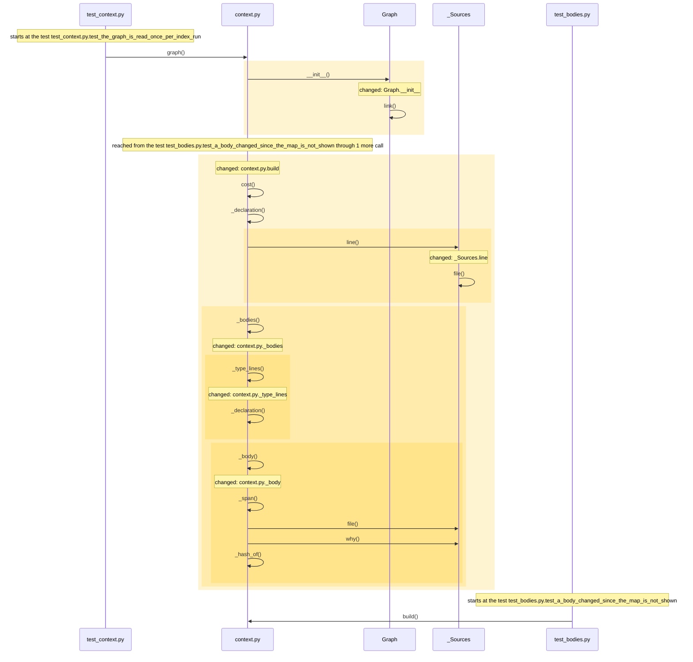
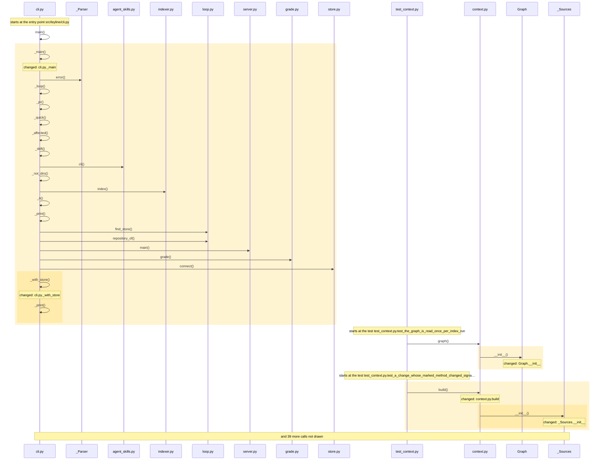
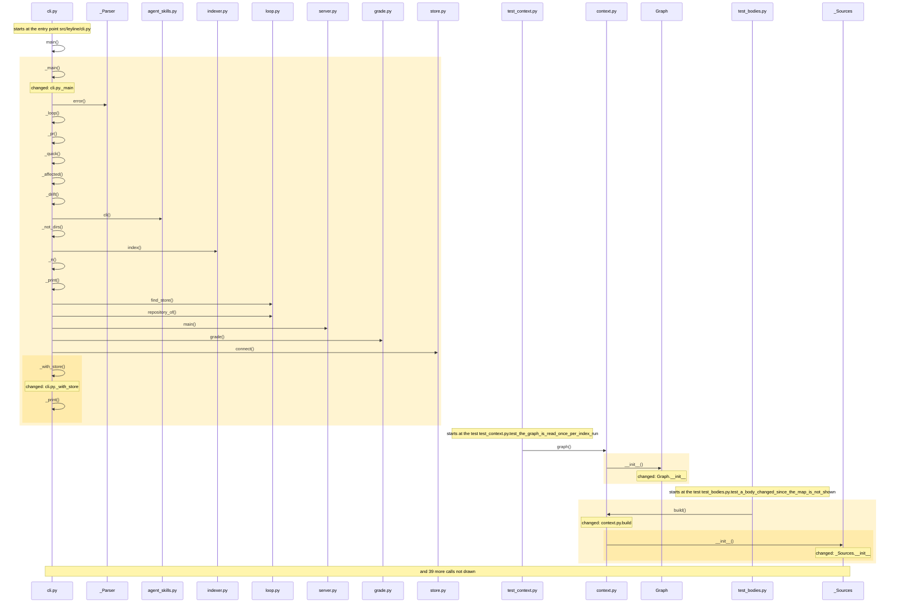

<!-- leyline:begin -->
# `context` can carry the bodies of the focus, its callers and the types it takes

The one-page plan for the change in `openspec/changes/context-bodies/`, written by Leyline from the spec files beside it. `leyline plan` rewrites it; edit the spec, not this page.

**State: done as agreed.** Every task that names code is done, every scenario is proven, and nothing outside the spec changed. Task 1.15 is yours to check.

`context` gives an agent about to edit code the declaration lines around it, never a body, so the agent then calls `source` once for each function it needs to read. The plan has 31 tasks: it changes Graph.__init__, Graph.end, Graph.hash, _Sources.line and 11 more. Nothing else must be edited with it; 64 places in 2 modules run into the changed code and may behave differently; 134 existing tests already run through it. It is done when 16 scenarios pass: 16 already have a test.

## 1. What code will be written

| Task | Does | Code |
| --- | --- | --- |
| 1.1 | Change `context.Graph.__init__` to keep the last line and the content hash of each node | Graph.__init__ |
| 1.2 | Add `Graph.end` and `Graph.hash` in `src/leyline/context.py`, the last line and the content hash of each node | Graph.end, Graph.hash, in src/leyline/context.py |
| 1.3 | Change `context._Sources.line` to refuse a file that is a link leaving the repository, as `source` does | _Sources.line; mentions source (could be 3 things) |
| 1.4 | Add `_Sources.refused` in `src/leyline/context.py`, why a file was not read | _Sources.refused, in src/leyline/context.py |
| 1.5 | Add `src/leyline/context.py: _body`, the lines of a node read from the working tree, guarded against a link out, compared with the node's hash so that an edited file is not shown, one definition at a time, and cut around a given line | _body |
| 1.6 | Add `src/leyline/context.py: _type_lines`, a type's declaration line and at most 12 of the declaration lines of its fields | _type_lines |
| 1.7 | Add `src/leyline/context.py: _callers_of`, the direct callers of the focus with their call lines, non-test callers first, saying when a caller was guessed or calls what the focus overrides | _callers_of |
| 1.8 | Add `src/leyline/context.py: _focus_types`, the types the focus takes as a parameter or returns, from the roles the map keeps on its type links | _focus_types |
| 1.9 | Add `src/leyline/context.py: _bodies`, which picks the focus functions, the callers and the types, decides from the lengths what fits before reading any file, stops after ten refusals for size, shows each text once and names what was left out | _bodies |
| 1.10 | Change `context.build` to take `bodies`, to raise a budget under 600 tokens and say so, to give the declaration outline a third of the budget, and to put the bodies once into the text and their descriptions into the answer | build |
| 1.11 | Change the top level of `src/leyline/context.py` to add the limits of a body, of a caller's lines, of a file's top level and of the focus functions, the refusals before packing stops, and the least budget with bodies | src/leyline/context.py |
| 1.12 | Change `server.context` to take `bodies`, to return the descriptions of the bodies without cutting them, to allow 44,000 characters, and to say in its description that bodies are whole when asked | context |
| 1.13 | Change `cli._main` to give the context command a `--bodies` flag | _main |
| 1.14 | Change `cli._with_store` to pass the flag to `context.build` | _with_store, build |
| 1.15 | Change the context row and the size sentence of docs/mcp-tools.md to list `bodies?` after `budget_tokens?` and 44,000 characters, and docs/understanding.md and skills/leyline-ask/SKILL.md to say what `bodies` gives | no code: checked by you |
| 2.1 | Add the test "The context outline carries the bodies of the focus and its callers" | a test for the scenario |
| 2.2 | Add the test "A body does not bring its sibling methods" | a test for the scenario |
| 2.3 | Add the test "The types a focus takes or returns show their declaration and fields" | a test for the scenario |
| 2.4 | Add the test "A body that does not fit is named" | a test for the scenario |
| 2.5 | Add the test "A hub does not crowd out the types" | a test for the scenario |
| 2.6 | Add the test "A long caller is cut around the call" | a test for the scenario |
| 2.7 | Add the test "The top level of a file is a caller with a short window" | a test for the scenario |
| 2.8 | Add the test "A file as the focus shows at most three bodies" | a test for the scenario |
| 2.9 | Add the test "A body is shown once" | a test for the scenario |
| 2.10 | Add the test "A function defined twice shows each definition" | a test for the scenario |
| 2.11 | Add the test "A hub reads only the files of the bodies it shows" | a test for the scenario |
| 2.12 | Add the test "A file that links outside the repository is not read" | a test for the scenario |
| 2.13 | Add the test "A body changed since the map is not shown" | a test for the scenario |
| 2.14 | Add the test "A large budget through the tool keeps the lines that say what was left out" | a test for the scenario |
| 2.15 | Add the test "A small budget is raised and says so" | a test for the scenario |
| 2.16 | Add the test "Without bodies the outline is as before" | a test for the scenario |

Not read as code (nothing to check on the map): task 1.10: `bodies` is not on the map; read as a word, not code; task 1.12: `bodies` is not on the map; read as a word, not code; task 1.15: `bodies` is not on the map; read as a word, not code.

### How it runs

How execution reaches the code the tasks change, and what that code calls, as the code is now:

Drawn from the map: every arrow is a call or a channel link found in the code, in the order the code makes them where that order is known. The code the tasks change is shaded. Not drawn, to keep it readable: context.py._callers_of, context.py._focus_types, server.py.context, cli.py._main, cli.py._with_store.

## 2. What it will affect

15 things change, 0 more must be edited with them, and 64 are reached without needing an edit, across 2 modules. 134 existing tests run through the change.

*Must be edited*: code that breaks unless it changes too, such as the callers of a function whose parameters change. *Reached*: code that runs into the change, directly or through other calls; it needs no edit but may behave differently.

- leyline: 15 changed, 11 reached
- tests: 53 reached
- **medium risk:** Reaches outside its own module: tests.
- **medium risk:** 2 of 31 changed functions are on no test's path.

**Shares a caller or a field with the change, and no task names it.** Each line is either right to leave alone or a missing task:
- Graph.__init__ is also called by graph
- _Sources.line is also called by _declaration
- build is also called by _show
- Graph.line (used by Graph.__init__) is also used by _declaration, _span
- and 1 more: `leyline spec facts`

15 more fields shared with the change left off this page: they share only a large type, or a reader of every field, with the change. `leyline spec facts` lists them.

**Usually changes with the files the tasks touch, and no task names it** (from the last 88 commits, leaving out 1 that changed more than 50 files). Each line is either right to leave alone or a missing task:
- `README.md` changed in 3 of the 3 commits that changed `skills/leyline-ask/SKILL.md` (and often with `src/leyline/cli.py`, `src/leyline/server.py`); no task names it.
- `tests/test_server.py` changed in 3 of the 3 commits that changed `skills/leyline-ask/SKILL.md`; no task names it.
- `tests/test_index.py` changed in 14 of the 27 commits that changed `src/leyline/server.py`; no task names it.

**Specs that no longer match code this change touches** (update them with it):
- The change node-summaries names `context.build`, which has changed signature since it was written. `leyline drift` says more.

**Earlier changes to this code** (finished OpenSpec changes and earlier reviews that touched the same code, newest first):

- `node-summaries` (checked 2026-10-15): Every node carries a one-line summary, read by every understanding tool. Touched `src/leyline/context.py`, `Graph.__init__`, `Graph.end`, `Graph.hash` and 8 more.
- `orientation-from-named-parts` (checked 2026-10-15): The orientation tour and `map` point at named parts, not cluster anchors. Touched `_main`.
- `server-in-another-checkout` (checked 2026-10-15): An agent working in another checkout of the server's repository can map it. Touched `context`.

## 3. How you will know it was done

Each scenario is proven by a test with the same name. After the change, `leyline check` marks each one from the test results.

| Scenario | When | Then | Test |
| --- | --- | --- | --- |
| The context outline carries the bodies of the focus and its callers | `context` is called with `bodies` on a function that other functions call | the text lists the whole body of the function and the lines around the call in each direct caller, each with | exists |
| A body does not bring its sibling methods | the focus is a method of a type that has other methods | no other method of that type or of its file appears in the bodies | exists |
| A hub does not crowd out the types | the focus has over a hundred callers and takes a parameter of a type on the map | the type is shown, and the callers that do not fit are left out | exists |
| The types a focus takes or returns show their declaration and fields | the focus takes a parameter of a type on the map, and returns another | each type appears as its declaration line and its field lines, at most 12 and then a count, and not its | exists |
| A body that does not fit is named | the budget is too small for every body | the focus comes first, whole or cut at a line it names, a caller that does not fit is listed under "Bodies | exists; invariant: a property test fits (Hypothesis) |
| A long caller is cut around the call | a caller is longer than 40 lines and calls the focus past its fortieth line | the lines shown are those around the call, and the answer says which lines of the caller they are | exists |
| The top level of a file is a caller with a short window | the focus is called from the top level of a file | at most 16 lines around the call are shown, not the first lines of the file | exists |
| A file as the focus shows at most three bodies | `context` is called with `bodies` and a file with many functions as the focus | at most three bodies of its functions are shown, the rest are listed as left out, and the answer stays within | exists |
| A body is shown once | a caller contains a body already shown, or is itself a focus function | its text appears once | exists |
| A function defined twice shows each definition | a function is defined in both branches of an if | each definition is shown by its own lines, and not the lines between them | exists |
| A hub reads only the files of the bodies it shows | the focus has over a hundred callers in many files | no more files are opened than the bodies shown and ten that were refused for size | exists |
| A file that links outside the repository is not read | a mapped file has become a link to a file outside the repository | its body is not shown and the answer says it was not read | exists |
| A body changed since the map is not shown | a focus function was edited after the map was made | its body is not shown and is listed as changed since the map, with a line telling the agent to map again | exists |
| A large budget through the tool keeps the lines that say what was left out | the `context` tool is called with `bodies` and a budget of 8,000 tokens on a focus with many callers | the answer is not cut, and still ends with the lines that name what was left out | exists |
| A small budget is raised and says so | `context` is called with `bodies` and a budget under 600 tokens | the answer uses 600 and says that it did | exists |
| Without bodies the outline is as before | `context` is called without `bodies` | the answer has no bodies and its text is what it was before this change | exists |

## Review findings

- Logic review: 12 findings, all settled.
- Performance review: 5 findings, all settled.

Settled (full text: `leyline spec findings`):
- high: The context tool answer would carry each body twice (inside 'text' and again as bodies[].text), so a 2,000-token budget costs the agent about 3,500 tokens, a... **Accepted**: Matthew accepted every review finding on 2026-10-15; the spec is rewritten to the reviewer's proposal, and unasserted is non-blocking by default.
- high: The proposal says bodies are read from the working tree 'as source does', but source guards with store.inside (a mapped file that became a link outside the r... **Accepted**: Matthew accepted every review finding on 2026-10-15; the spec is rewritten to the reviewer's proposal, and unasserted is non-blocking by default.
- high: The context tool returns the answer's text and, per the proposal, also a bodies list holding the same text, so at the maximum budget (8000 tokens = 32,000 ch... **Accepted**: Matthew accepted every review finding on 2026-10-15; the spec is rewritten to the reviewer's proposal, and unasserted is non-blocking by default.
- medium: The spec does not bound which callers are tried, so on a hub (store.connect has 206 callers, 184 of them tests in 43 files) every caller is ranked, its file... **Accepted**: Matthew accepted every review finding on 2026-10-15; the spec is rewritten to the reviewer's proposal, and unasserted is non-blocking by default.
- medium: A focus of many nodes (a file path seeds all its top-level nodes: indexer.py gives 49 focus nodes, about 1,000 lines at the 80-line limit; a change id gives... **Accepted**: Matthew accepted every review finding on 2026-10-15; the spec is rewritten to the reviewer's proposal, and unasserted is non-blocking by default.
- medium: No scenario or existing test would show a performance or size regression: none uses a hub with many callers, a many-node focus, a count of files read, or the... **Accepted**: Matthew accepted every review finding on 2026-10-15; the spec is rewritten to the reviewer's proposal, and unasserted is non-blocking by default.
- medium: Graph cannot tell which types a focus 'takes': it folds every uses_type edge into an undirected weight and keeps only the sum, while the parameter/return/fie... **Accepted**: Matthew accepted every review finding on 2026-10-15; the spec is rewritten to the reviewer's proposal, and unasserted is non-blocking by default.
- medium: Direct callers come from Graph.callers, which includes the '<module>' callable of every file that calls the focus at top level (13 such callers on this map;... **Accepted**: Matthew accepted every review finding on 2026-10-15; the spec is rewritten to the reviewer's proposal, and unasserted is non-blocking by default.
- medium: A caller longer than 40 lines is cut at its first 40 lines, but the reason to show a caller is its call site, which can be anywhere in the body, so the cut c... **Accepted**: Matthew accepted every review finding on 2026-10-15; the spec is rewritten to the reviewer's proposal, and unasserted is non-blocking by default.
- medium: With bodies the outline gets a third of the budget, but build's fixed reserve (520 characters plus the header and not-found lines) already exceeds a third of... **Accepted**: Matthew accepted every review finding on 2026-10-15; the spec is rewritten to the reviewer's proposal, and unasserted is non-blocking by default.
- medium: _body reads the working tree at line numbers saved when the map was made, so after the agent edits the focus's file (the case 'context' is for) and before th... **Accepted**: Matthew accepted every review finding on 2026-10-15; the spec is rewritten to the reviewer's proposal, and unasserted is non-blocking by default.
- medium: The spec only handles a focus that is one function: resolve_focus also gives a type (its whole span holds every method, so 'no sibling method' fails), a file... **Accepted**: Matthew accepted every review finding on 2026-10-15; the spec is rewritten to the reviewer's proposal, and unasserted is non-blocking by default.
- medium: The same text can be shown twice and no task dedupes it: a nested function's only caller is usually its enclosing function, whose body contains the focus bod... **Accepted**: Matthew accepted every review finding on 2026-10-15; the spec is rewritten to the reviewer's proposal, and unasserted is non-blocking by default.
- low: The types the focus takes get their declaration and every field with no cap and no place in the packing order (Indexer has 90 fields, Run 39), so one type ca... **Accepted**: Matthew accepted every review finding on 2026-10-15; the spec is rewritten to the reviewer's proposal, and unasserted is non-blocking by default.
- low: A function defined twice in a file (if/else, a property's getter and setter) is one node whose span covers both definitions and everything between them, so t... **Accepted**: Matthew accepted every review finding on 2026-10-15; the spec is rewritten to the reviewer's proposal, and unasserted is non-blocking by default.
- low: Callers come only from direct call edges of the focus node: for a focus that overrides or implements a method, the callers that call the base or interface me... **Accepted**: Matthew accepted every review finding on 2026-10-15; the spec is rewritten to the reviewer's proposal, and unasserted is non-blocking by default.
- low: Tasks 1.7 and 1.10 leave documentation that becomes false: the context tool's own docstring says 'declaration lines (no bodies)' and 'Read a body with source... **Accepted**: Matthew accepted every review finding on 2026-10-15; the spec is rewritten to the reviewer's proposal, and unasserted is non-blocking by default.

## Before implementation

Nothing blocks implementation: every task that names code is tied to it, everything that must be edited has a task, and every scenario has a test or a task to write one.

- Task 1.15 names no code, so you check it yourself after the change; it does not hold up the verdict.

## 4. Was it done as agreed

Leyline marks each task from what changed in the code since the plan, whether or not it is ticked in tasks.md, and each scenario from the test results.

**Yes.** Every task that names code is done, every scenario is proven, and nothing outside the spec changed. Task 1.15 is yours to check.

*The baseline was taken by another version of Leyline (or one that did not record its version), which may have read the same code differently: a change below that the diff does not show comes from that, not from the edit.*

| Task | Result | Verdict | Missing |
| --- | --- | --- | --- |
| 1.1 Change `context.Graph.__init__` to keep the last line and the content… | done | proven |  |
| 1.10 Change `context.build` to take `bodies`, to raise a budget under 600… | done | proven |  |
| 1.11 Change the top level of `src/leyline/context.py` to add the limits of… | done | proven |  |
| 1.12 Change `server.context` to take `bodies`, to return the descriptions… | done | proven |  |
| 1.13 Change `cli._main` to give the context command a `--bodies` flag | done | proven |  |
| 1.14 Change `cli._with_store` to pass the flag to `context.build` | done | proven |  |
| 1.15 Change the context row and the size sentence of docs/mcp-tools.md to… | checked by you | needs a person |  |
| 1.2 Add `Graph.end` and `Graph.hash` in `src/leyline/context.py`, the… | done | proven |  |
| 1.3 Change `context._Sources.line` to refuse a file that is a link… | done | proven |  |
| 1.4 Add `_Sources.refused` in `src/leyline/context.py`, why a file was… | done | proven |  |
| 1.5 Add `src/leyline/context.py: _body`, the lines of a node read from… | done | proven |  |
| 1.6 Add `src/leyline/context.py: _type_lines`, a type's declaration line… | done | proven |  |
| 1.7 Add `src/leyline/context.py: _callers_of`, the direct callers of the… | done | proven |  |
| 1.8 Add `src/leyline/context.py: _focus_types`, the types the focus takes… | done | proven |  |
| 1.9 Add `src/leyline/context.py: _bodies`, which picks the focus… | done | proven |  |
| 2.1 Add the test "The context outline carries the bodies of the focus and… | done | proven |  |
| 2.10 Add the test "A function defined twice shows each definition" | done | proven |  |
| 2.11 Add the test "A hub reads only the files of the bodies it shows" | done | proven |  |
| 2.12 Add the test "A file that links outside the repository is not read" | done | proven |  |
| 2.13 Add the test "A body changed since the map is not shown" | done | proven |  |
| 2.14 Add the test "A large budget through the tool keeps the lines that… | done | proven |  |
| 2.15 Add the test "A small budget is raised and says so" | done | proven |  |
| 2.16 Add the test "Without bodies the outline is as before" | done | proven |  |
| 2.2 Add the test "A body does not bring its sibling methods" | done | proven |  |
| 2.3 Add the test "The types a focus takes or returns show their… | done | proven |  |
| 2.4 Add the test "A body that does not fit is named" | done | proven |  |
| 2.5 Add the test "A hub does not crowd out the types" | done | proven |  |
| 2.6 Add the test "A long caller is cut around the call" | done | proven |  |
| 2.7 Add the test "The top level of a file is a caller with a short window" | done | proven |  |
| 2.8 Add the test "A file as the focus shows at most three bodies" | done | proven |  |
| 2.9 Add the test "A body is shown once" | done | proven |  |

*Checked by you*: the task names no code, so the map cannot see it done; it does not hold up the verdict.

| Scenario | Result | Verdict | Evidence |
| --- | --- | --- | --- |
| The context outline carries the bodies of the focus and its callers | passes | proven | its test reaches the changed code on the map |
| A body does not bring its sibling methods | passes | proven | its test reaches the changed code on the map |
| A hub does not crowd out the types | passes | proven | its test reaches the changed code on the map |
| The types a focus takes or returns show their declaration and fields | passes | proven | its test reaches the changed code on the map |
| A body that does not fit is named | passes | proven | its test reaches the changed code on the map |
| A long caller is cut around the call | passes | proven | its test reaches the changed code on the map |
| The top level of a file is a caller with a short window | passes | proven | its test reaches the changed code on the map |
| A file as the focus shows at most three bodies | passes | proven | its test reaches the changed code on the map |
| A body is shown once | passes | proven | its test reaches the changed code on the map |
| A function defined twice shows each definition | passes | proven | its test reaches the changed code on the map |
| A hub reads only the files of the bodies it shows | passes | proven | its test reaches the changed code on the map |
| A file that links outside the repository is not read | passes | proven | its test reaches the changed code on the map |
| A body changed since the map is not shown | passes | proven | its test reaches the changed code on the map |
| A large budget through the tool keeps the lines that say what was left out | passes | proven | its test reaches the changed code on the map |
| A small budget is raised and says so | passes | proven | its test reaches the changed code on the map |
| Without bodies the outline is as before | passes | proven | its test reaches the changed code on the map |

Verdicts: 46 proven, 1 needs you. Blocking: partial, contradicted, inconclusive. Not blocking: needs you. (The default.)

**Not proven, and why:**
- task 1.15, needs a person: it names no code, so the map cannot see it done (does not block)

**Expected to change, and did not:**
- src/leyline/context.py

Tests: 599 of 611 passed before, 615 of 627 after.

### How it runs now

**Before**: the code the change edits, as it ran at the baseline (drawn from the baseline alone):

Drawn from the map: every arrow is a call or a channel link found in the code, in the order the code makes them where that order is known. The code the change edits is shaded. Not drawn, to keep it readable: _Sources.line, server.py.context.

**After**: the changed code as it runs now:

Drawn from the map: every arrow is a call or a channel link found in the code, in the order the code makes them where that order is known. The changed code is shaded. Not drawn, to keep it readable: _Sources.line, server.py.context, _Sources.file, _Sources.why, context.py._bodies, context.py.refuse and 8 more.

**What changed in how it runs** (calls and channel links into or out of the changed code, compared with the baseline):

- `_Sources.file` now calls `indexer.py.source_lines`
- `_Sources.file` now calls `store.py.inside`
- `_Sources.line` now calls `_Sources.file`
- `context.py._bodies` now calls `context.py.refuse`
- `context.py._bodies` now calls `context.py._body`
- `context.py._bodies` now calls `context.py._callers_of`
- `context.py._bodies` now calls `context.py._focus_types`
- `context.py._bodies` now calls `context.py._short`
- `context.py._bodies` now calls `context.py._span`
- `context.py._bodies` now calls `context.py._type_lines`
- `context.py.refuse` now calls `context.py._short`
- `context.py.refuse` now calls `context.py._span`
- and 25 more
- `_Sources.line` no longer calls `indexer.py.source_lines`

Review before implementation:
- Logic review: 12 findings, all settled.
- Performance review: 5 findings, all settled.

Compared with the code as it was at 7bc2ec3.
<!-- leyline:end -->
