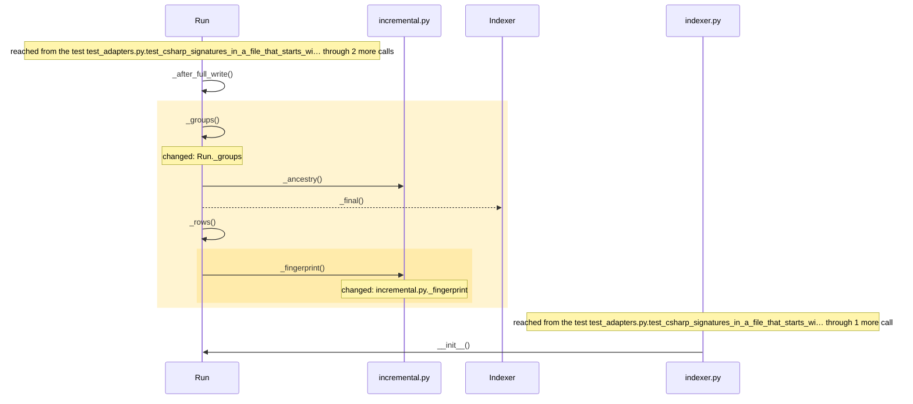
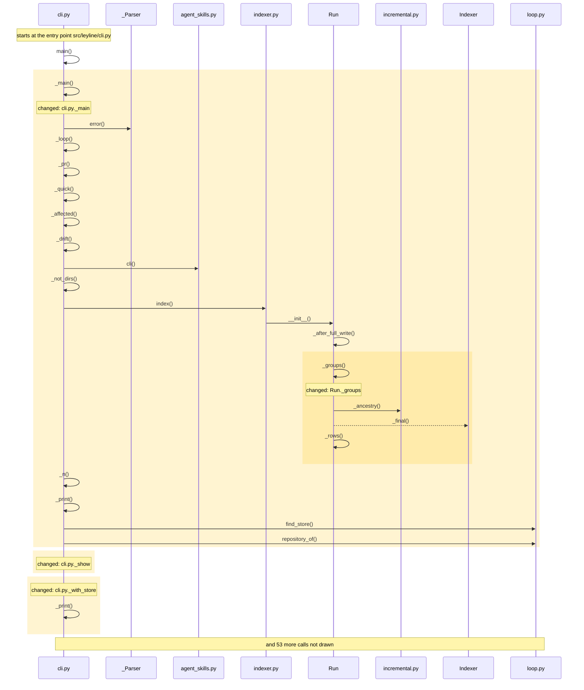
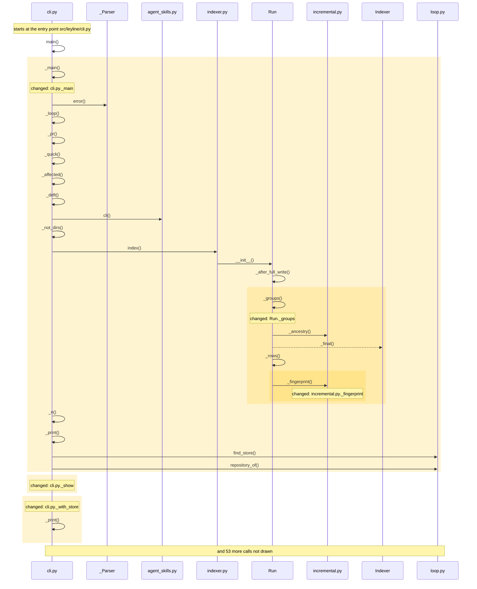

<!-- leyline:begin -->
# Map on a Python without blake2b

The one-page plan for the change in `openspec/changes/hash-fallback/`, written by Leyline from the spec files beside it. `leyline plan` rewrites it; edit the spec, not this page.

**State: not done as agreed yet:** 22 edits are outside the spec. Details under "Was it done as agreed".

`leyline map` crashes with `AttributeError: module 'hashlib' has no attribute 'blake2b'` on a CPython built without its `_blake2` module (a pyenv 3.12 on this machine). The plan has 3 tasks: it changes Run._groups, _fingerprint. Nothing else must be edited with it; 302 places in 2 modules run into the changed code and may behave differently; 330 existing tests already run through it. It is done when 1 scenario passes: 1 already has a test.

## 1. What code will be written

| Task | Does | Code |
| --- | --- | --- |
| 1.1 | Add `incremental._fingerprint`: 8 bytes of an object, by blake2b when `hashlib` has it at the time of the call, else the first 8 bytes of sha256 | _fingerprint |
| 1.2 | Change `Run._groups` to hash with `incremental._fingerprint` | Run._groups; mentions _fingerprint |
| 2.1 | Add the test "A Python without blake2b still maps" | a test for the scenario |

Not read as code (nothing to check on the map): task 1.1: `hashlib` is not on the map; read as a word, not code.

### How it runs

How execution reaches the code the tasks change, and what that code calls, as the code is now:

Drawn from the map: every arrow is a call or a channel link found in the code, in the order the code makes them where that order is known. The code the tasks change is shaded. A dotted arrow is a link the map guessed by name: read the code before relying on it.

## 2. What it will affect

2 things change, 0 more must be edited with them, and 302 are reached without needing an edit, across 2 modules. 330 existing tests run through the change.

*Must be edited*: code that breaks unless it changes too, such as the callers of a function whose parameters change. *Reached*: code that runs into the change, directly or through other calls; it needs no edit but may behave differently.

- leyline: 2 changed, 238 reached
- tests: 64 reached
- **medium risk:** Reaches outside its own module: tests.

2 more fields shared with the change left off this page: they share only a large type, or a reader of every field, with the change. `leyline spec facts` lists them.

**Usually changes with the files the tasks touch, and no task names it** (from the last 88 commits, leaving out 1 that changed more than 50 files). Each line is either right to leave alone or a missing task:
- `src/leyline/cli.py` changed in 4 of the 5 commits that changed `src/leyline/incremental.py`; no task names it.
- `src/leyline/indexer.py` changed in 4 of the 5 commits that changed `src/leyline/incremental.py`; no task names it.
- `src/leyline/store.py` changed in 4 of the 5 commits that changed `src/leyline/incremental.py`; no task names it.
- `README.md` changed in 3 of the 5 commits that changed `src/leyline/incremental.py`; no task names it.
- and 3 more: `leyline spec facts`

**Earlier changes to this code** (no OpenSpec history on this code; from git history: commits before it whose diff names the same functions, then those that changed the same files (of the last 500 that touched them)):

- `b62850b` (2026-10-07): Map very large repositories in less memory. Changed `Run._groups`.
- `77238ea` (2026-10-06): Re-map after an edit in seconds: redo only what the edit changed. Changed `Run._groups`.
- `af37020` (2026-10-07): Review a pull request with no spec: leyline pr. Changed the same file: `src/leyline/incremental.py`.
- `3fa333b` (2026-10-07): Resolve what the Parlance rehearsal found in the plan loop. Changed the same file: `src/leyline/incremental.py`.
- `312d5b9` (2026-10-07): Survive any repository on any OS: skipped files named, dead workers, spawn, CI. Changed the same file: `src/leyline/incremental.py`.

## 3. How you will know it was done

Each scenario is proven by a test with the same name. After the change, `leyline check` marks each one from the test results.

| Scenario | When | Then | Test |
| --- | --- | --- | --- |
| A Python without blake2b still maps | `hashlib` has no `blake2b` (removed with `raising=False`, after the module is imported) and a | both maps complete, the second run reports no groups written and its patterns kept, and the | exists |

## Review findings

- Logic review: 3 findings, all settled.
- Performance review: ran, and filed nothing.

Settled (full text: `leyline spec findings`):
- medium: The test for 'A Python without blake2b still maps' removes hashlib.blake2b after leyline.incremental is already imported (tests/test_incremental.py imports i... **Accepted**: Matthew accepted every review finding on 2026-10-12; the spec is rewritten to the reviewer's proposal.
- medium: The THEN 'the second run reuses the first run's cache' is met by mode == 'incremental', which Run.__init__ decides from the cache key and generation token be... **Accepted**: Matthew accepted every review finding on 2026-10-12; the spec is rewritten to the reviewer's proposal.
- low: The proposal's Impact ('existing caches stay valid where blake2b exists; a machine without it starts fresh') and the harmlessness of two digests giving diffe... **Accepted**: Matthew accepted every review finding on 2026-10-12; the spec is rewritten to the reviewer's proposal.

## Before implementation

Nothing blocks implementation: every task that names code is tied to it, everything that must be edited has a task, and every scenario has a test or a task to write one.

## 4. Was it done as agreed

Leyline marks each task from what changed in the code since the plan, whether or not it is ticked in tasks.md, and each scenario from the test results.

**Not yet:** 22 edits are outside the spec.

*The baseline was taken by another version of Leyline (or one that did not record its version), which may have read the same code differently: a change below that the diff does not show comes from that, not from the edit.*

| Task | Result | Verdict | Missing |
| --- | --- | --- | --- |
| 1.1 Add `incremental._fingerprint`: 8 bytes of an object, by blake2b when… | done | proven |  |
| 1.2 Change `Run._groups` to hash with `incremental._fingerprint` | done | proven |  |
| 2.1 Add the test "A Python without blake2b still maps" | done | proven |  |

| Scenario | Result | Verdict | Evidence |
| --- | --- | --- | --- |
| A Python without blake2b still maps | passes | proven | its test reaches the changed code on the map |

Verdicts: 4 proven. Blocking: partial, contradicted, inconclusive. Not blocking: needs you. (The default.)

**Changed, but not in the spec:**
- _main (callable) src/leyline/cli.py
- _show (callable) src/leyline/cli.py
- _with_store (callable) src/leyline/cli.py
- _group_label (callable) src/leyline/outline.py
- _groups (callable) src/leyline/outline.py
- _louvain (callable) src/leyline/outline.py
- names (callable) src/leyline/outline.py
- expand (callable) src/leyline/query.py
- _fit (callable) src/leyline/server.py
- _tool (callable) src/leyline/server.py
- run (callable) src/leyline/server.py
- expand (callable) src/leyline/server.py
- explain_path (callable) src/leyline/server.py
- find_flows (callable) src/leyline/server.py
- impact (callable) src/leyline/server.py
- module_outline (callable) src/leyline/server.py
- neighbors (callable) src/leyline/server.py
- overview (callable) src/leyline/server.py
- the top level of src/leyline/outline.py (code outside any function)
- the top level of src/leyline/server.py (code outside any function)
- _resplit (new, not declared in the proposal) src/leyline/outline.py
- reaching (new, not declared in the proposal) src/leyline/query.py

Tests: 563 of 575 passed before, 577 of 589 after.

### How it runs now

**Before**: the code the change edits, as it ran at the baseline (drawn from the baseline alone):

Drawn from the map: every arrow is a call or a channel link found in the code, in the order the code makes them where that order is known. The code the change edits is shaded. A dotted arrow is a link the map guessed by name: read the code before relying on it. Not drawn, to keep it readable: outline.py._group_label, outline.py._groups, outline.py._louvain, outline.py.names, query.py.expand, server.py._fit and 9 more.

**After**: the changed code as it runs now:

Drawn from the map: every arrow is a call or a channel link found in the code, in the order the code makes them where that order is known. The changed code is shaded. A dotted arrow is a link the map guessed by name: read the code before relying on it. Not drawn, to keep it readable: outline.py._group_label, outline.py._groups, outline.py._louvain, outline.py.names, query.py.expand, server.py._fit and 13 more.

**What changed in how it runs** (calls and channel links into or out of the changed code, compared with the baseline):

- `Run._groups` now calls `incremental.py._fingerprint`
- `outline.py._groups` now calls `Model.lines`
- `outline.py._groups` now calls `outline.py._resplit`
- `outline.py._resplit` now calls `outline.py._group_label`
- `outline.py._resplit` now calls `outline.py._louvain`
- `outline.py._resplit` now calls `outline.py.file_part`
- `query.py.expand` now calls `coverage.py.has`
- `query.py.expand` now calls `coverage.py.tests_for`
- `query.py.expand` now calls `query.py.reaching`
- `query.py.reaching` now calls `query.py._adjacency`
- `query.py.reaching` now calls `query.py.lift`
- `query.py.reaching` now calls `query.py.listing`
- and 9 more
- `store.py.write_flows` now reaches `query.py.reaching` over db flows

Review before implementation:
- Logic review: 3 findings, all settled.
- Performance review: ran, and filed nothing.

Compared with the code as it was at 7bc2ec3.
<!-- leyline:end -->
