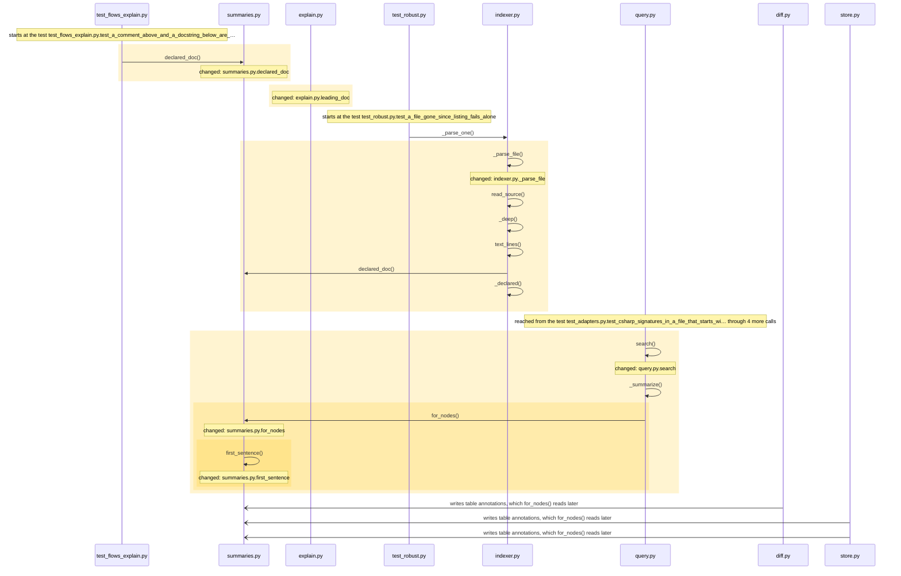
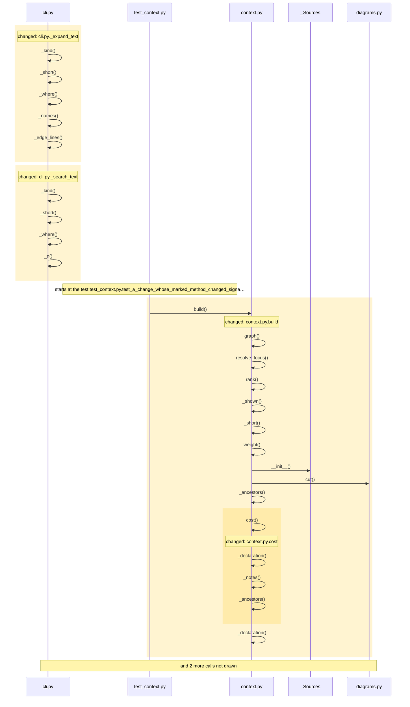
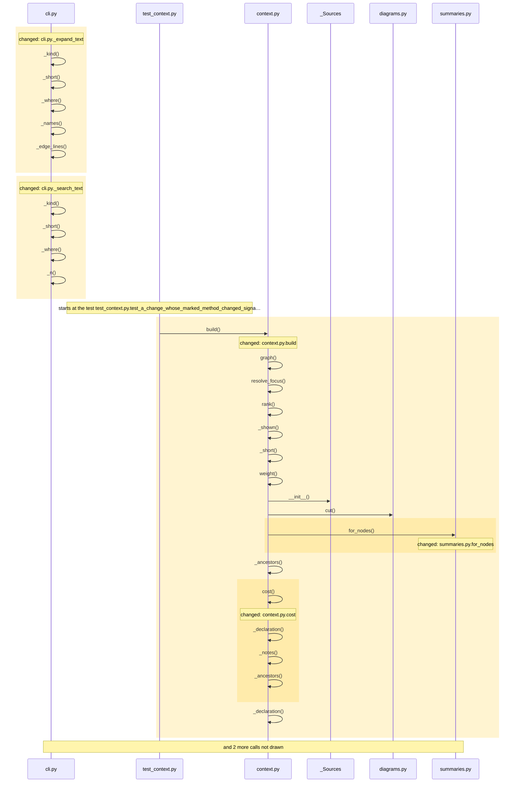

<!-- leyline:begin -->
# Every node carries a one-line summary, read by every understanding tool

The one-page plan for the change in `openspec/changes/node-summaries/`, written by Leyline from the spec files beside it. `leyline plan` rewrites it; edit the spec, not this page.

**State: done as agreed.** Every task that names code is done, every scenario is proven, and nothing outside the spec changed. Task 3.1 is yours to check.

The map knows structure (callers, callees, fields, flows) but not meaning. The plan has 30 tasks: it changes Index.__init__, Index.where, _expand_text, _parse_file and 22 more. Nothing else must be edited with it; 402 places in 2 modules run into the changed code and may behave differently; 431 existing tests already run through it. It is done when 9 scenarios pass: 9 already have a test.

## 1. What code will be written

| Task | Does | Code |
| --- | --- | --- |
| 1.1 | Add `summaries.declared_doc` in `src/leyline/summaries.py`, the reader of the comment above a declaration and of a Python docstring | declared_doc, in src/leyline/summaries.py |
| 1.2 | Remove `explain.leading_doc` | leading_doc |
| 1.3 | Change `indexer._parse_file` to decode the file once with `indexer.text_lines` for every adapter and set `doc` in the attributes of each callable and type node from `summaries.declared_doc` | _parse_file, declared_doc; mentions text_lines |
| 1.4 | Change the top level of `src/leyline/incremental.py` to add doc to the POSITIONS list of attributes, so `Run._shapes` leaves it out of the shape hash | src/leyline/incremental.py; mentions Run._shapes |
| 1.5 | Add `summaries.for_nodes`, `summaries.first_sentence` and `summaries.annotation_text` in `src/leyline/summaries.py`: the summary of some node ids in one query (a `responsibility` annotation that is not stale, the intent layer before the inferred one, else the node's `doc`, cut to its first sentence or 200 characters), and the annotation text `find_flows` reads on each call | annotation_text, first_sentence, for_nodes, in src/leyline/summaries.py; mentions find_flows (could be 2 things) |
| 1.6 | Change `query.search` and `query.expand` to add `summary` to their rows after `query._brief`, with one `summaries.for_nodes` call per answer | expand, search; mentions summary (could be 2 things), _brief, for_nodes |
| 1.7 | Change `cli._search_text` and `cli._expand_text` to print the summary after a row's name | _expand_text, _search_text |
| 1.8 | Change `context.build` and `cost` to add the summary of the focus and of each shown direct neighbour as a `--` line, looked up once for the focus and its direct neighbours only, within the budget | build, cost |
| 1.9 | Change the top level of `src/leyline/context.py` to add `SUMMARY_WIDTH` | src/leyline/context.py |
| 1.10 | Add `outline._summarize_items`, which adds `summary` to the busiest functions, key types and key functions of an answer in one lookup | _summarize_items; mentions summary (could be 2 things) |
| 1.11 | Change `outline.outline` to call `outline._summarize_items` on its answer | outline; mentions _summarize_items |
| 1.12 | Change `outline._part_lines` and `outline.text` to print the summaries | _part_lines, text |
| 1.13 | Change the top level of `src/leyline/outline.py` to add `SUMMARY_WIDTH` | src/leyline/outline.py |
| 1.14 | Change `explain.explain_path` to add `summary` to each step, cut to 120 characters | explain_path; mentions summary (could be 2 things) |
| 1.15 | Change `explain.walk_text` to print the summary after the step's name | walk_text |
| 1.16 | Add `Index.where` in `src/leyline/explain.py`, a node id's row in the index | Index.where, in src/leyline/explain.py |
| 1.17 | Change `explain.Index.__init__` to read `doc` from the node's attributes instead of the source | Index.__init__ |
| 1.18 | Change `explain.find_flows` to read annotation text fresh on each call as a `note` field matched like the words of the code, and to multiply a candidate's score by 1.5 when it matches two or more distinct description words in strong fields, keeping the strong-field rule and the halving of tests and samples | find_flows; mentions note (could be 3 things) |
| 1.19 | Change the top level of `src/leyline/explain.py` to add a note weight to the WEIGHT table, and the STRONG and STEP_SUMMARY constants | src/leyline/explain.py |
| 1.20 | Change `test_a_comment_above_and_a_docstring_below_are_read` to call `summaries.declared_doc` | test_a_comment_above_and_a_docstring_below_are_read; mentions declared_doc |
| 2.1 | Add the test "The docstring of a function is on the map" | a test for the scenario |
| 2.2 | Add the test "A comment edited above a function re-parses only its own file" | a test for the scenario |
| 2.3 | Add the test "An annotation overrides the docstring in a summary" | a test for the scenario |
| 2.4 | Add the test "Search and expand say what a function does" | a test for the scenario |
| 2.5 | Add the test "The context outline says what the focus does" | a test for the scenario |
| 2.6 | Add the test "The busiest functions of an outline carry their summary" | a test for the scenario |
| 2.7 | Add the test "Each step of a walk says what it does" | a test for the scenario |
| 2.8 | Add the test "A match on several words outranks a match on one word in a name" | a test for the scenario |
| 2.9 | Add the test "An annotation written after the map is found at once" | a test for the scenario |
| 3.1 | Document the summary and doc fields in README.md, docs/understanding.md and docs/mcp-tools.md | no code: checked by you |

Not read as code (nothing to check on the map): task 1.3: `doc` is not on the map; read as a word, not code; task 1.5: `responsibility` is not on the map; read as a word, not code; task 1.5: `doc` is not on the map; read as a word, not code; task 1.9: `SUMMARY_WIDTH` is not on the map; read as a word, not code; task 1.13: `SUMMARY_WIDTH` is not on the map; read as a word, not code; task 1.17: `doc` is not on the map; read as a word, not code.

### How it runs

How execution reaches the code the tasks change, and what that code calls, as the code is now:

Drawn from the map: every arrow is a call or a channel link found in the code, in the order the code makes them where that order is known. The code the tasks change is shaded. An open arrowhead crosses a channel (a request, a message, a table, another program): the far side runs later, or in another process, and nothing checks the two sides against each other. Not drawn, to keep it readable: summaries.py.annotation_text, query.py.expand, cli.py._search_text, cli.py._expand_text, context.py.build, context.py.cost and 8 more. Nothing on the map reaches explain.py.leading_doc.

## 2. What it will affect

26 things change, 0 more must be edited with them, and 402 are reached without needing an edit, across 2 modules. 431 existing tests run through the change.

*Must be edited*: code that breaks unless it changes too, such as the callers of a function whose parameters change. *Reached*: code that runs into the change, directly or through other calls; it needs no edit but may behave differently.

- leyline: 25 changed, 278 reached
- tests: 1 changed, 124 reached
- **medium risk:** 28 of 155 changed functions are on no test's path.
- **low risk:** 11 direct caller links are guesses by name, so the caller list may be wrong.
- **low risk:** A breaking change with no callers found. Check for use through reflection, events or outside code.
- **high risk:** Crosses a db boundary (annotations): query.py.expand, summaries.py.annotation_text, summaries.py.for_nodes, change.py.assess and 5 more read what diff.py.snapshot writes. One end changes (expand, annotation_text and for_nodes); the other has no compile-time link to it.
- **high risk:** Crosses a db boundary (ancestry): query.py.expand, affected.py._expand, affected.py._ran, affected.py.product_code and 27 more read what Run._write_patch writes. One end changes (expand); the other has no compile-time link to it.
- **high risk:** Crosses a db boundary (search): query.py.search reads what Run._write_patch writes. One end changes (search); the other has no compile-time link to it.
- **high risk:** Crosses a db boundary (annotations): query.py.expand, summaries.py.annotation_text, summaries.py.for_nodes, change.py.assess and 6 more read what store.py.annotate writes. One end changes (expand, annotation_text and for_nodes); the other has no compile-time link to it.
- **high risk:** Crosses a db boundary (ancestry): query.py.expand, affected.py._expand, affected.py._ran, affected.py.product_code and 28 more read what store.py.derive_some writes. One end changes (expand); the other has no compile-time link to it.
- **high risk:** Crosses a db boundary (search): query.py.search reads what store.py.derive_some writes. One end changes (search); the other has no compile-time link to it.

**Must agree with the change, and no task names it** (another end of a channel it crosses):
- diff.py.snapshot (src/leyline/diff.py): writes what query.py.expand, summaries.py.annotation_text, summaries.py.for_nodes reads
- store.py.annotate (src/leyline/store.py): writes what query.py.expand, summaries.py.annotation_text, summaries.py.for_nodes reads
- store.py.derive_some (src/leyline/store.py): writes what query.py.expand reads
- store.py.rebuild_derived (src/leyline/store.py): writes what query.py.expand reads
- store.py.refresh_stale (src/leyline/store.py): writes what query.py.expand, summaries.py.annotation_text, summaries.py.for_nodes reads
- store.py.write_flows (src/leyline/store.py): writes what Index.__init__ reads

**Shares a caller or a field with the change, and no task names it.** Each line is either right to leave alone or a missing task:
- search is also called by _show, _with_store, _search, find and 2 more
- outline is also called by _with_store, module_outline
- explain_path is also called by _with_store, explain_path
- expand is also called by _show, _with_store, expand
- build is also called by _show, _with_store, context
- and 21 more: `leyline spec facts`

4 more fields shared with the change left off this page: they share only a large type, or a reader of every field, with the change. `leyline spec facts` lists them.

**Usually changes with the files the tasks touch, and no task names it** (from the last 88 commits, leaving out 1 that changed more than 50 files). Each line is either right to leave alone or a missing task:
- `src/leyline/server.py` changed in 3 of the 3 commits that changed `src/leyline/explain.py` (and often with `README.md`, `src/leyline/cli.py` and 1 more); no task names it.
- `tests/test_server.py` changed in 3 of the 3 commits that changed `src/leyline/explain.py`; no task names it.
- `src/leyline/store.py` changed in 4 of the 5 commits that changed `src/leyline/incremental.py` (and often with `src/leyline/query.py`); no task names it.
- `src/leyline/export.py` changed in 9 of the 13 commits that changed `src/leyline/query.py`; no task names it.
- and 6 more: `leyline spec facts`

**Earlier changes to this code** (finished OpenSpec changes and earlier reviews that touched the same code, newest first):

- `outline-splits-large-group` (checked 2026-10-14): An outline splits a group that holds most of a level. Touched `src/leyline/outline.py`, `_part_lines`, `_summarize_items`, `outline` and 1 more.

## 3. How you will know it was done

Each scenario is proven by a test with the same name. After the change, `leyline check` marks each one from the test results.

| Scenario | When | Then | Test |
| --- | --- | --- | --- |
| The docstring of a function is on the map | a file with a function that has a docstring is mapped | the function's node has `doc` in its attributes, holding the docstring's text | exists |
| A comment edited above a function re-parses only its own file | only the comment above a function named like functions in other files is edited and the map is run again | the incremental run parses that file and resolves no other file again | exists |
| An annotation overrides the docstring in a summary | a function has a docstring and a `responsibility` annotation | its summary is the annotation, the intent layer wins over the inferred one, and an annotation marked | exists |
| Search and expand say what a function does | `search` or `expand` returns a function that has a docstring and a `responsibility` annotation | each result row carries `summary` holding the annotation, from one summaries query per answer, and the | exists |
| The context outline says what the focus does | `context` is built around a function with a summary | the focus line and the lines of its shown direct neighbours carry the summary as a `--` line, looked up | exists |
| The busiest functions of an outline carry their summary | `module_outline` lists a part's busiest functions, key types or key functions | each one that has a summary carries it, and the `outline` command prints it | exists |
| Each step of a walk says what it does | `explain_path` walks through a function with a summary | the step carries `summary`, cut to 120 characters, and the text form prints it after the step's name | exists |
| A match on several words outranks a match on one word in a name | `find_flows` is asked "how the server answers a question", one function is named `answers` with no doc | the function with the doc ranks first, and a test or sample code matching the same words still ranks | exists |
| An annotation written after the map is found at once | `annotate` writes a `responsibility` on a function and `find_flows` is asked with words from it | the function is a candidate matched on "its note", without a new map | exists |

## Review findings

- Logic review: 7 findings, all settled.
- Performance review: 6 findings, all settled.

Settled (full text: `leyline spec findings`):
- high: Task 1.4 puts the summary in query._brief(row), which has no store connection, so search and expand cannot show a responsibility annotation over the docstrin... **Accepted**: Matthew accepted every review finding on 2026-10-12; the spec is rewritten to the reviewer's proposal.
- high: Putting doc into node attrs puts it into Run._shapes's crc (only loc and body_line are left out), so after a comment-only or docstring-only edit the incremen... **Accepted**: Matthew accepted every review finding on 2026-10-12; the spec is rewritten to the reviewer's proposal.
- medium: find_flows scores a hit with WEIGHT[f] and names it with a fixed field-to-words dict, so a candidate whose best hit is in the new note field raises KeyError... **Accepted**: Matthew accepted every review finding on 2026-10-12; the spec is rewritten to the reviewer's proposal.
- medium: The explain index is cached on (generation, node count, flow count) and store.annotate writes none of them, so once task 1.8 puts annotations into the Index... **Accepted**: Matthew accepted every review finding on 2026-10-12; the spec is rewritten to the reviewer's proposal.
- medium: Ranking find_flows candidates by the count of distinct description words before the weighted score lets matches in path, folder and language fields, weak wor... **Accepted**: Matthew accepted every review finding on 2026-10-12; the spec is rewritten to the reviewer's proposal.
- medium: The text forms of search, expand and module_outline (cli._search_text, cli._expand_text, outline._part_lines) print fixed fields, so the summary added to the... **Accepted**: Matthew accepted every review finding on 2026-10-12; the spec is rewritten to the reviewer's proposal.
- medium: query._brief takes a row and no connection, so adding a summary that needs the responsibility annotation means either changing its signature at all 10 call s... **Accepted**: Matthew accepted every review finding on 2026-10-12; the spec is rewritten to the reviewer's proposal.
- medium: explain.index caches the Index on (generation, node count, flow count), none of which store.annotate changes, so a note field read in Index.__init__ is stale... **Accepted**: Matthew accepted every review finding on 2026-10-12; the spec is rewritten to the reviewer's proposal.
- low: The summary prefers the responsibility annotation even when store.refresh_stale has marked it stale because its evidence changed, and no scenario says whethe... **Accepted**: Matthew accepted every review finding on 2026-10-12; the spec is rewritten to the reviewer's proposal.
- low: indexer._parse_file holds the file's lines as bytes (data.split(b'\n')) while leading_doc expects str lines and calls str methods on them, so task 1.2 as wri... **Accepted**: Matthew accepted every review finding on 2026-10-12; the spec is rewritten to the reviewer's proposal.
- low: A default explain_path answer is already about 600 JSON characters per step (12,649 for 21 steps here) against the server's 24,000-character cut, so a summar... **Accepted**: Matthew accepted every review finding on 2026-10-12; the spec is rewritten to the reviewer's proposal.
- low: context.build shows every direct neighbour of the focus today (left_out.direct is 0 for Indexer.run at 2000 tokens, 127 symbols shown), and 42% of this repos... **Accepted**: Matthew accepted every review finding on 2026-10-12; the spec is rewritten to the reviewer's proposal.
- low: _parse_file holds the file as bytes lines and decodes them to text only for GENERIC adapters, while leading_doc takes str lines, so task 1.2 either decodes e... **Accepted**: Matthew accepted every review finding on 2026-10-12; the spec is rewritten to the reviewer's proposal.

## Before implementation

Nothing blocks implementation: every task that names code is tied to it, everything that must be edited has a task, and every scenario has a test or a task to write one.

- Task 3.1 names no code, so you check it yourself after the change; it does not hold up the verdict.

## 4. Was it done as agreed

Leyline marks each task from what changed in the code since the plan, whether or not it is ticked in tasks.md, and each scenario from the test results.

**Yes.** Every task that names code is done, every scenario is proven, and nothing outside the spec changed. Task 3.1 is yours to check.

*The baseline was taken by another version of Leyline (or one that did not record its version), which may have read the same code differently: a change below that the diff does not show comes from that, not from the edit.*

| Task | Result | Verdict | Missing |
| --- | --- | --- | --- |
| 1.1 Add `summaries.declared_doc` in `src/leyline/summaries.py`, the… | done | proven |  |
| 1.10 Add `outline._summarize_items`, which adds `summary` to the busiest… | done | proven |  |
| 1.11 Change `outline.outline` to call `outline._summarize_items` on its… | done | proven |  |
| 1.12 Change `outline._part_lines` and `outline.text` to print the summaries | done | proven |  |
| 1.13 Change the top level of `src/leyline/outline.py` to add… | done | proven |  |
| 1.14 Change `explain.explain_path` to add `summary` to each step, cut to… | done | proven |  |
| 1.15 Change `explain.walk_text` to print the summary after the step's name | done | proven |  |
| 1.16 Add `Index.where` in `src/leyline/explain.py`, a node id's row in the… | done | proven |  |
| 1.17 Change `explain.Index.__init__` to read `doc` from the node's… | done | proven |  |
| 1.18 Change `explain.find_flows` to read annotation text fresh on each… | done | proven |  |
| 1.19 Change the top level of `src/leyline/explain.py` to add a note weight… | done | proven |  |
| 1.2 Remove `explain.leading_doc` | done | proven |  |
| 1.20 Change `test_a_comment_above_and_a_docstring_below_are_read` to call… | done | proven |  |
| 1.3 Change `indexer._parse_file` to decode the file once with… | done | proven |  |
| 1.4 Change the top level of `src/leyline/incremental.py` to add doc to… | done | proven |  |
| 1.5 Add `summaries.for_nodes`, `summaries.first_sentence` and… | done | proven |  |
| 1.6 Change `query.search` and `query.expand` to add `summary` to their… | done | proven |  |
| 1.7 Change `cli._search_text` and `cli._expand_text` to print the summary… | done | proven |  |
| 1.8 Change `context.build` and `cost` to add the summary of the focus and… | done | proven |  |
| 1.9 Change the top level of `src/leyline/context.py` to add… | done | proven |  |
| 2.1 Add the test "The docstring of a function is on the map" | done | proven |  |
| 2.2 Add the test "A comment edited above a function re-parses only its… | done | proven |  |
| 2.3 Add the test "An annotation overrides the docstring in a summary" | done | proven |  |
| 2.4 Add the test "Search and expand say what a function does" | done | proven |  |
| 2.5 Add the test "The context outline says what the focus does" | done | proven |  |
| 2.6 Add the test "The busiest functions of an outline carry their summary" | done | proven |  |
| 2.7 Add the test "Each step of a walk says what it does" | done | proven |  |
| 2.8 Add the test "A match on several words outranks a match on one word… | done | proven |  |
| 2.9 Add the test "An annotation written after the map is found at once" | done | proven |  |
| 3.1 Document the summary and doc fields in README.md… | checked by you | needs a person |  |

*Checked by you*: the task names no code, so the map cannot see it done; it does not hold up the verdict.

| Scenario | Result | Verdict | Evidence |
| --- | --- | --- | --- |
| The docstring of a function is on the map | passes | proven | its test reaches the changed code on the map |
| A comment edited above a function re-parses only its own file | passes | proven | its test reaches the changed code on the map |
| An annotation overrides the docstring in a summary | passes | proven | its test reaches the changed code on the map |
| Search and expand say what a function does | passes | proven | its test reaches the changed code on the map |
| The context outline says what the focus does | passes | proven | its test reaches the changed code on the map |
| The busiest functions of an outline carry their summary | passes | proven | its test reaches the changed code on the map |
| Each step of a walk says what it does | passes | proven | its test reaches the changed code on the map |
| A match on several words outranks a match on one word in a name | passes | proven | its test reaches the changed code on the map |
| An annotation written after the map is found at once | passes | proven | its test reaches the changed code on the map |

Verdicts: 38 proven, 1 needs you. Blocking: partial, contradicted, inconclusive. Not blocking: needs you. (The default.)

**Not proven, and why:**
- task 3.1, needs a person: it names no code, so the map cannot see it done (does not block)

**Helpers added** (new, and called only by code the spec names):
- _summarize, called by expand, search

**Expected to change, and did not:**
- src/leyline/context.py
- src/leyline/explain.py
- src/leyline/incremental.py
- src/leyline/outline.py
- _leaf
- describe

Tests: 577 of 589 passed before, 586 of 598 after.

### How it runs now

**Before**: the code the change edits, as it ran at the baseline (drawn from the baseline alone):

Drawn from the map: every arrow is a call or a channel link found in the code, in the order the code makes them where that order is known. The code the change edits is shaded. Not drawn, to keep it readable: Index.__init__, explain.py.explain_path, explain.py.find_flows, explain.py.walk_text, indexer.py._parse_file, outline.py._part_lines and 5 more.

**After**: the changed code as it runs now:

Drawn from the map: every arrow is a call or a channel link found in the code, in the order the code makes them where that order is known. The changed code is shaded. Not drawn, to keep it readable: Index.__init__, explain.py.explain_path, explain.py.find_flows, explain.py.walk_text, indexer.py._parse_file, outline.py._part_lines and 9 more.

**What changed in how it runs** (calls and channel links into or out of the changed code, compared with the baseline):

- `context.py.build` now calls `summaries.py.for_nodes`
- `explain.py.explain_path` now calls `summaries.py.for_nodes`
- `explain.py.find_flows` now calls `explain.py.split_words`
- `explain.py.find_flows` now calls `explain.py.stem`
- `explain.py.find_flows` now calls `summaries.py.annotation_text`
- `indexer.py._parse_file` now calls `summaries.py.declared_doc`
- `outline.py._summarize_items` now calls `summaries.py.for_nodes`
- `outline.py.outline` now calls `outline.py._summarize_items`
- `query.py._summarize` now calls `summaries.py.for_nodes`
- `query.py.expand` now calls `query.py._summarize`
- `query.py.search` now calls `query.py._summarize`
- `summaries.py.for_nodes` now calls `summaries.py.first_sentence`
- and 11 more
- `Index.__init__` no longer calls `_Lines.__init__`
- `Index.__init__` no longer calls `_Lines.get`
- `Index.__init__` called `explain.py.leading_doc`, which was removed; `Index.__init__` was edited too
- `test_flows_explain.py.test_a_comment_above_and_a_docstring_below_are_…` still calls `explain.py.leading_doc`, which was removed
- `diff.py.snapshot` now reaches `summaries.py.annotation_text` over db annotations
- `diff.py.snapshot` now reaches `summaries.py.for_nodes` over db annotations
- `store.py.annotate` now reaches `summaries.py.annotation_text` over db annotations
- `store.py.annotate` now reaches `summaries.py.for_nodes` over db annotations
- `store.py.refresh_stale` now reaches `summaries.py.annotation_text` over db annotations
- `store.py.refresh_stale` now reaches `summaries.py.for_nodes` over db annotations

Review before implementation:
- Logic review: 7 findings, all settled.
- Performance review: 6 findings, all settled.

Compared with the code as it was at 7bc2ec3.
<!-- leyline:end -->
