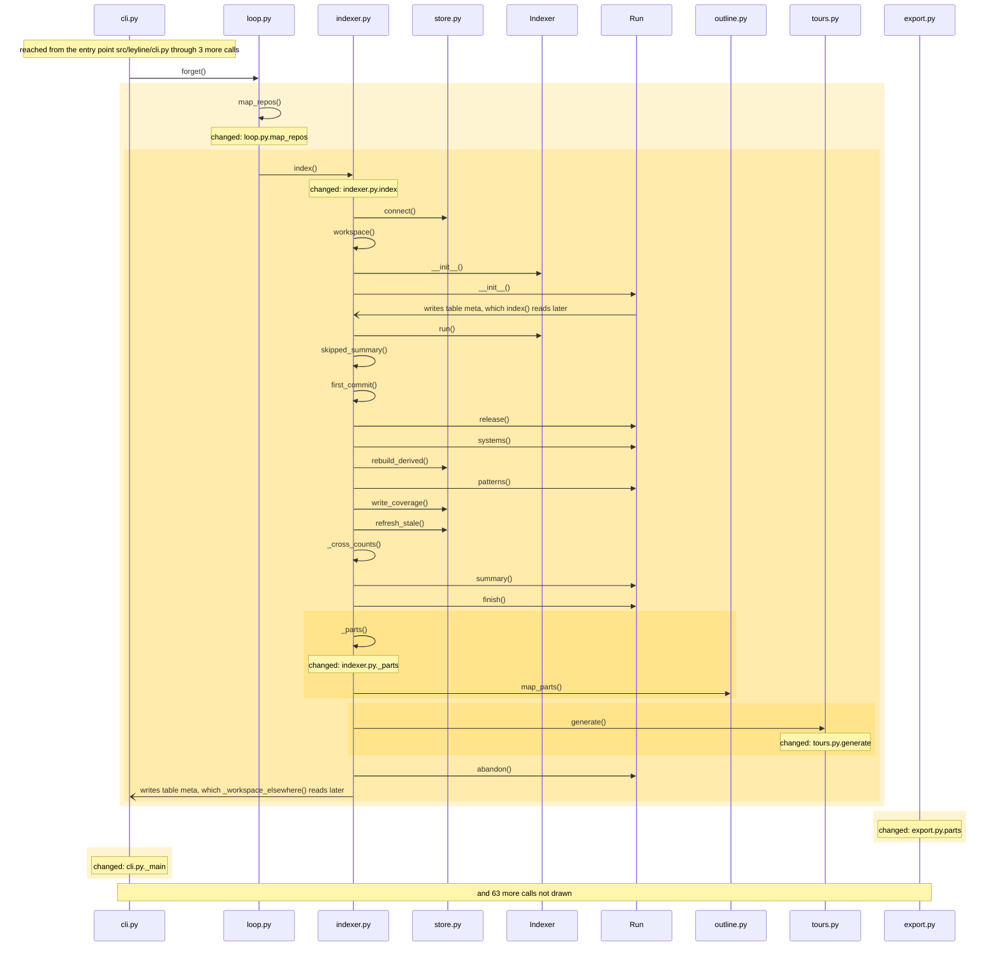
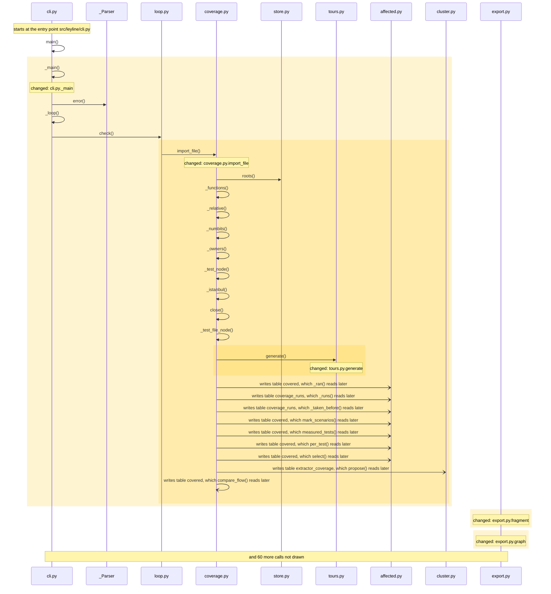
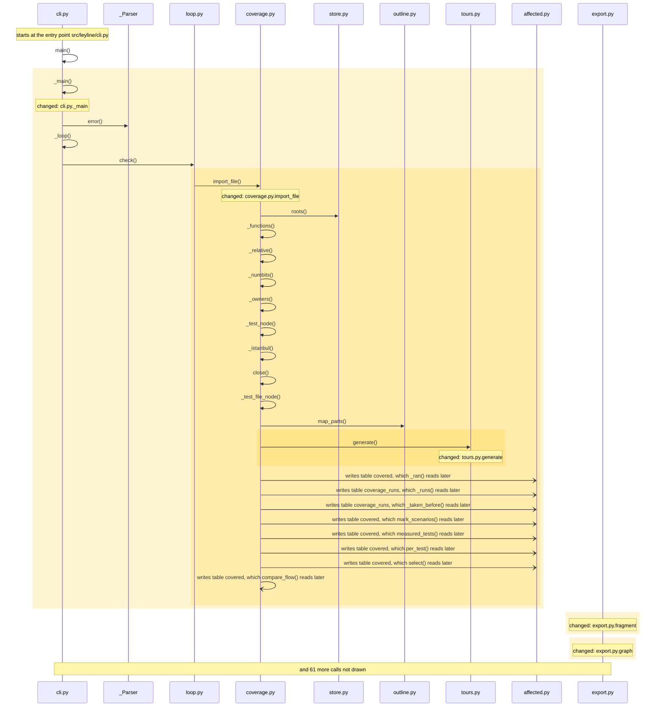

<!-- leyline:begin -->
# The orientation tour and `map` point at named parts, not cluster anchors

The one-page plan for the change in `openspec/changes/orientation-from-named-parts/`, written by Leyline from the spec files beside it. `leyline plan` rewrites it; edit the spec, not this page.

**State: done as agreed.** Every task that names code is done, every scenario is proven, and nothing outside the spec changed. Tasks 1.14, 3.1 are yours to check.

On this repository the orientation tour's module stop reads "Clustering splits it into 11 groups: Generic + generic.py + __init__.py group; Indexer + indexer.py + Run group…". The plan has 21 tasks: it changes _main, _parts, _parts_sentence, counts and 13 more. Nothing else must be edited with it; 500 places in 2 modules run into the changed code and may behave differently; 430 existing tests already run through it. It is done when 6 scenarios pass: 6 already have a test.

## 1. What code will be written

| Task | Does | Code |
| --- | --- | --- |
| 1.1 | Change `indexer.index` to write the tour after `inc.finish`, from parts it works out once and returns under `parts`, and to note which Leyline made the map after the tour | index, parts |
| 1.2 | Add `indexer._parts`, the parts of the large modules from the outline module's map_parts, or None when they cannot be worked out | _parts |
| 1.3 | Change `cli._main` to leave the parts out of what the index command prints | _main |
| 1.4 | Add `tours._parts_sentence`, what a large module's parts are, named ones first with their summaries and how many have no name | _parts_sentence |
| 1.5 | Change `tours.generate` to take the parts, and to describe a module of 30 files or more by them | generate |
| 1.6 | Change `coverage.import_file` to pass the parts to `tours.generate` | generate, import_file |
| 1.7 | Change `export.graph`, `export.parts`, `export.fragment` and `export.page` to take the parts the map worked out | fragment, graph, page, parts |
| 1.8 | Change `loop.map_repos` to take the parts from the index and hand them to `loop.counts` and `loop.write_page` | counts, map_repos; mentions write_page |
| 1.9 | Change `loop.write_page` and `loop.counts` to take the parts | counts, write_page |
| 1.10 | Add `loop.unnamed_parts`, the largest product module of 30 files or more with parts that have no name | unnamed_parts |
| 1.11 | Change `loop.map_text` to append to its Next line, in both branches, how many parts are unnamed and how to name them | map_text |
| 1.12 | Change `server.map_code` to add to `next`, after the spec step, the orientation steps and the parts to name | map_code |
| 1.13 | Change `outline.name_part` to say in its `next` that the tour shows the name after the next map | name_part |
| 1.14 | Add to skills/leyline-ask/SKILL.md a tool row for the tours and tour tools and the tour command, and a route for "What is this codebase? How is it organized?" to the overview tool, the orientation tour and the leyline-explore-module skill on the largest module | no code: checked by you |
| 2.1 | Add the test "The orientation tour lists the named parts of a module" | a test for the scenario |
| 2.2 | Add the test "The stop of an unnamed module says its parts are unnamed" | a test for the scenario |
| 2.3 | Add the test "The stop of a small module is unchanged" | a test for the scenario |
| 2.4 | Add the test "The parts are computed once per map" | a test for the scenario |
| 2.5 | Add the test "Map says when the parts of the main module are unnamed" | a test for the scenario |
| 2.6 | Add the test "The next of the map tool offers to look around" | a test for the scenario |
| 3.1 | Document in docs/understanding.md that the orientation tour and map describe a large module by its named parts | no code: checked by you |

Not read as code (nothing to check on the map): task 1.1: `inc.finish` is not on the map; read as a word, not code; task 1.12: `next` is not on the map; read as a word, not code; task 1.13: `next` is not on the map; read as a word, not code.

### How it runs

How execution reaches the code the tasks change, and what that code calls, as the code is now:

Drawn from the map: every arrow is a call or a channel link found in the code, in the order the code makes them where that order is known. The code the tasks change is shaded. An open arrowhead crosses a channel (a request, a message, a table, another program): the far side runs later, or in another process, and nothing checks the two sides against each other. Not drawn, to keep it readable: tours.py._parts_sentence, coverage.py.import_file, export.py.graph, export.py.fragment, export.py.page, loop.py.counts and 5 more.

## 2. What it will affect

17 things change, 0 more must be edited with them, and 500 are reached without needing an edit, across 2 modules. 430 existing tests run through the change.

*Must be edited*: code that breaks unless it changes too, such as the callers of a function whose parameters change. *Reached*: code that runs into the change, directly or through other calls; it needs no edit but may behave differently.

- leyline: 17 changed, 287 reached
- tests: 213 reached
- **medium risk:** Reaches outside its own module: tests.
- **medium risk:** 1 of 17 changed functions are on no test's path.
- **high risk:** Crosses a db boundary (views): export.py.graph, affected.py.change_code, affected.py.change_id_for, change.py.get_view and 9 more read what change.py.save_view writes. One end changes (graph); the other has no compile-time link to it.
- **high risk:** Crosses a db boundary (covered): export.py.graph, affected.py._ran, affected.py.mark_scenarios, affected.py.measured_tests and 9 more read what coverage.py.import_file writes. Both ends change (import_file and graph); nothing checks one against the other, so a mismatch fails only at run time.
- **high risk:** Crosses a db boundary (coverage_runs): affected.py._runs, affected.py._taken_before and Indexer._write_coverage read what coverage.py.import_file writes. One end changes (import_file); the other has no compile-time link to it.
- **high risk:** Crosses a db boundary (extractor_coverage): tours.py.generate, cluster.py.propose, Run.patterns and query.py.overview read what coverage.py.import_file writes. Both ends change (import_file and generate); nothing checks one against the other, so a mismatch fails only at run time.
- **high risk:** Crosses a db boundary (meta): indexer.py.index, cli.py._workspace_elsewhere, context.py.graph, diff.py.lost and 19 more read what diff.py.drop_snapshot writes. One end changes (index); the other has no compile-time link to it.
- **high risk:** Crosses a db boundary (annotations): export.py.graph, tours.py.generate, change.py.assess, query.py._notes and 5 more read what diff.py.snapshot writes. One end changes (graph and generate); the other has no compile-time link to it.

**Must agree with the change, and no task names it** (another end of a channel it crosses):
- change.py.save_view (src/leyline/change.py): writes what export.py.graph reads
- affected.py._ran (src/leyline/affected.py): also reads what coverage.py.import_file writes
- affected.py.mark_scenarios (src/leyline/affected.py): also reads what coverage.py.import_file writes
- affected.py.measured_tests (src/leyline/affected.py): also reads what coverage.py.import_file writes
- affected.py.per_test (src/leyline/affected.py): also reads what coverage.py.import_file writes
- affected.py.select (src/leyline/affected.py): also reads what coverage.py.import_file writes
- coverage.py.compare_flow (src/leyline/coverage.py): also reads what coverage.py.import_file writes
- coverage.py.has (src/leyline/coverage.py): also reads what coverage.py.import_file writes
- coverage.py.ran (src/leyline/coverage.py): also reads what coverage.py.import_file writes
- coverage.py.summary (src/leyline/coverage.py): also reads what coverage.py.import_file writes

**Shares a caller or a field with the change, and no task names it.** Each line is either right to leave alone or a missing task:
- import_file is also called by _with_store, check, done, coverage
- index is also called by verify, refresh, base_snapshot
- map_repos is also called by _loop, forget, review, start
- name_part is also called by _with_store, name_part
- map_text is also called by _loop
- and 16 more: `leyline spec facts`

**Usually changes with the files the tasks touch, and no task names it** (from the last 88 commits, leaving out 1 that changed more than 50 files). Each line is either right to leave alone or a missing task:
- `README.md` changed in 3 of the 3 commits that changed `skills/leyline-ask/SKILL.md` (and often with `src/leyline/cli.py`, `src/leyline/coverage.py` and 4 more); no task names it.
- `tests/test_server.py` changed in 3 of the 3 commits that changed `skills/leyline-ask/SKILL.md`; no task names it.
- `src/leyline/viewer/viewer.html` changed in 14 of the 16 commits that changed `src/leyline/export.py`; no task names it.
- `tests/test_index.py` changed in 11 of the 16 commits that changed `src/leyline/export.py` (and often with `src/leyline/indexer.py`, `src/leyline/server.py` and 1 more); no task names it.
- and 5 more: `leyline spec facts`

**Usually changes with the functions the tasks name, and no task names it.** Each line is either right to leave alone or a missing task:
- `cli.py.main` changed in 8 of the 13 commits that changed `indexer.py.index`; no task names it.
- `Indexer.__init__` changed in 8 of the 13 commits that changed `indexer.py.index`; no task names it.
- `Indexer.run` changed in 6 of the 11 commits that changed `tours.py.generate`; no task names it.

**Earlier changes to this code** (finished OpenSpec changes and earlier reviews that touched the same code, newest first):

- `node-summaries` (checked 2026-10-15): Every node carries a one-line summary, read by every understanding tool. Touched `name_part`.
- `outline-splits-large-group` (checked 2026-10-14): An outline splits a group that holds most of a level. Touched `name_part`.

## 3. How you will know it was done

Each scenario is proven by a test with the same name. After the change, `leyline check` marks each one from the test results.

| Scenario | When | Then | Test |
| --- | --- | --- | --- |
| The orientation tour lists the named parts of a module | a module of 30 files or more has parts named with `name_part` and the map is built again | the module's stop names each named part with its summary, in the order `module_outline` lists them, | exists |
| The stop of an unnamed module says its parts are unnamed | a module of 30 files or more has parts and none is named | its stop says how many parts are unnamed and names the leyline-explore-module skill | exists |
| The stop of a small module is unchanged | a module has fewer than 30 files | its stop reads as before and says nothing about naming parts | exists |
| The parts are computed once per map | a repository is mapped | `outline.map_parts` runs once, after the generation stamp is written, and the tour and the page read | exists |
| Map says when the parts of the main module are unnamed | `leyline map` finishes on a repository whose largest product module of 30 files or more has unnamed parts | its `Next:` line ends with how many parts are unnamed and how to name them, whether or not change | exists |
| The next of the map tool offers to look around | the `map` MCP tool finishes | `next` keeps the spec step first and then names the orientation tour, `find_flows`, `module_outline` | exists |

## Review findings

- Logic review: 8 findings, all settled.
- Performance review: 4 findings, all settled.

Settled (full text: `leyline spec findings`):
- high: The module stop's two promises, 'in the order module_outline lists them' and 'how many parts are unnamed', can only come from outline.split (a full Model of... **Accepted**: Matthew accepted every review finding on 2026-10-12; the spec is rewritten to the reviewer's proposal.
- high: Task 1.2 cannot be done in loop.map_text alone: it receives only the dict that loop.counts builds and has no store connection, so the unnamed-part count of t... **Accepted**: Matthew accepted every review finding on 2026-10-12; the spec is rewritten to the reviewer's proposal.
- high: Two existing tests fail as the spec is written and no task names them: tests.test_index.test_two_systems_whose_anchors_share_a_name_are_named_apart asserts t... **Accepted**: Matthew accepted every review finding on 2026-10-12; the spec is rewritten to the reviewer's proposal.
- medium: Task 1.2 makes loop.map_text say when the largest product module has unnamed parts, but the dict map_repos builds from loop.counts holds no part data, and th... **Accepted**: Matthew accepted every review finding on 2026-10-12; the spec is rewritten to the reviewer's proposal.
- medium: No test measures tours.generate or a whole map, so a Model build or a Louvain run added to the tour's module stop would pass every scenario in the spec unnot... **Accepted**: Matthew accepted every review finding on 2026-10-12; the spec is rewritten to the reviewer's proposal.
- medium: outline.named_parts gives names sorted by part id over every depth and every repository, with no split, so a stop built from it (task 1.1) cannot list parts... **Accepted**: Matthew accepted every review finding on 2026-10-12; the spec is rewritten to the reviewer's proposal.
- medium: outline.named_parts carries no stale mark and does not follow a group whose anchor changed (outline.names does both, via _stale and 'from'), so the tour woul... **Accepted**: Matthew accepted every review finding on 2026-10-12; the spec is rewritten to the reviewer's proposal.
- medium: The spec sets no threshold for 'a module with several parts': outline._split gives a 2-file module two file parts and an 8-file fixture module six, so every... **Accepted**: Matthew accepted every review finding on 2026-10-12; the spec is rewritten to the reviewer's proposal.
- low: The plan lists outline.named_parts as changed code and query.overview calls it on every overview call, so any Model or split dependency added to named_parts... **Accepted**: Matthew accepted every review finding on 2026-10-12; the spec is rewritten to the reviewer's proposal.
- low: After name_part the orientation tour keeps the old stop until the next map, and name_part's next tells the agent the names show in module_outline and the map... **Accepted**: Matthew accepted every review finding on 2026-10-12; the spec is rewritten to the reviewer's proposal.
- low: loop.map_text builds two different Next lines (change folders present or not), the scenario does not say which carries the unnamed-parts sentence, and tests.... **Accepted**: Matthew accepted every review finding on 2026-10-12; the spec is rewritten to the reviewer's proposal.
- low: Task 1.4 routes a question to 'the overview tool, the orientation tour and the leyline-explore-module skill', but the skill's tool table has no row for the t... **Accepted**: Matthew accepted every review finding on 2026-10-12; the spec is rewritten to the reviewer's proposal.

## Before implementation

Nothing blocks implementation: every task that names code is tied to it, everything that must be edited has a task, and every scenario has a test or a task to write one.

- Tasks 1.14, 3.1 name no code, so you check them yourself after the change; they do not hold up the verdict.

## 4. Was it done as agreed

Leyline marks each task from what changed in the code since the plan, whether or not it is ticked in tasks.md, and each scenario from the test results.

**Yes.** Every task that names code is done, every scenario is proven, and nothing outside the spec changed. Tasks 1.14, 3.1 are yours to check.

*The baseline was taken by another version of Leyline (or one that did not record its version), which may have read the same code differently: a change below that the diff does not show comes from that, not from the edit.*

| Task | Result | Verdict | Missing |
| --- | --- | --- | --- |
| 1.1 Change `indexer.index` to write the tour after `inc.finish`, from… | done | proven |  |
| 1.10 Add `loop.unnamed_parts`, the largest product module of 30 files or… | done | proven |  |
| 1.11 Change `loop.map_text` to append to its Next line, in both branches… | done | proven |  |
| 1.12 Change `server.map_code` to add to `next`, after the spec step, the… | done | proven |  |
| 1.13 Change `outline.name_part` to say in its `next` that the tour shows… | done | proven |  |
| 1.14 Add to skills/leyline-ask/SKILL.md a tool row for the tours and tour… | checked by you | needs a person |  |
| 1.2 Add `indexer._parts`, the parts of the large modules from the outline… | done | proven |  |
| 1.3 Change `cli._main` to leave the parts out of what the index command… | done | proven |  |
| 1.4 Add `tours._parts_sentence`, what a large module's parts are, named… | done | proven |  |
| 1.5 Change `tours.generate` to take the parts, and to describe a module… | done | proven |  |
| 1.6 Change `coverage.import_file` to pass the parts to `tours.generate` | done | proven |  |
| 1.7 Change `export.graph`, `export.parts`, `export.fragment` and… | done | proven |  |
| 1.8 Change `loop.map_repos` to take the parts from the index and hand… | done | proven |  |
| 1.9 Change `loop.write_page` and `loop.counts` to take the parts | done | proven |  |
| 2.1 Add the test "The orientation tour lists the named parts of a module" | done | proven |  |
| 2.2 Add the test "The stop of an unnamed module says its parts are… | done | proven |  |
| 2.3 Add the test "The stop of a small module is unchanged" | done | proven |  |
| 2.4 Add the test "The parts are computed once per map" | done | proven |  |
| 2.5 Add the test "Map says when the parts of the main module are unnamed" | done | proven |  |
| 2.6 Add the test "The next of the map tool offers to look around" | done | proven |  |
| 3.1 Document in docs/understanding.md that the orientation tour and map… | checked by you | needs a person |  |

*Checked by you*: the task names no code, so the map cannot see it done; it does not hold up the verdict.

| Scenario | Result | Verdict | Evidence |
| --- | --- | --- | --- |
| The orientation tour lists the named parts of a module | passes | proven | its test reaches the changed code on the map |
| The stop of an unnamed module says its parts are unnamed | passes | proven | its test reaches the changed code on the map |
| The stop of a small module is unchanged | passes | proven | its test reaches the changed code on the map |
| The parts are computed once per map | passes | proven | its test reaches the changed code on the map |
| Map says when the parts of the main module are unnamed | passes | proven | its test reaches the changed code on the map |
| The next of the map tool offers to look around | passes | proven | its test reaches the changed code on the map |

Verdicts: 25 proven, 2 needs you. Blocking: partial, contradicted, inconclusive. Not blocking: needs you. (The default.)

**Not proven, and why:**
- task 1.14, needs a person: it names no code, so the map cannot see it done (does not block)
- task 3.1, needs a person: it names no code, so the map cannot see it done (does not block)

Tests: 586 of 598 passed before, 593 of 605 after.

### How it runs now

**Before**: the code the change edits, as it ran at the baseline (drawn from the baseline alone):

Drawn from the map: every arrow is a call or a channel link found in the code, in the order the code makes them where that order is known. The code the change edits is shaded. An open arrowhead crosses a channel (a request, a message, a table, another program): the far side runs later, or in another process, and nothing checks the two sides against each other. Not drawn, to keep it readable: export.py.page, export.py.parts, indexer.py.index, loop.py.counts, loop.py.map_repos, loop.py.map_text and 3 more.

**After**: the changed code as it runs now:

Drawn from the map: every arrow is a call or a channel link found in the code, in the order the code makes them where that order is known. The changed code is shaded. An open arrowhead crosses a channel (a request, a message, a table, another program): the far side runs later, or in another process, and nothing checks the two sides against each other. Not drawn, to keep it readable: export.py.page, export.py.parts, indexer.py.index, loop.py.counts, loop.py.map_repos, loop.py.map_text and 6 more.

**What changed in how it runs** (calls and channel links into or out of the changed code, compared with the baseline):

- `coverage.py.import_file` now calls `outline.py.map_parts`
- `indexer.py._parts` now calls `outline.py.map_parts`
- `indexer.py.index` now calls `indexer.py._parts`
- `loop.py.counts` now calls `loop.py.unnamed_parts`
- `loop.py.unnamed_parts` now calls `store.py.aside_modules`
- `tours.py.generate` now calls `tours.py._parts_sentence`
- `test_orientation.py.big` now calls `indexer.py.index`
- `test_orientation.py.test_map_says_when_the_parts_of_the_main_module…` now calls `loop.py.map_repos`
- `test_orientation.py.test_map_says_when_the_parts_of_the_main_module…` now calls `loop.py.map_text`
- `test_orientation.py.test_map_says_when_the_parts_of_the_main_module…` now calls `outline.py.name_part`
- `test_orientation.py.test_the_orientation_tour_lists_the_named_parts…` now calls `indexer.py.index`
- `test_orientation.py.test_the_orientation_tour_lists_the_named_parts…` now calls `outline.py.name_part`
- and 3 more

Review before implementation:
- Logic review: 8 findings, all settled.
- Performance review: 4 findings, all settled.

Compared with the code as it was at 7bc2ec3.
<!-- leyline:end -->
