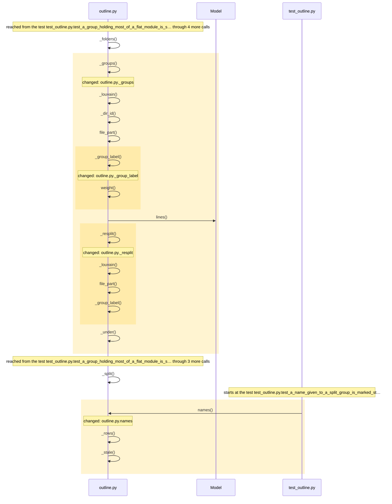
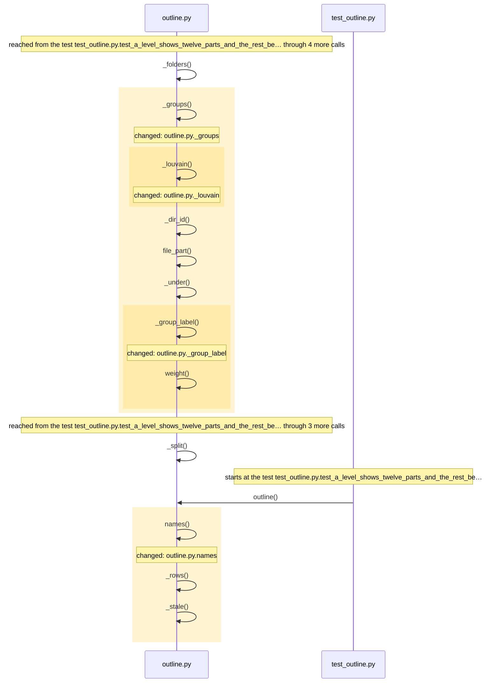
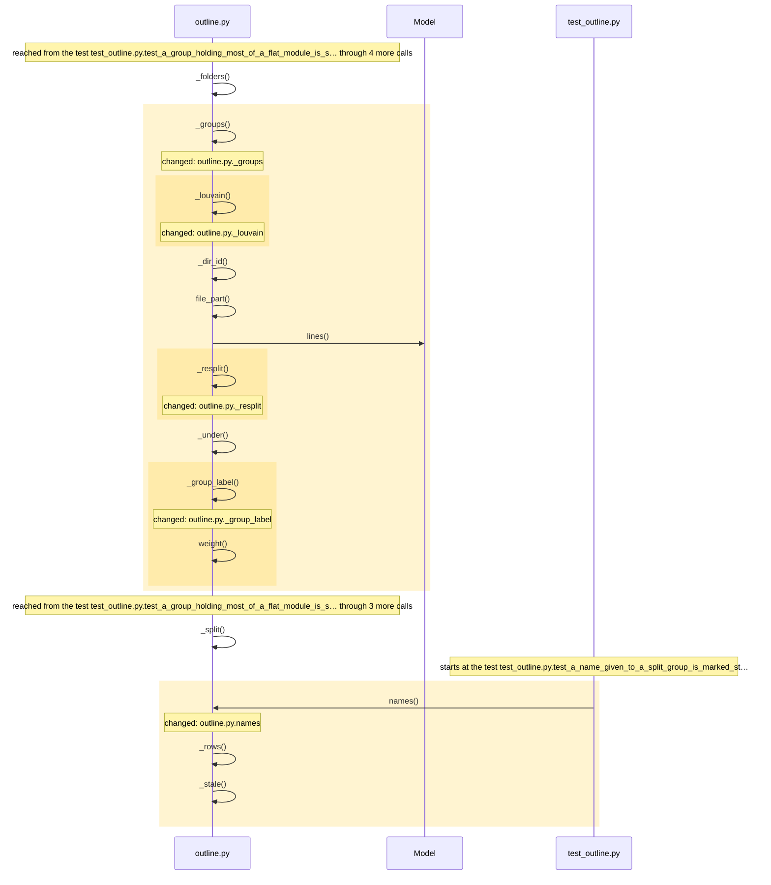

<!-- leyline:begin -->
# An outline splits a group that holds most of a level

The one-page plan for the change in `openspec/changes/outline-splits-large-group/`, written by Leyline from the spec files beside it. `leyline plan` rewrites it; edit the spec, not this page.

**State: done as agreed.** Every task is done, every scenario is proven, and nothing outside the spec changed.

`leyline outline src/leyline` puts 25 of 47 files and 16,115 of 28,708 loose-file lines into one group named "spec.py + diff.py + quick.py group". The plan has 8 tasks: it changes _group_label, _groups, _resplit, names. Nothing else must be edited with it; 21 places in 2 modules run into the changed code and may behave differently; 38 existing tests already run through it. It is done when 4 scenarios pass: 4 already have a test.

## 1. What code will be written

| Task | Does | Code |
| --- | --- | --- |
| 1.1 | Add `outline._resplit` in `src/leyline/outline.py`: the pieces of one group by the two-step community detection `outline._groups` uses, once, with files no community took kept under the group's own id and label; fewer than two pieces gives the group back | _resplit, in src/leyline/outline.py; mentions _groups |
| 1.2 | Change `outline._groups` to replace, with `outline._resplit`, a group holding more than 40% of the loose files' lines and at least 6 files | _groups; mentions _resplit |
| 1.3 | Change `outline.names` to match an old row to a new part by shared files when their parents differ | names |
| 1.4 | Change `outline._group_label` to say how many files the group holds beyond the three it names, keeping the "group" ending | _group_label |
| 2.1 | Add the test "A group holding most of a flat module is split again", with a fixture whose large group separates with the code it uses | a test for the scenario |
| 2.2 | Add the test "A group that does not separate stays whole" | a test for the scenario |
| 2.3 | Add the test "A name given to a split group is marked stale, not lost" | a test for the scenario |
| 2.4 | Add the test "The label of a group counts the files it does not name" | a test for the scenario |

### How it runs

How execution reaches the code the tasks change, and what that code calls, as the code is now:

Drawn from the map: every arrow is a call or a channel link found in the code, in the order the code makes them where that order is known. The code the tasks change is shaded.

## 2. What it will affect

4 things change, 0 more must be edited with them, and 21 are reached without needing an edit, across 2 modules. 38 existing tests run through the change.

*Must be edited*: code that breaks unless it changes too, such as the callers of a function whose parameters change. *Reached*: code that runs into the change, directly or through other calls; it needs no edit but may behave differently.

- leyline: 4 changed, 16 reached
- tests: 5 reached
- **medium risk:** Reaches outside its own module: tests.

**Earlier changes to this code** (no OpenSpec history on this code; from git history: commits before it whose diff names the same functions, then those that changed the same files (of the last 500 that touched them)):

- `68ad525` (2026-10-11): Release 0.9.0: exploring a codebase comes first, names work everywhere, a newcomer's fixes (#4). Changed `_group_label`, `names`.
- `2eed3e1` (2026-10-07): Module outline: split a large module into named parts, for agents and the map page. Changed `_groups`, `names`.

## 3. How you will know it was done

Each scenario is proven by a test with the same name. After the change, `leyline check` marks each one from the test results.

| Scenario | When | Then | Test |
| --- | --- | --- | --- |
| A group holding most of a flat module is split again | a flat module's files group so that one group holds more than 40% of the loose files' lines and at | the outline shows the group's communities as separate parts of the level, each smaller than the group, | exists |
| A group that does not separate stays whole | such a group gives fewer than two communities either way | the outline shows it unchanged | exists |
| A name given to a split group is marked stale, not lost | a group was named with `name_part` and a later outline splits it | the piece sharing most of its files shows the name marked "may be stale" when it kept less than half of | exists |
| The label of a group counts the files it does not name | a group holds more than three files | its label names its three busiest files, says how many more it holds, and ends with "group" | exists |

## Review findings

- Logic review: 8 findings, all settled.
- Performance review: 3 findings, all settled.

Settled (full text: `leyline spec findings`):
- high: On src/leyline, _louvain over the big group's own 40 units returns no communities (modularity 0.258 is under MIN_MODULARITY 0.3), so task 1.1 as written leav... **Accepted**: Matthew accepted every review finding on 2026-10-12; the spec is rewritten to the reviewer's proposal.
- high: On the current map, _louvain over the 25-file group's own units returns [] (modularity 0.258 < MIN_MODULARITY 0.3), so the re-split as specified leaves 'leyl... **Accepted**: Matthew accepted every review finding on 2026-10-12; the spec is rewritten to the reviewer's proposal.
- medium: The scenario's THEN ('no part holds more than 40% of the lines unless it does not separate') can only be met by repeating the split while a piece still excee... **Accepted**: Matthew accepted every review finding on 2026-10-12; the spec is rewritten to the reviewer's proposal.
- medium: A name given to the large group does not reach the stale rule: names() matches an old row to a new-id piece only when row.parent == piece.parent, but the mot... **Accepted**: Matthew accepted every review finding on 2026-10-12; the spec is rewritten to the reviewer's proposal.
- medium: The proposed label 'spec.py + diff.py + quick.py and 22 more' no longer ends with ' group', which test_the_repository_then_a_module_then_a_flat_folder (order... **Accepted**: Matthew accepted every review finding on 2026-10-12; the spec is rewritten to the reviewer's proposal.
- medium: The scenario requires that no part holds more than 40% 'unless it does not separate', but task 1.1 and the proposal split once ('Louvain twice'): a re-split... **Accepted**: Matthew accepted every review finding on 2026-10-12; the spec is rewritten to the reviewer's proposal.
- medium: Files the re-split's communities do not take have no place in the spec: _groups puts such files in '<folder>#other', an id the level's own leftovers already... **Accepted**: Matthew accepted every review finding on 2026-10-12; the spec is rewritten to the reviewer's proposal.
- medium: The test for 'A group holding most of a flat module is split again' passes with the task left out whenever its fixture's group does not separate: the existin... **Accepted**: Matthew accepted every review finding on 2026-10-12; the spec is rewritten to the reviewer's proposal.
- low: No test runs the changed _groups under a clock or counts its Louvain runs (the nearest speed test, test_layout_of_a_huge_level_stays_bounded, covers export._... **Accepted**: Matthew accepted every review finding on 2026-10-12; the spec is rewritten to the reviewer's proposal.
- low: A level is capped at MAX_PARTS (12): on the current map the pieces plus the existing 8 other parts exceed it, so _pack moves the smallest existing parts (e.g. **Accepted**: Matthew accepted every review finding on 2026-10-12; the spec is rewritten to the reviewer's proposal.
- low: '40% of the level's lines' is ambiguous when the level holds subfolders: _groups receives only the loose files (28,708 lines for src/leyline) while the level... **Accepted**: Matthew accepted every review finding on 2026-10-12; the spec is rewritten to the reviewer's proposal.

## Before implementation

Nothing blocks implementation: every task that names code is tied to it, everything that must be edited has a task, and every scenario has a test or a task to write one.

## 4. Was it done as agreed

Leyline marks each task from what changed in the code since the plan, whether or not it is ticked in tasks.md, and each scenario from the test results.

**Yes.** Every task is done, every scenario is proven, and nothing outside the spec changed.

*The baseline was taken by another version of Leyline (or one that did not record its version), which may have read the same code differently: a change below that the diff does not show comes from that, not from the edit.*

| Task | Result | Verdict | Missing |
| --- | --- | --- | --- |
| 1.1 Add `outline._resplit` in `src/leyline/outline.py`: the pieces of one… | done | proven |  |
| 1.2 Change `outline._groups` to replace, with `outline._resplit`, a group… | done | proven |  |
| 1.3 Change `outline.names` to match an old row to a new part by shared… | done | proven |  |
| 1.4 Change `outline._group_label` to say how many files the group holds… | done | proven |  |
| 2.1 Add the test "A group holding most of a flat module is split again"… | done | proven |  |
| 2.2 Add the test "A group that does not separate stays whole" | done | proven |  |
| 2.3 Add the test "A name given to a split group is marked stale, not lost" | done | proven |  |
| 2.4 Add the test "The label of a group counts the files it does not name" | done | proven |  |

| Scenario | Result | Verdict | Evidence |
| --- | --- | --- | --- |
| A group holding most of a flat module is split again | passes | proven | its test reaches the changed code on the map |
| A group that does not separate stays whole | passes | proven | its test reaches the changed code on the map |
| A name given to a split group is marked stale, not lost | passes | proven | its test reaches the changed code on the map |
| The label of a group counts the files it does not name | passes | proven | its test reaches the changed code on the map |

Verdicts: 12 proven. Blocking: partial, contradicted, inconclusive. Not blocking: needs you. (The default.)

Tests: 573 of 585 passed before, 577 of 589 after.

### How it runs now

**Before**: the code the change edits, as it ran at the baseline (drawn from the baseline alone):

Drawn from the map: every arrow is a call or a channel link found in the code, in the order the code makes them where that order is known. The code the change edits is shaded.

**After**: the changed code as it runs now:

Drawn from the map: every arrow is a call or a channel link found in the code, in the order the code makes them where that order is known. The changed code is shaded.

**What changed in how it runs** (calls and channel links into or out of the changed code, compared with the baseline):

- `outline.py._groups` now calls `Model.lines`
- `outline.py._groups` now calls `outline.py._resplit`
- `outline.py._resplit` now calls `outline.py._group_label`
- `outline.py._resplit` now calls `outline.py._louvain`
- `outline.py._resplit` now calls `outline.py.file_part`
- `test_outline.py.test_a_group_holding_most_of_a_flat_module_is_s…` now calls `outline.py._resplit`
- `test_outline.py.test_a_group_that_does_not_separate_stays_whole` now calls `outline.py._resplit`
- `test_outline.py.test_a_name_given_to_a_split_group_is_marked_st…` now calls `outline.py.names`

Review before implementation:
- Logic review: 8 findings, all settled.
- Performance review: 3 findings, all settled.

Compared with the code as it was at 7bc2ec3.
<!-- leyline:end -->
