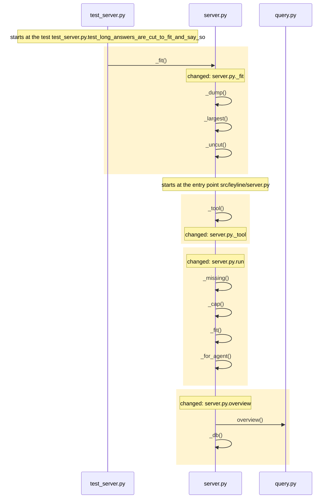
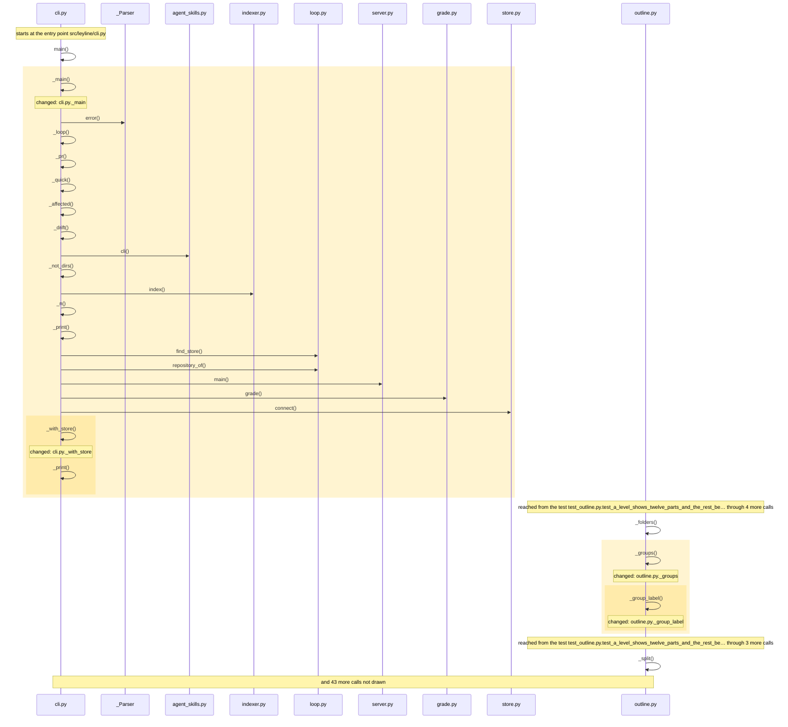

<!-- leyline:begin -->
# The read tools that do not size themselves take a token budget

The one-page plan for the change in `openspec/changes/read-tool-budgets/`, written by Leyline from the spec files beside it. `leyline plan` rewrites it; edit the spec, not this page.

**State: not done as agreed yet:** 6 edits are outside the spec. Details under "Was it done as agreed".

On a 47,000-line repository `overview` answers in 57 KB, `explain_path` 33 KB, `module_outline` 31 KB and `expand` 22 KB before the server's cut. The plan has 13 tasks: it changes _fit, _main, _tool, _with_store and 10 more. Nothing else must be edited with it; 34 places in 2 modules run into the changed code and may behave differently; 112 existing tests already run through it. It is done when 4 scenarios pass: 4 already have a test.

## 1. What code will be written

| Task | Does | Code |
| --- | --- | --- |
| 1.1 | Change the top level of `src/leyline/server.py` to define `Budget`, the annotated type of a `budget_tokens` argument (600 to 6,000 tokens, four characters each), and the floors the answer is cut to | src/leyline/server.py |
| 1.2 | Change `server._fit` to take the floors it cuts to, with a last floor of no items and 80 characters used only under a budget | _fit |
| 1.3 | Change `server._tool` and `_tool.run` to take a `budgeted` flag and, for a budgeted tool given `budget_tokens`, cut the answer to the smaller of the budget times four and the tool's limit, with `more` naming `budget_tokens` beside the tool's own knob | _tool, run |
| 1.4 | Change the signature of `server.overview`, `server.expand`, `server.impact`, `server.module_outline`, `server.explain_path`, `server.find_flows` and `server.neighbors` to take `budget_tokens`, and `server.explain_path` and `server.module_outline` to lower `max_steps` or depth to fit it | expand, explain_path, find_flows, impact, module_outline, neighbors and 1 more; mentions explain_path, module_outline |
| 1.5 | Change `cli._main` to give the tour command a `--json` flag | _main |
| 1.6 | Change `cli._with_store` to print the whole tour as the tours module returns it when `--json` is given | _with_store |
| 1.7 | Change skills/leyline-explain-flow/SKILL.md to say `--json` works on find-flows, explain-path and diagram only | no code: checked by you |
| 1.8 | Document `budget_tokens` in docs/mcp-tools.md | no code: checked by you |
| 1.9 | Change `test_the_skill_names_the_tools_and_their_commands` to expect `budget_tokens` in the docs row of `find_flows` | test_the_skill_names_the_tools_and_their_commands |
| 2.1 | Add the test "A read tool answers within the budget it was given" | a test for the scenario |
| 2.2 | Add the test "A budget below the default cuts lists and says so" | a test for the scenario |
| 2.3 | Add the test "Context keeps its own budget" | a test for the scenario |
| 2.4 | Add the test "Tour prints JSON when asked" | a test for the scenario |

Not read as code (nothing to check on the map): task 1.1: `Budget` is not on the map; read as a word, not code; task 1.1: `budget_tokens` is not on the map; read as a word, not code; task 1.3: `budgeted` is not on the map; read as a word, not code; task 1.3: `budget_tokens` is not on the map; read as a word, not code; task 1.3: `more` is not on the map; read as a word, not code; task 1.4: `budget_tokens` is not on the map; read as a word, not code; task 1.4: `max_steps` is not on the map; read as a word, not code; task 1.8: `budget_tokens` is not on the map; read as a word, not code; and 1 more.

### How it runs

How execution reaches the code the tasks change, and what that code calls, as the code is now:

Drawn from the map: every arrow is a call or a channel link found in the code, in the order the code makes them where that order is known. The code the tasks change is shaded. Not drawn, to keep it readable: server.py.expand, server.py.impact, server.py.module_outline, server.py.explain_path, server.py.find_flows, server.py.neighbors and 2 more. Nothing on the map reaches server.py.run, server.py.overview.

## 2. What it will affect

14 things change, 0 more must be edited with them, and 34 are reached without needing an edit, across 2 modules. 112 existing tests run through the change.

*Must be edited*: code that breaks unless it changes too, such as the callers of a function whose parameters change. *Reached*: code that runs into the change, directly or through other calls; it needs no edit but may behave differently.

- leyline: 13 changed, 4 reached
- tests: 1 changed, 30 reached
- **medium risk:** 56 of 72 changed functions are on no test's path.
- **low risk:** A breaking change with no callers found. Check for use through reflection, events or outside code.

**Usually changes with the files the tasks touch, and no task names it** (from the last 88 commits, leaving out 1 that changed more than 50 files). Each line is either right to leave alone or a missing task:
- `README.md` changed in 26 of the 27 commits that changed `src/leyline/server.py` (and often with `src/leyline/cli.py`); no task names it.
- `tests/test_index.py` changed in 14 of the 27 commits that changed `src/leyline/server.py`; no task names it.

**Usually changes with the functions the tasks name, and no task names it.** Each line is either right to leave alone or a missing task:
- `server.py.source` changed in 3 of the 3 commits that changed `server.py.expand`; no task names it.
- `server.py.flows` changed in 3 of the 3 commits that changed `server.py.impact`; no task names it.
- `server.py.trace` changed in 3 of the 3 commits that changed `server.py.impact`; no task names it.

**Specs that no longer match code this change touches** (update them with it):
- The change show-tests-reaching names `server.expand`, which has changed signature since it was written. `leyline drift` says more.

**Earlier changes to this code** (finished OpenSpec changes and earlier reviews that touched the same code, newest first):

- `show-tests-reaching` (checked 2026-10-13): `show` and `expand` say which tests reach a function. Touched `expand`.

## 3. How you will know it was done

Each scenario is proven by a test with the same name. After the change, `leyline check` marks each one from the test results.

| Scenario | When | Then | Test |
| --- | --- | --- | --- |
| A read tool answers within the budget it was given | `expand`, `overview`, `impact`, `module_outline`, `explain_path`, `find_flows` or `neighbors` is called | the answer is at most four characters per token of that budget plus the `cut` and `more` fields, and | exists |
| A budget below the default cuts lists and says so | a read tool is called with a budget smaller than its answer | the answer's `cut` names each list or string that was shortened and `more` names `budget_tokens` and | exists |
| Context keeps its own budget | `context` is called with `budget_tokens` | its text is sized as before and its "Left out" line is kept | exists |
| Tour prints JSON when asked | `leyline tour --json` runs | it prints the whole tour as `tours.get` returns it | exists |

## Review findings

- Logic review: 6 findings, all settled.
- Performance review: 3 findings, all settled.

Settled (full text: `leyline spec findings`):
- high: At the bottom of the proposed range (200 tokens = 800 characters) _fit stops when nothing is left above its second floor (1 item, 200 characters per string),... **Accepted**: Matthew accepted every review finding on 2026-10-12; the spec is rewritten to the reviewer's proposal.
- high: Reading budget_tokens in _tool for every call collides with context, whose budget_tokens (200-8000) already sizes its outline text: context(budget_tokens=500... **Accepted**: Matthew accepted every review finding on 2026-10-12; the spec is rewritten to the reviewer's proposal.
- high: Scenario 'A read tool's answer fits the budget it was given' cannot hold at the low end of the range: _fit never cuts a list below 1 item or a string below 2... **Accepted**: Matthew accepted every review finding on 2026-10-12; the spec is rewritten to the reviewer's proposal.
- medium: A budget_tokens of 9,000 is 36,000 characters, 50% more than the 24,000-character LIMIT that overview, expand, impact, find_flows and neighbors answer under... **Accepted**: Matthew accepted every review finding on 2026-10-12; the spec is rewritten to the reviewer's proposal.
- medium: Task 1.2 replaces the tool's limit with budget_tokens*4, so a budget of 9,000 tokens allows 36,000 characters: more than LIMIT (24,000) and more than module_... **Accepted**: Matthew accepted every review finding on 2026-10-12; the spec is rewritten to the reviewer's proposal.
- medium: When the cut comes from a budget, the existing more texts mislead: MORE says 'raise limit' (an item count) and module_outline's and explain_path's say 'lower... **Accepted**: Matthew accepted every review finding on 2026-10-12; the spec is rewritten to the reviewer's proposal.
- medium: The proposal's Why misreads the skill: leyline-explain-flow's table names find-flows, explain-path, diagram, source and map (not tour) and says --json works... **Accepted**: Matthew accepted every review finding on 2026-10-12; the spec is rewritten to the reviewer's proposal.
- low: The budget is applied in _tool after the tool computed and serialised its whole answer, so explain_path with max_steps=200 still walks 200 steps and builds 8... **Accepted**: Matthew accepted every review finding on 2026-10-12; the spec is rewritten to the reviewer's proposal.
- low: leyline tour --json printed from tours.get differs from the tour tool's answer when a tour has more than 60 stops or exceeds 24,000 characters: the tool goes... **Accepted**: Matthew accepted every review finding on 2026-10-12; the spec is rewritten to the reviewer's proposal.

## Before implementation

- task 1.9: `find_flows` could be 2 things; write it as `Owner.Name` or `path/to/file: Name`

- Tasks 1.7, 1.8 name no code, so you check them yourself after the change; they do not hold up the verdict.

## 4. Was it done as agreed

Leyline marks each task from what changed in the code since the plan, whether or not it is ticked in tasks.md, and each scenario from the test results.

**Not yet:** 6 edits are outside the spec.

*The baseline was taken by another version of Leyline (or one that did not record its version), which may have read the same code differently: a change below that the diff does not show comes from that, not from the edit.*

| Task | Result | Verdict | Missing |
| --- | --- | --- | --- |
| 1.1 Change the top level of `src/leyline/server.py` to define `Budget`… | done | proven |  |
| 1.2 Change `server._fit` to take the floors it cuts to, with a last floor… | done | proven |  |
| 1.3 Change `server._tool` and `_tool.run` to take a `budgeted` flag and… | done | proven |  |
| 1.4 Change the signature of `server.overview`, `server.expand`… | done | proven |  |
| 1.5 Change `cli._main` to give the tour command a `--json` flag | done | proven |  |
| 1.6 Change `cli._with_store` to print the whole tour as the tours module… | done | proven |  |
| 1.7 Change skills/leyline-explain-flow/SKILL.md to say `--json` works on… | checked by you | needs a person |  |
| 1.8 Document `budget_tokens` in docs/mcp-tools.md | checked by you | needs a person |  |
| 1.9 Change `test_the_skill_names_the_tools_and_their_commands` to expect… | done | proven |  |
| 2.1 Add the test "A read tool answers within the budget it was given" | done | proven |  |
| 2.2 Add the test "A budget below the default cuts lists and says so" | done | proven |  |
| 2.3 Add the test "Context keeps its own budget" | done | proven |  |
| 2.4 Add the test "Tour prints JSON when asked" | done | proven |  |

*Checked by you*: the task names no code, so the map cannot see it done; it does not hold up the verdict.

| Scenario | Result | Verdict | Evidence |
| --- | --- | --- | --- |
| A read tool answers within the budget it was given | passes | proven | its test reaches the changed code on the map |
| A budget below the default cuts lists and says so | passes | proven | its test reaches the changed code on the map |
| Context keeps its own budget | passes | proven | its test reaches the changed code on the map |
| Tour prints JSON when asked | passes | proven | its test reaches the changed code on the map |

Verdicts: 15 proven, 2 needs you. Blocking: partial, contradicted, inconclusive. Not blocking: needs you. (The default.)

**Not proven, and why:**
- task 1.7, needs a person: it names no code, so the map cannot see it done (does not block)
- task 1.8, needs a person: it names no code, so the map cannot see it done (does not block)

**Changed, but not in the spec:**
- _group_label (callable) src/leyline/outline.py
- _groups (callable) src/leyline/outline.py
- _louvain (callable) src/leyline/outline.py
- names (callable) src/leyline/outline.py
- the top level of src/leyline/outline.py (code outside any function)
- _resplit (new, not declared in the proposal) src/leyline/outline.py

**Expected to change, and did not:**
- src/leyline/cli.py
- src/leyline/server.py
- tests/fixture5/rpc/py/server.py
- tour

Tests: 569 of 581 passed before, 577 of 589 after.

### How it runs now

**Before**: the code the change edits, as it ran at the baseline (drawn from the baseline alone):

Drawn from the map: every arrow is a call or a channel link found in the code, in the order the code makes them where that order is known. The code the change edits is shaded. Not drawn, to keep it readable: outline.py._louvain, outline.py.names, server.py._fit, server.py._tool, server.py.run, server.py.expand and 6 more.

**After**: the changed code as it runs now:

Drawn from the map: every arrow is a call or a channel link found in the code, in the order the code makes them where that order is known. The changed code is shaded. Not drawn, to keep it readable: outline.py._louvain, outline.py.names, server.py._fit, server.py._tool, server.py.run, server.py.expand and 7 more.

**What changed in how it runs** (calls and channel links into or out of the changed code, compared with the baseline):

- `outline.py._groups` now calls `Model.lines`
- `outline.py._groups` now calls `outline.py._resplit`
- `outline.py._resplit` now calls `outline.py._group_label`
- `outline.py._resplit` now calls `outline.py._louvain`
- `outline.py._resplit` now calls `outline.py.file_part`
- `test_outline.py.test_a_group_holding_most_of_a_flat_module_is_s…` now calls `outline.py._resplit`
- `test_outline.py.test_a_group_that_does_not_separate_stays_whole` now calls `outline.py._resplit`
- `test_outline.py.test_a_name_given_to_a_split_group_is_marked_st…` now calls `outline.py.names`

Review before implementation:
- Logic review: 6 findings, all settled.
- Performance review: 3 findings, all settled.

Compared with the code as it was at 7bc2ec3.
<!-- leyline:end -->
