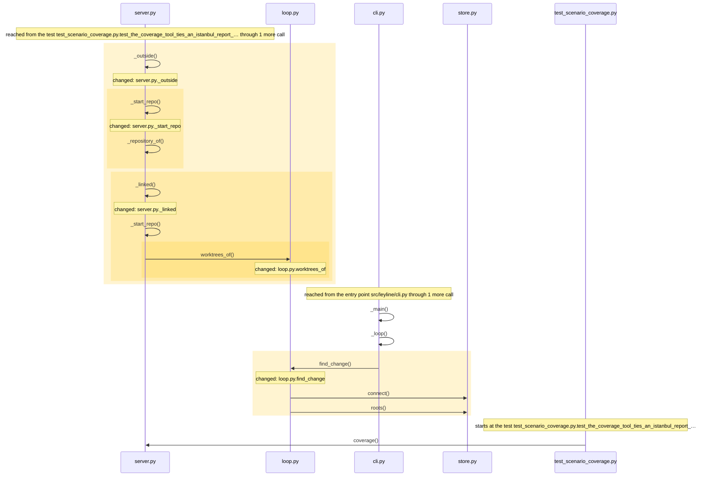
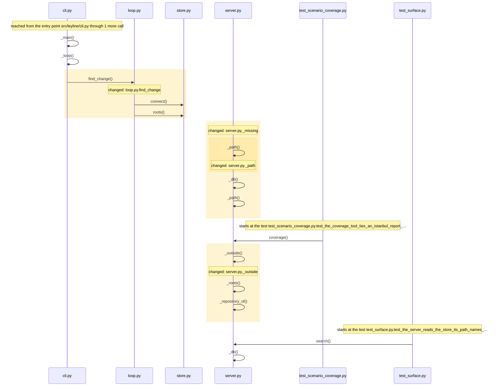
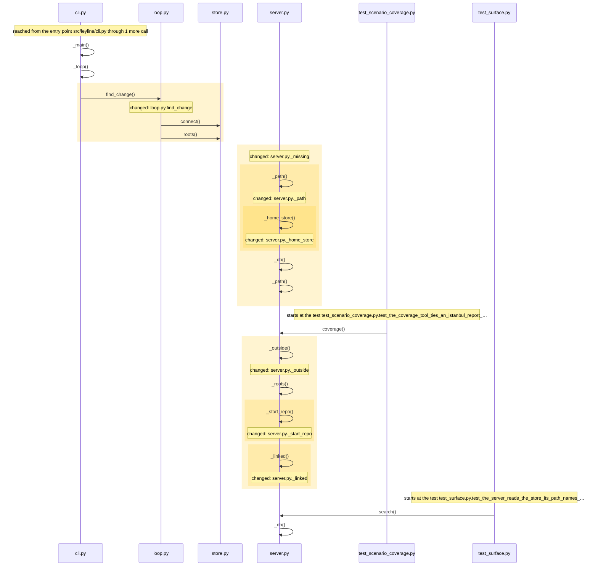

<!-- leyline:begin -->
# An agent working in another checkout of the server's repository can map it

The one-page plan for the change in `openspec/changes/server-in-another-checkout/`, written by Leyline from the spec files beside it. `leyline plan` rewrites it; edit the spec, not this page.

**State: done as agreed.** Every task that names code is done, every scenario is proven, and nothing outside the spec changed. Tasks 1.13, 3.1 are yours to check.

The desktop app starts `leyline serve` in the main checkout while the agent works in a worktree under `.claude/worktrees/`. The plan has 20 tasks: it changes _home, _home_store, _linked, _missing and 9 more. Nothing else must be edited with it; 37 places in 2 modules run into the changed code and may behave differently; 113 existing tests already run through it. It is done when 6 scenarios pass: 6 already have a test.

## 1. What code will be written

| Task | Does | Code |
| --- | --- | --- |
| 1.1 | Add `loop.worktrees_of`: the linked worktrees of a git repository, from `git worktree list --porcelain`, resolved | worktrees_of |
| 1.2 | Change `loop.find_change` to search the store's roots before the server's directory | find_change |
| 1.3 | Add `server._linked`, the linked worktrees of the repository the server started in, listed once and again on each `map` | _linked |
| 1.4 | Add `server._start_repo`, the git repository the server started in, asked of git once | _start_repo |
| 1.5 | Add `server._home`, the first repository the store maps, else the server's directory | _home |
| 1.6 | Add `server._home_store`, the store the server started with | _home_store |
| 1.7 | Change `server._path` to return the store `map` made current for this process, starting from the store the server started with | _path |
| 1.8 | Change the top level of `src/leyline/server.py` to add the current-store variable and the caches of the start repository and the worktrees | src/leyline/server.py |
| 1.9 | Change `server._outside` to allow the store's roots, the server's directory and its repository, and the linked worktrees from a list made once | _outside |
| 1.10 | Change `server._missing` to say "an agent working in another checkout passes that checkout's absolute path to `map`" | _missing |
| 1.11 | Change `server.map_code` to skip the fold for a directory that is itself a git top level, to use the checkout's own store when it is not the server's own, to make it current only after `loop.map_repos` returns without error inside the lock, and to name the current store and the restart rule in its answer | map_code; mentions map_repos |
| 1.12 | Change `server.review_pr` and `server.drift` to default their path to the first repository the store maps | drift, review_pr |
| 1.13 | Change skills/leyline-ask/SKILL.md and skills/leyline-explain-flow/SKILL.md to say that `map` takes the absolute path of the repository the agent works in, which may not be the server's directory | no code: checked by you |
| 2.1 | Add the test "A linked worktree under the main checkout is mapped as itself" | a test for the scenario |
| 2.2 | Add the test "Mapping another checkout moves the store to it" | a test for the scenario |
| 2.3 | Add the test "A refused store leaves the old one current" | a test for the scenario |
| 2.4 | Add the test "After the move the paths the server defaults to follow the store" | a test for the scenario |
| 2.5 | Add the test "Accepting a worktree runs no git per call" | a test for the scenario |
| 2.6 | Add the test "The nothing-mapped error names the directory the server started in" | a test for the scenario |
| 3.1 | Document in README.md and docs/mcp-tools.md that a checkout other than the server's own is mapped as itself and its store is read until the server restarts | no code: checked by you |

Not read as code (nothing to check on the map): task 1.3: `map` is not on the map; read as a word, not code; task 1.7: `map` is not on the map; read as a word, not code; task 1.10: `map` is not on the map; read as a word, not code; task 1.13: `map` is not on the map; read as a word, not code.

### How it runs

How execution reaches the code the tasks change, and what that code calls, as the code is now:

Drawn from the map: every arrow is a call or a channel link found in the code, in the order the code makes them where that order is known. The code the tasks change is shaded. Not drawn, to keep it readable: server.py._home, server.py._home_store, server.py._path, server.py._missing, server.py.map_code, server.py.review_pr and 1 more.

## 2. What it will affect

13 things change, 0 more must be edited with them, and 37 are reached without needing an edit, across 2 modules. 113 existing tests run through the change.

*Must be edited*: code that breaks unless it changes too, such as the callers of a function whose parameters change. *Reached*: code that runs into the change, directly or through other calls; it needs no edit but may behave differently.

- leyline: 13 changed, 9 reached
- tests: 28 reached
- **medium risk:** Reaches outside its own module: tests.
- **medium risk:** 55 of 74 changed functions are on no test's path.

**Shares a caller or a field with the change, and no task names it.** Each line is either right to leave alone or a missing task:
- find_change is also called by _affected, _loop, _spec, _change and 1 more
- _missing is also called by run
- and 2 more: `leyline spec facts`

**Usually changes with the files the tasks touch, and no task names it** (from the last 88 commits, leaving out 1 that changed more than 50 files). Each line is either right to leave alone or a missing task:
- `src/leyline/cli.py` changed in 3 of the 3 commits that changed `skills/leyline-ask/SKILL.md` (and often with `README.md`, `src/leyline/loop.py` and 1 more); no task names it.
- `tests/test_server.py` changed in 3 of the 3 commits that changed `skills/leyline-ask/SKILL.md`; no task names it.
- `src/leyline/spec.py` changed in 9 of the 17 commits that changed `src/leyline/loop.py`; no task names it.
- `tests/test_index.py` changed in 14 of the 27 commits that changed `src/leyline/server.py`; no task names it.

**Specs that no longer match code this change touches** (update them with it):
- The change show-tests-reaching names `server.expand`, which has changed signature since it was written. `leyline drift` says more.

**Earlier changes to this code** (finished OpenSpec changes and earlier reviews that touched the same code, newest first):

- `orientation-from-named-parts` (checked 2026-10-15): The orientation tour and `map` point at named parts, not cluster anchors. Touched `map_code`.

## 3. How you will know it was done

Each scenario is proven by a test with the same name. After the change, `leyline check` marks each one from the test results.

| Scenario | When | Then | Test |
| --- | --- | --- | --- |
| A linked worktree under the main checkout is mapped as itself | the server starts in a git repository with a linked worktree under it, and `map` is called with the | the store's root is the worktree, not the repository that contains it | exists |
| Mapping another checkout moves the store to it | `map` maps a checkout that is not the directory the server started in and the map succeeds | the store is at `<checkout>/.leyline/leyline.db`, later tools read it, the answer names it and says the | exists |
| A refused store leaves the old one current | `map` maps a checkout whose `.leyline` is tracked by git | the map is refused with the files named and later tools still read the store they read before | exists |
| After the move the paths the server defaults to follow the store | the store has moved and `review_pr` or `drift` is called with no path, or a change id exists in both | each reads the mapped checkout | exists |
| Accepting a worktree runs no git per call | a tool is called with a path inside a mapped repository | `loop.worktrees_of` is not called | exists |
| The nothing-mapped error names the directory the server started in | a tool is called before anything is mapped | the error names the server's directory and says "an agent working in another checkout passes that | exists |

## Review findings

- Logic review: 8 findings, all settled.
- Performance review: 3 findings, all settled.

Settled (full text: `leyline spec findings`):
- high: leyline serve sets os.environ['LEYLINE_DB'] unconditionally (cli.py line 1060, from find_store or repository_of of its own directory), so task 1.4's rule tha... **Accepted**: Matthew accepted every review finding on 2026-10-12; the spec is rewritten to the reviewer's proposal.
- high: A worktree under .claude/worktrees/ sits inside the main checkout, so _outside already allows it today and map_code's fold ('root in r.parents' with roots fa... **Accepted**: Matthew accepted every review finding on 2026-10-12; the spec is rewritten to the reviewer's proposal.
- medium: Task 1.2 does not say when _outside consults worktrees_of; since the scenario needs linked worktrees allowed even after the main checkout is mapped (when _ro... **Accepted**: Matthew accepted every review finding on 2026-10-12; the spec is rewritten to the reviewer's proposal.
- medium: Scenario 3's test passes with task 1.3 left out: _missing already names the server's directory ('paths=["."] for {Path.cwd()}'), and so does map_code's own n... **Accepted**: Matthew accepted every review finding on 2026-10-12; the spec is rewritten to the reviewer's proposal.
- medium: Scenario 1's test passes with task 1.2 left out whenever the test's worktree is created under the main checkout (git worktree add .claude/worktrees/x), becau... **Accepted**: Matthew accepted every review finding on 2026-10-12; the spec is rewritten to the reviewer's proposal.
- medium: After the store moves, _roots() is the worktree alone, so _outside refuses the server's own directory: review_pr's default path='.' is refused, drift's defau... **Accepted**: Matthew accepted every review finding on 2026-10-12; the spec is rewritten to the reviewer's proposal.
- medium: The spec does not say what a second map does after the store moved: map of the server's own directory or of another worktree with roots=[worktree] folds onto... **Accepted**: Matthew accepted every review finding on 2026-10-12; the spec is rewritten to the reviewer's proposal.
- medium: Task 1.4 does not order the move: if _path switches to <checkout>/.leyline/leyline.db before map_repos succeeds, a worktree whose branch tracks .leyline (wha... **Accepted**: Matthew accepted every review finding on 2026-10-12; the spec is rewritten to the reviewer's proposal.
- low: Task 1.4 does not say whether _path switches to the new checkout's store before or after loop.map_repos writes it; _db reopens a thread's connection whenever... **Accepted**: Matthew accepted every review finding on 2026-10-12; the spec is rewritten to the reviewer's proposal.
- low: No test shows a regression in _outside's cost: none of the speed tests run the changed functions, and the existing outside-path test in tests/test_server.py... **Accepted**: Matthew accepted every review finding on 2026-10-12; the spec is rewritten to the reviewer's proposal.
- low: After a restart, leyline serve recomputes the store from its own directory (find_store, else repository_of), so the server silently reads the main checkout's... **Accepted**: Matthew accepted every review finding on 2026-10-12; the spec is rewritten to the reviewer's proposal.

## Before implementation

Nothing blocks implementation: every task that names code is tied to it, everything that must be edited has a task, and every scenario has a test or a task to write one.

- Tasks 1.13, 3.1 name no code, so you check them yourself after the change; they do not hold up the verdict.

## 4. Was it done as agreed

Leyline marks each task from what changed in the code since the plan, whether or not it is ticked in tasks.md, and each scenario from the test results.

**Yes.** Every task that names code is done, every scenario is proven, and nothing outside the spec changed. Tasks 1.13, 3.1 are yours to check.

*The baseline was taken by another version of Leyline (or one that did not record its version), which may have read the same code differently: a change below that the diff does not show comes from that, not from the edit.*

| Task | Result | Verdict | Missing |
| --- | --- | --- | --- |
| 1.1 Add `loop.worktrees_of`: the linked worktrees of a git repository… | done | proven |  |
| 1.10 Change `server._missing` to say "an agent working in another checkout… | done | proven |  |
| 1.11 Change `server.map_code` to skip the fold for a directory that is… | done | proven |  |
| 1.12 Change `server.review_pr` and `server.drift` to default their path to… | done | proven |  |
| 1.13 Change skills/leyline-ask/SKILL.md and… | checked by you | needs a person |  |
| 1.2 Change `loop.find_change` to search the store's roots before the… | done | proven |  |
| 1.3 Add `server._linked`, the linked worktrees of the repository the… | done | proven |  |
| 1.4 Add `server._start_repo`, the git repository the server started in… | done | proven |  |
| 1.5 Add `server._home`, the first repository the store maps, else the… | done | proven |  |
| 1.6 Add `server._home_store`, the store the server started with | done | proven |  |
| 1.7 Change `server._path` to return the store `map` made current for this… | done | proven |  |
| 1.8 Change the top level of `src/leyline/server.py` to add the… | done | proven |  |
| 1.9 Change `server._outside` to allow the store's roots, the server's… | done | proven |  |
| 2.1 Add the test "A linked worktree under the main checkout is mapped as… | done | proven |  |
| 2.2 Add the test "Mapping another checkout moves the store to it" | done | proven |  |
| 2.3 Add the test "A refused store leaves the old one current" | done | proven |  |
| 2.4 Add the test "After the move the paths the server defaults to follow… | done | proven |  |
| 2.5 Add the test "Accepting a worktree runs no git per call" | done | proven |  |
| 2.6 Add the test "The nothing-mapped error names the directory the server… | done | proven |  |
| 3.1 Document in README.md and docs/mcp-tools.md that a checkout other… | checked by you | needs a person |  |

*Checked by you*: the task names no code, so the map cannot see it done; it does not hold up the verdict.

| Scenario | Result | Verdict | Evidence |
| --- | --- | --- | --- |
| A linked worktree under the main checkout is mapped as itself | passes | proven | its test reaches the changed code on the map |
| Mapping another checkout moves the store to it | passes | proven | its test reaches the changed code on the map |
| A refused store leaves the old one current | passes | proven | its test reaches the changed code on the map |
| After the move the paths the server defaults to follow the store | passes | proven | its test reaches the changed code on the map |
| Accepting a worktree runs no git per call | passes | proven | its test reaches the changed code on the map |
| The nothing-mapped error names the directory the server started in | passes | proven | its test reaches the changed code on the map |

Verdicts: 24 proven, 2 needs you. Blocking: partial, contradicted, inconclusive. Not blocking: needs you. (The default.)

**Not proven, and why:**
- task 1.13, needs a person: it names no code, so the map cannot see it done (does not block)
- task 3.1, needs a person: it names no code, so the map cannot see it done (does not block)

**Expected to change, and did not:**
- src/leyline/server.py

Tests: 593 of 605 passed before, 599 of 611 after.

### How it runs now

**Before**: the code the change edits, as it ran at the baseline (drawn from the baseline alone):

Drawn from the map: every arrow is a call or a channel link found in the code, in the order the code makes them where that order is known. The code the change edits is shaded. Not drawn, to keep it readable: server.py.drift, server.py.map_code, server.py.review_pr.

**After**: the changed code as it runs now:

Drawn from the map: every arrow is a call or a channel link found in the code, in the order the code makes them where that order is known. The changed code is shaded. Not drawn, to keep it readable: server.py.drift, server.py.map_code, server.py.review_pr, loop.py.worktrees_of, server.py._home.

**What changed in how it runs** (calls and channel links into or out of the changed code, compared with the baseline):

- `server.py._home` now calls `server.py._roots`
- `server.py._linked` now calls `loop.py.worktrees_of`
- `server.py._linked` now calls `server.py._start_repo`
- `server.py._outside` now calls `server.py._linked`
- `server.py._outside` now calls `server.py._start_repo`
- `server.py._path` now calls `server.py._home_store`
- `server.py._start_repo` now calls `server.py._repository_of`
- `server.py.drift` now calls `server.py._home`
- `server.py.map_code` now calls `server.py._home_store`
- `server.py.map_code` now calls `server.py._linked`
- `server.py.map_code` now calls `server.py._start_repo`
- `server.py.review_pr` now calls `server.py._home`
- and 1 more
- `server.py._outside` no longer calls `server.py._repository_of`
- `server.py.map_code` no longer calls `server.py._repository_of`

Review before implementation:
- Logic review: 8 findings, all settled.
- Performance review: 3 findings, all settled.

Compared with the code as it was at 7bc2ec3.
<!-- leyline:end -->
