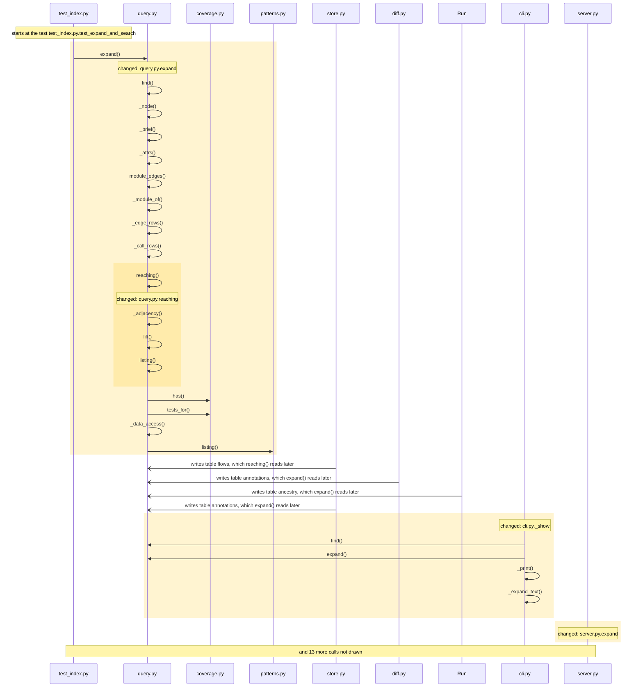
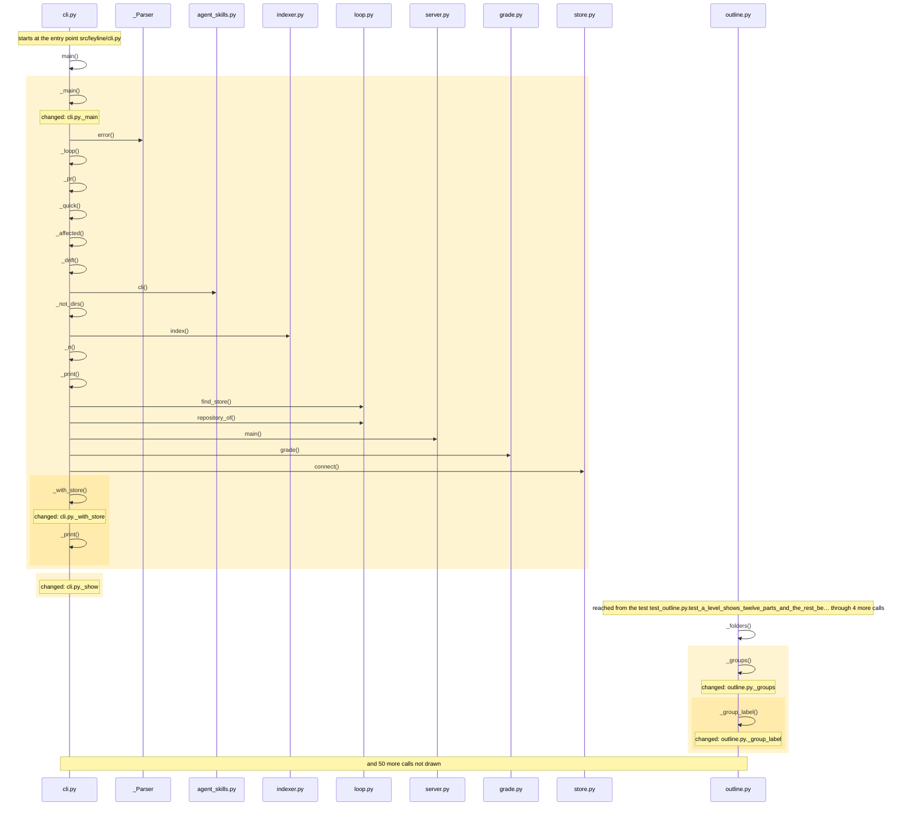

<!-- leyline:begin -->
# `show` and `expand` say which tests reach a function

The one-page plan for the change in `openspec/changes/show-tests-reaching/`, written by Leyline from the spec files beside it. `leyline plan` rewrites it; edit the spec, not this page.

**State: not done as agreed yet:** 18 edits are outside the spec. Details under "Was it done as agreed".

Which test exercises a function is the strongest thing the map gives that grep cannot. The plan has 10 tasks: it changes _show, expand, reaching. Nothing else must be edited with it; 59 places in 2 modules run into the changed code and may behave differently; 7 existing tests already run through it. It is done when 5 scenarios pass: 5 already have a test.

## 1. What code will be written

| Task | Does | Code |
| --- | --- | --- |
| 1.1 | Add `src/leyline/query.py: reaching`: the tests and entry points that reach a callable over the reverse call graph `query._adjacency` gives, with totals, the nearest first by stored flow depth then by distance, each with its node id and its flow id when one exists, reading the flow steps once | reaching; mentions _adjacency |
| 1.2 | Change `query.expand` to add, for every callable, `tests_reaching` and `entries_reaching` read with `query.reaching`, and `tests_measured` read with the coverage reader `coverage.tests_for` when a run was imported | expand; mentions reaching, tests_for |
| 1.3 | Change `cli._show` to print "tests that reach it on the map (N): …", "reached from (N): …" and "tests measured running it (N): …" | _show |
| 1.4 | Change `server.expand` to name `tests_reaching`, `entries_reaching` and `tests_measured` in its description | expand |
| 1.5 | Change skills/leyline-ask/SKILL.md to say that the expand tool answers which tests reach a function | no code: checked by you |
| 2.1 | Add the test "Expand says which tests reach a function" | a test for the scenario |
| 2.2 | Add the test "A function no tests reach says so" | a test for the scenario |
| 2.3 | Add the test "Measured tests are shown apart from static ones" | a test for the scenario |
| 2.4 | Add the test "Show prints the tests that reach a function" | a test for the scenario |
| 2.5 | Add the test "Expand reads the flow steps once" | a test for the scenario |

Not read as code (nothing to check on the map): task 1.2: `tests_reaching` is not on the map; read as a word, not code; task 1.2: `entries_reaching` is not on the map; read as a word, not code; task 1.2: `tests_measured` is not on the map; read as a word, not code; task 1.4: `tests_reaching` is not on the map; read as a word, not code; task 1.4: `entries_reaching` is not on the map; read as a word, not code; task 1.4: `tests_measured` is not on the map; read as a word, not code.

### How it runs

How execution reaches the code the tasks change, and what that code calls, as the code is now:

Drawn from the map: every arrow is a call or a channel link found in the code, in the order the code makes them where that order is known. The code the tasks change is shaded. An open arrowhead crosses a channel (a request, a message, a table, another program): the far side runs later, or in another process, and nothing checks the two sides against each other. Nothing on the map reaches server.py.expand.

## 2. What it will affect

4 things change, 0 more must be edited with them, and 59 are reached without needing an edit, across 2 modules. 7 existing tests run through the change.

*Must be edited*: code that breaks unless it changes too, such as the callers of a function whose parameters change. *Reached*: code that runs into the change, directly or through other calls; it needs no edit but may behave differently.

- leyline: 4 changed, 4 reached
- tests: 55 reached
- **medium risk:** Reaches outside its own module: tests.
- **medium risk:** 2 of 4 changed functions are on no test's path.
- **high risk:** Crosses a db boundary (annotations): query.py.expand, change.py.assess, export.py.graph, query.py._notes and 3 more read what diff.py.snapshot writes. One end changes (expand); the other has no compile-time link to it.
- **high risk:** Crosses a db boundary (ancestry): query.py.expand, affected.py._expand, affected.py._ran, affected.py.product_code and 27 more read what Run._write_patch writes. One end changes (expand); the other has no compile-time link to it.
- **high risk:** Crosses a db boundary (annotations): query.py.expand, change.py.assess, diff.py.snapshot, export.py.graph and 4 more read what store.py.annotate writes. One end changes (expand); the other has no compile-time link to it.
- **high risk:** Crosses a db boundary (ancestry): query.py.expand, affected.py._expand, affected.py._ran, affected.py.product_code and 28 more read what store.py.derive_some writes. One end changes (expand); the other has no compile-time link to it.
- **high risk:** Crosses a db boundary (ancestry): query.py.expand, affected.py._expand, affected.py._ran, affected.py.product_code and 27 more read what store.py.rebuild_derived writes. One end changes (expand); the other has no compile-time link to it.
- **high risk:** Crosses a db boundary (annotations): query.py.expand, change.py.assess, diff.py.snapshot, export.py.graph and 3 more read what store.py.refresh_stale writes. One end changes (expand); the other has no compile-time link to it.

**Must agree with the change, and no task names it** (another end of a channel it crosses):
- diff.py.snapshot (src/leyline/diff.py): writes what query.py.expand reads
- Run._write_patch (src/leyline/incremental.py): writes what query.py.expand reads
- store.py.annotate (src/leyline/store.py): writes what query.py.expand reads
- store.py.derive_some (src/leyline/store.py): writes what query.py.expand reads
- store.py.rebuild_derived (src/leyline/store.py): writes what query.py.expand reads
- store.py.refresh_stale (src/leyline/store.py): writes what query.py.expand reads
- store.py.write_flows (src/leyline/store.py): writes what query.py.reaching reads

**Shares a caller or a field with the change, and no task names it.** Each line is either right to leave alone or a missing task:
- expand is also called by _with_store
- and 1 more: `leyline spec facts`

**Usually changes with the files the tasks touch, and no task names it** (from the last 88 commits, leaving out 1 that changed more than 50 files). Each line is either right to leave alone or a missing task:
- `README.md` changed in 3 of the 3 commits that changed `skills/leyline-ask/SKILL.md` (and often with `src/leyline/cli.py`, `src/leyline/query.py` and 1 more); no task names it.
- `tests/test_server.py` changed in 3 of the 3 commits that changed `skills/leyline-ask/SKILL.md`; no task names it.
- `src/leyline/export.py` changed in 9 of the 13 commits that changed `src/leyline/query.py`; no task names it.
- `src/leyline/indexer.py` changed in 9 of the 13 commits that changed `src/leyline/query.py`; no task names it.
- and 4 more: `leyline spec facts`

**Usually changes with the functions the tasks name, and no task names it.** Each line is either right to leave alone or a missing task:
- `server.py.neighbors` changed in 3 of the 3 commits that changed `server.py.expand`; no task names it.
- `server.py.source` changed in 3 of the 3 commits that changed `server.py.expand`; no task names it.
- `cli.py.main` changed in 3 of the 5 commits that changed `query.py.expand`; no task names it.
- `query.py.overview` changed in 3 of the 5 commits that changed `query.py.expand`; no task names it.

**Earlier changes to this code** (no OpenSpec history on this code; from git history: commits before it whose diff names the same functions, then those that changed the same files (of the last 500 that touched them)):

- `68ad525` (2026-10-11): Release 0.9.0: exploring a codebase comes first, names work everywhere, a newcomer's fixes (#4). Changed `_show`, `expand`.
- `040e4a3` (2026-10-06): Three commands for the common path: map, plan, check. Changed `_show`, `expand`.
- `2eed3e1` (2026-10-07): Module outline: split a large module into named parts, for agents and the map page. Changed `expand`.
- `5f10f5a` (2026-10-06): Track field reads and writes; rank state assigned from outside its type. Changed `expand`.
- `f06a203` (2026-10-06): Add design-pattern labels, tours and the tour skill; fix MCP threading. Changed `expand`.
- and 37 more.

## 3. How you will know it was done

Each scenario is proven by a test with the same name. After the change, `leyline check` marks each one from the test results.

| Scenario | When | Then | Test |
| --- | --- | --- | --- |
| Expand says which tests reach a function | `expand` is called on a callable that tests reach through calls, some through flows the walk cut short | the result has `tests_reaching` with the total from the reverse call graph and the nearest tests, each | exists |
| A function no tests reach says so | `expand` is called on a callable no test reaches | `tests_reaching` is present with a total of 0 | exists |
| Measured tests are shown apart from static ones | a coverage run was imported and `expand` is called on a callable it ran | the result also has `tests_measured`, and `show` prints it under its own heading | exists |
| Show prints the tests that reach a function | `leyline show <function>` runs on a function some tests reach | it prints "tests that reach it on the map (N): …" and "reached from (N): …" | exists |
| Expand reads the flow steps once | `expand` is called on the callable the most flows pass | exactly one statement reads the flow steps | exists |

## Review findings

- Logic review: 6 findings, all settled.
- Performance review: 2 findings, all settled.

Settled (full text: `leyline spec findings`):
- high: tests_reaching counts only recorded flow steps, and 342 of 542 flows stop at 300 steps or depth 8, so show would print 0 tests for renames.for_file although... **Accepted**: Matthew accepted every review finding on 2026-10-12; the spec is rewritten to the reviewer's proposal.
- medium: Task 1.1 cannot give the totals the proposal and scenario promise by reading flow_steps 'the way explain._flows_through reads it', because that query has LIM... **Accepted**: Matthew accepted every review finding on 2026-10-12; the spec is rewritten to the reviewer's proposal.
- medium: Built the way _flows_through reads the table, each item carries the flow id (flow:...), which query.find does not resolve, so an agent cannot pass a listed t... **Accepted**: Matthew accepted every review finding on 2026-10-12; the spec is rewritten to the reviewer's proposal.
- medium: The store already answers which tests ran a function from measured coverage (coverage.tests_for, the coverage tool with node_id), and show saying "tests that... **Accepted**: Matthew accepted every review finding on 2026-10-12; the spec is rewritten to the reviewer's proposal.
- low: No test would show a regression in the cost of expand on a callable: the only test that runs expand (test_expand_and_search) checks content, and none of the... **Accepted**: Matthew accepted every review finding on 2026-10-12; the spec is rewritten to the reviewer's proposal.
- low: The scenarios cover only a callable some tests' flows pass; expand omits zero-total groups (calls, called_by), so an agent cannot tell a function no test rea... **Accepted**: Matthew accepted every review finding on 2026-10-12; the spec is rewritten to the reviewer's proposal.
- low: impact on a type counts flows through the type's members (its targets include every descendant), but expand on a type or a nested function's owner gets no te... **Accepted**: Matthew accepted every review finding on 2026-10-12; the spec is rewritten to the reviewer's proposal.
- low: The expand tool's description enumerates what a function's answer holds (signature, callers, callees, data) and no task updates it or the leyline-ask skill t... **Accepted**: Matthew accepted every review finding on 2026-10-12; the spec is rewritten to the reviewer's proposal.

## Before implementation

Nothing blocks implementation: every task that names code is tied to it, everything that must be edited has a task, and every scenario has a test or a task to write one.

- Task 1.5 names no code, so you check it yourself after the change; it does not hold up the verdict.

## 4. Was it done as agreed

Leyline marks each task from what changed in the code since the plan, whether or not it is ticked in tasks.md, and each scenario from the test results.

**Not yet:** 18 edits are outside the spec.

*The baseline was taken by another version of Leyline (or one that did not record its version), which may have read the same code differently: a change below that the diff does not show comes from that, not from the edit.*

| Task | Result | Verdict | Missing |
| --- | --- | --- | --- |
| 1.1 Add `src/leyline/query.py: reaching`: the tests and entry points that… | done | proven |  |
| 1.2 Change `query.expand` to add, for every callable, `tests_reaching`… | done | proven |  |
| 1.3 Change `cli._show` to print "tests that reach it on the map (N): …"… | done | proven |  |
| 1.4 Change `server.expand` to name `tests_reaching`, `entries_reaching`… | done | proven |  |
| 1.5 Change skills/leyline-ask/SKILL.md to say that the expand tool… | checked by you | needs a person |  |
| 2.1 Add the test "Expand says which tests reach a function" | done | proven |  |
| 2.2 Add the test "A function no tests reach says so" | done | proven |  |
| 2.3 Add the test "Measured tests are shown apart from static ones" | done | proven |  |
| 2.4 Add the test "Show prints the tests that reach a function" | done | proven |  |
| 2.5 Add the test "Expand reads the flow steps once" | done | proven |  |

*Checked by you*: the task names no code, so the map cannot see it done; it does not hold up the verdict.

| Scenario | Result | Verdict | Evidence |
| --- | --- | --- | --- |
| Expand says which tests reach a function | passes | proven | its test reaches the changed code on the map |
| A function no tests reach says so | passes | proven | its test reaches the changed code on the map |
| Measured tests are shown apart from static ones | passes | proven | its test reaches the changed code on the map |
| Show prints the tests that reach a function | passes | proven | its test reaches the changed code on the map |
| Expand reads the flow steps once | passes | proven | its test reaches the changed code on the map |

Verdicts: 14 proven, 1 needs you. Blocking: partial, contradicted, inconclusive. Not blocking: needs you. (The default.)

**Not proven, and why:**
- task 1.5, needs a person: it names no code, so the map cannot see it done (does not block)

**Changed, but not in the spec:**
- _main (callable) src/leyline/cli.py
- _with_store (callable) src/leyline/cli.py
- _group_label (callable) src/leyline/outline.py
- _groups (callable) src/leyline/outline.py
- _louvain (callable) src/leyline/outline.py
- names (callable) src/leyline/outline.py
- _fit (callable) src/leyline/server.py
- _tool (callable) src/leyline/server.py
- run (callable) src/leyline/server.py
- explain_path (callable) src/leyline/server.py
- find_flows (callable) src/leyline/server.py
- impact (callable) src/leyline/server.py
- module_outline (callable) src/leyline/server.py
- neighbors (callable) src/leyline/server.py
- overview (callable) src/leyline/server.py
- the top level of src/leyline/outline.py (code outside any function)
- the top level of src/leyline/server.py (code outside any function)
- _resplit (new, not declared in the proposal) src/leyline/outline.py

**Expected to change, and did not:**
- tests_for

Tests: 564 of 576 passed before, 577 of 589 after.

### How it runs now

**Before**: the code the change edits, as it ran at the baseline (drawn from the baseline alone):

Drawn from the map: every arrow is a call or a channel link found in the code, in the order the code makes them where that order is known. The code the change edits is shaded. Not drawn, to keep it readable: outline.py._louvain, outline.py.names, query.py.expand, server.py._fit, server.py._tool, server.py.run and 7 more.

**After**: the changed code as it runs now:

Drawn from the map: every arrow is a call or a channel link found in the code, in the order the code makes them where that order is known. The changed code is shaded. Not drawn, to keep it readable: outline.py._louvain, outline.py.names, query.py.expand, server.py._fit, server.py._tool, server.py.run and 11 more.

**What changed in how it runs** (calls and channel links into or out of the changed code, compared with the baseline):

- `outline.py._groups` now calls `Model.lines`
- `outline.py._groups` now calls `outline.py._resplit`
- `outline.py._resplit` now calls `outline.py._group_label`
- `outline.py._resplit` now calls `outline.py._louvain`
- `outline.py._resplit` now calls `outline.py.file_part`
- `query.py.expand` now calls `coverage.py.has`
- `query.py.expand` now calls `coverage.py.tests_for`
- `query.py.expand` now calls `query.py.reaching`
- `query.py.reaching` now calls `query.py._adjacency`
- `query.py.reaching` now calls `query.py.lift`
- `query.py.reaching` now calls `query.py.listing`
- `query.py.lift` now calls `change.py.enclosing`
- and 7 more
- `store.py.write_flows` now reaches `query.py.reaching` over db flows

Review before implementation:
- Logic review: 6 findings, all settled.
- Performance review: 2 findings, all settled.

Compared with the code as it was at 7bc2ec3.
<!-- leyline:end -->
