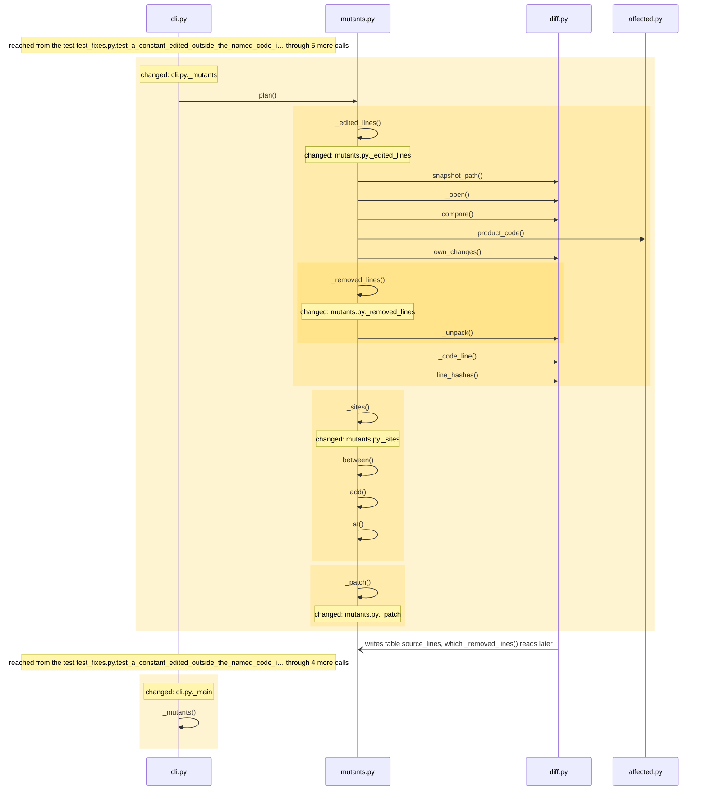
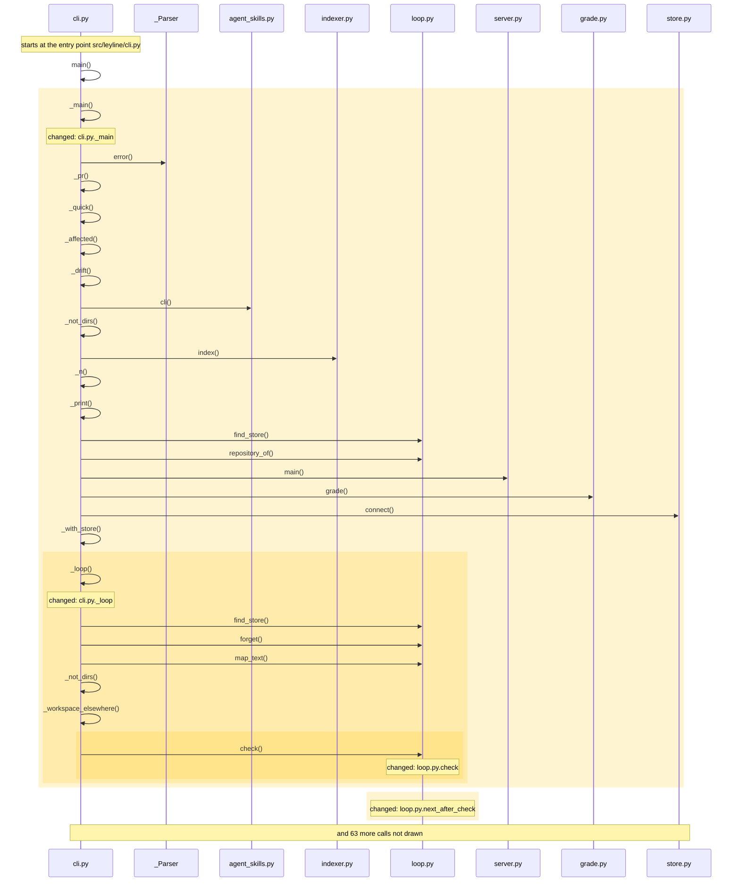
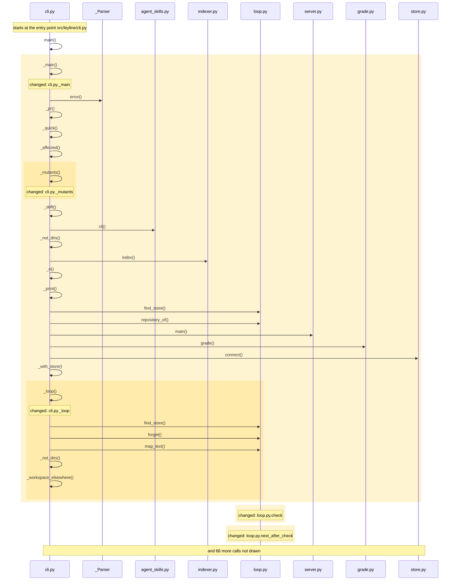

<!-- leyline:begin -->
# Say when a scenario's own test would pass whatever the change did

The one-page plan for the change in `openspec/changes/unasserted-changes/`, written by Leyline from the spec files beside it. `leyline plan` rewrites it; edit the spec, not this page.

**State: done as agreed.** Every task that names code is done, every scenario is proven, and nothing outside the spec changed. Task 2.26 is yours to check.

`check` proves a scenario by its test passing and reaching the changed code, and measured per-test coverage tightens that to "the test ran the changed code". The plan has 54 tasks: it changes _choose, _edited_lines, _loop, _main and 21 more. Nothing else must be edited with it; 751 places in 2 modules run into the changed code and may behave differently; 113 existing tests already run through it. It is done when 24 scenarios pass: 24 already have a test.

## 1. What code will be written

| Task | Does | Code |
| --- | --- | --- |
| 1.1 | Add `src/leyline/mutants.py` with `plan`, which writes the mutation plan of a spec change under a mutants folder beside the store and returns a short description of it | in src/leyline/mutants.py; mentions plan (could be 3 things) |
| 1.2 | Add `src/leyline/mutants.py: _removed_lines`, the hashes of the lines of the functions the change removed from the baseline | _removed_lines |
| 1.3 | Add `src/leyline/mutants.py: _edited_lines`, the lines of the edited functions whose text is new, built on `diff.own_changes` and reading the snapshot rows of the edited files only | _edited_lines; mentions own_changes |
| 1.4 | Add `src/leyline/mutants.py: _sites`, the places in a Python function where a comparison, a boolean operator, a negation, a returned value, an integer or an arithmetic operator can be broken, found with the standard library's ast, placed by character, skipping the inside of f-strings, each mutated source required to parse | _sites |
| 1.5 | Add `src/leyline/mutants.py: _patch`, a unified diff of one broken line in the file's own line endings, relative to its repository's root, that `git apply` accepts | _patch |
| 1.6 | Add `src/leyline/mutants.py: _choose`, which takes at most 30 mutants and 3 to a line, one to each edited function first, numbers them in that order and names the functions left without one | _choose |
| 1.7 | Add `src/leyline/mutants.py: _tests_for`, the tests of the scenarios that reach a function and at most 40 other tests that reach it, each function worked out once | _tests_for |
| 1.8 | Add `src/leyline/mutants.py: plan_text`, the plan as a person reads it | plan_text |
| 1.9 | Add `src/leyline/mutants.py: read_results`, the results file of a run of the plan: refused for another plan or changed code, partial files read, equivalent marks and baseline failures kept, mutants not run named | read_results |
| 1.10 | Add `src/leyline/mutants.py: mark_scenarios`, which says for each scenario whether its own tests failed a mutant of the changed functions they reach | mark_scenarios |
| 1.11 | Add `src/leyline/mutants.py: page_data`, what the page says about the mutants | page_data |
| 1.12 | Add `src/leyline/mutants.py: page_lines`, the section "Covered, but not asserted" | page_lines |
| 1.13 | Change the top level of `src/leyline/verdicts.py` to add the verdict unasserted, in the order of the verdicts and not in the default blocking | src/leyline/verdicts.py |
| 1.14 | Change `verdicts._scenario_verdict` to give a passing scenario whose own tests failed no mutant the verdict `unasserted`, after the verdict for a test that never ran the changed code and before the verdicts that prove a new test | _scenario_verdict |
| 1.15 | Change `verdicts.blocking_line` to name `unasserted` as not blocking only when an item has it or the project lists it | blocking_line |
| 1.16 | Change `spec.verify` to take the results of the mutants, to carry the names of each scenario's results, to call `mutants.mark_scenarios`, and to carry what the page says | verify; mentions mark_scenarios |
| 1.17 | Change `spec.verify_text` to print "Covered, but not asserted" with the survivors, the equivalent mutants and those not run, and the links named in the spec | verify_text |
| 1.18 | Add `src/leyline/spec.py: _named_in_spec`, the names a change writes in backticks in its proposal, design, tasks and specs | _named_in_spec |
| 1.19 | Change `spec.verify` to list a new link between modules whose target the change names apart from those that hold the verdict up | verify |
| 1.20 | Change `loop.check` to take the path of a results file, read it, and pass its contents on | check |
| 1.21 | Add `loop._unasserted_note`, what to do about a scenario whose own tests failed no mutant | _unasserted_note |
| 1.22 | Change `loop.next_after_check` to say, for an unasserted scenario, to strengthen the test and run the plan again | next_after_check |
| 1.23 | Change `server.check` to take `mutants_path` and to refuse a path outside the repositories | check |
| 1.24 | Add `src/leyline/server.py: mutants`, the tool that writes the plan of a spec change and returns the counts, the folder and one short line per mutant | mutants |
| 1.25 | Change `cli._main` to add the `mutants` command and `--mutants` to the check command | _main; mentions mutants |
| 1.26 | Change `cli._loop` to pass `--mutants` to `loop.check` | _loop, check |
| 1.27 | Add `src/leyline/cli.py: _mutants`, the `mutants` command | _mutants, mutants |
| 1.28 | Change docs/mcp-tools.md to list the `mutants` tool and `mutants_path?` on `check`, docs/changes.md and docs/quick-reference.md to describe the plan, the runner, the results and the verdict, and skills/leyline-spec/SKILL.md to say when to run it | mutants; mentions check (could be 5 things) |
| 2.1 | Add the test "The mutation plan covers only the lines the change edited" | a test for the scenario |
| 2.2 | Add the test "A moved function gets no mutants" | a test for the scenario |
| 2.3 | Add the test "Each mutant is a patch that applies" | a test for the scenario |
| 2.4 | Add the test "A mutant is made at the operator" | a test for the scenario |
| 2.5 | Add the test "Code of the tests gets no mutants" | a test for the scenario |
| 2.6 | Add the test "The cap gives each edited function a mutant first" | a test for the scenario |
| 2.7 | Add the test "A language with no mutation operators is named" | a test for the scenario |
| 2.8 | Add the test "A plan is for spec changes only" | a test for the scenario |
| 2.9 | Add the test "Planning reads the line hashes of the edited files only" | a test for the scenario |
| 2.10 | Add the test "The runner restores the file after a hang" | a test for the scenario |
| 2.11 | Add the test "A baseline failure kills nothing" | a test for the scenario |
| 2.12 | Add the test "A mutant that survived is listed" | a test for the scenario |
| 2.13 | Add the test "A scenario with no mutant caught by its own tests is unasserted" | a test for the scenario |
| 2.14 | Add the test "A scenario with a mutant caught by its own tests keeps its verdict" | a test for the scenario |
| 2.15 | Add the test "A scenario whose tests are new is judged too" | a test for the scenario |
| 2.16 | Add the test "A mutant that was never run leaves the scenario unjudged" | a test for the scenario |
| 2.17 | Add the test "An equivalent mutant counts for nothing" | a test for the scenario |
| 2.18 | Add the test "A scenario with no mutants is not unasserted" | a test for the scenario |
| 2.19 | Add the test "Results made for other code are refused" | a test for the scenario |
| 2.20 | Add the test "Unasserted does not block by default" | a test for the scenario |
| 2.21 | Add the test "A project can make unasserted block" | a test for the scenario |
| 2.22 | Add the test "Without results check is as it was" | a test for the scenario |
| 2.23 | Add the test "A link the spec names is not a hold-up" | a test for the scenario |
| 2.24 | Add the test "A link the spec does not name holds the change up" | a test for the scenario |
| 2.25 | Change `test_config_default_override_and_mistakes` to expect unasserted among the verdicts the message names | test_config_default_override_and_mistakes |
| 2.26 | Add the test "The mutants tool writes a plan" | no code: checked by you |

Not read as code (nothing to check on the map): task 1.14: `unasserted` is not on the map; read as a word, not code; task 1.15: `unasserted` is not on the map; read as a word, not code; task 1.23: `mutants_path` is not on the map; read as a word, not code.

### How it runs

How execution reaches the code the tasks change, and what that code calls, as the code is now:

Drawn from the map: every arrow is a call or a channel link found in the code, in the order the code makes them where that order is known. The code the tasks change is shaded. An open arrowhead crosses a channel (a request, a message, a table, another program): the far side runs later, or in another process, and nothing checks the two sides against each other. Not drawn, to keep it readable: mutants.py._choose, mutants.py._tests_for, mutants.py.plan_text, mutants.py.read_results, mutants.py.mark_scenarios, mutants.py.page_data and 12 more.

## 2. What it will affect

26 things change, 0 more must be edited with them, and 751 are reached without needing an edit, across 2 modules. 113 existing tests run through the change.

*Must be edited*: code that breaks unless it changes too, such as the callers of a function whose parameters change. *Reached*: code that runs into the change, directly or through other calls; it needs no edit but may behave differently.

- leyline: 25 changed, 302 reached
- tests: 1 changed, 449 reached
- **medium risk:** 6 of 44 changed functions are on no test's path.
- **high risk:** Crosses a db boundary (change_proposals): spec.py.verify, affected.py.change_id_for, diff.py.review, export.py.changes and 15 more read what change.py.propose writes. One end changes (verify); the other has no compile-time link to it.
- **high risk:** Crosses a db boundary (covered): spec.py.verify, affected.py._ran, affected.py.mark_scenarios, affected.py.measured_tests and 9 more read what coverage.py.import_file writes. One end changes (verify); the other has no compile-time link to it.
- **high risk:** Crosses a db boundary (meta): loop.py.check, cli.py._workspace_elsewhere, context.py.graph, diff.py.lost and 19 more read what diff.py.drop_snapshot writes. One end changes (check); the other has no compile-time link to it.
- **high risk:** Crosses a db boundary (test_results): loop.py.check, spec.py.verify, affected.py.mark_scenarios, diff.py.load and 8 more read what diff.py.record_tests writes. One end changes (check and verify); the other has no compile-time link to it.
- **high risk:** Crosses a db boundary (change_proposals): spec.py.verify, affected.py.change_id_for, change.py.propose, export.py.changes and 15 more read what diff.py.review writes. One end changes (verify); the other has no compile-time link to it.
- **high risk:** Crosses a db boundary (meta): loop.py.check, cli.py._workspace_elsewhere, context.py.graph, diff.py.lost and 18 more read what diff.py.snapshot writes. One end changes (check); the other has no compile-time link to it.

**Must agree with the change, and no task names it** (another end of a channel it crosses):
- change.py.propose (src/leyline/change.py): writes what spec.py.verify reads
- coverage.py.import_file (src/leyline/coverage.py): writes what spec.py.verify reads
- diff.py.drop_snapshot (src/leyline/diff.py): writes what loop.py.check reads
- diff.py.record_tests (src/leyline/diff.py): writes what loop.py.check, spec.py.verify reads
- diff.py.review (src/leyline/diff.py): writes what spec.py.verify reads
- diff.py.snapshot (src/leyline/diff.py): writes what loop.py.check reads
- Run.__init__ (src/leyline/incremental.py): writes what loop.py.check reads
- Run._let_go (src/leyline/incremental.py): writes what loop.py.check reads
- Run._take (src/leyline/incremental.py): writes what loop.py.check reads
- Run._write_patch (src/leyline/incremental.py): writes what spec.py.verify reads

**Shares a caller or a field with the change, and no task names it.** Each line is either right to leave alone or a missing task:
- verify is also called by _spec, spec_verify
- verify_text is also called by _spec, check_text
- and 9 more: `leyline spec facts`

**Usually changes with the files the tasks touch, and no task names it** (from the last 88 commits, leaving out 1 that changed more than 50 files). Each line is either right to leave alone or a missing task:
- `README.md` changed in 26 of the 27 commits that changed `src/leyline/server.py` (and often with `skills/leyline-spec/SKILL.md`, `src/leyline/cli.py` and 2 more); no task names it.
- `tests/test_index.py` changed in 14 of the 27 commits that changed `src/leyline/server.py`; no task names it.

**Earlier changes to this code** (finished OpenSpec changes and earlier reviews that touched the same code, newest first):

- `server-in-another-checkout` (checked 2026-10-15): An agent working in another checkout of the server's repository can map it. Touched `check`, `mutants`.
- `context-bodies` (checked 2026-10-15): `context` can carry the bodies of the focus, its callers and the types it takes. Touched `_main`.
- `orientation-from-named-parts` (checked 2026-10-15): The orientation tour and `map` point at named parts, not cluster anchors. Touched `_main`.

## 3. How you will know it was done

Each scenario is proven by a test with the same name. After the change, `leyline check` marks each one from the test results.

| Scenario | When | Then | Test |
| --- | --- | --- | --- |
| The mutation plan covers only the lines the change edited | a change edited two lines of a Python function that has comparisons on other lines | the plan holds mutants of the two lines only, each with its file, line, what it changes, its function and its | exists |
| A moved function gets no mutants | a change moved a function to another file, or reformatted it, with the same lines | the plan holds no mutant of it | exists |
| Each mutant is a patch that applies | the plan is written for a file with LF line endings and for one with CRLF | each patch is accepted by `git apply --check` from its repository's root, and the working tree is unchanged | exists |
| A mutant is made at the operator | a changed line has two comparisons and a non-ASCII character before them | the mutant that flips the second changes only that operator, and the mutated file parses | exists |
| Code of the tests gets no mutants | a change edited a function and the test that covers it | the plan holds mutants of the function and none of the test | exists |
| The cap gives each edited function a mutant first | a change edited five functions with ten mutable lines each and the cap is 30 | every function has a mutant before any has three, the mutants are numbered in that order, and a function the | exists |
| A language with no mutation operators is named | a change edited a TypeScript file | the plan says there are no mutants for that file and why | exists |
| A plan is for spec changes only | `mutants` is called on a `pr-<id>` or a quick change | it is refused, and says that plans are for spec changes | exists |
| Planning reads the line hashes of the edited files only | the plan is made on a repository of many files, two of them edited | the snapshot rows of those two files are read | exists |
| The runner restores the file after a hang | a mutant makes a test run past its timeout | `run.py` stops it, undoes the patch, records `timeout` and goes on, and the file is as it was | exists |
| A baseline failure kills nothing | a test fails in the unmutated run | it is listed as a baseline failure and no mutant counts as killed by it | exists |
| A mutant that survived is listed | a results file marks a mutant as survived | the page lists it under "Covered, but not asserted" with its file, line, what was changed and the tests that ran it | exists |
| A scenario with no mutant caught by its own tests is unasserted | a scenario passes, its test reaches a changed function, and every mutant of that function was run and none | its verdict is `unasserted`, saying how many mutants and which tests did fail them | exists |
| A scenario with a mutant caught by its own tests keeps its verdict | a mutant of a function the scenario reaches failed the scenario's own test | the scenario keeps the verdict it had | exists |
| A scenario whose tests are new is judged too | the scenario's test is new since the plan, and caught no mutant | its verdict is `unasserted`, not `proven` | exists |
| A mutant that was never run leaves the scenario unjudged | the results file leaves a mutant of the function out, or marks it as an error | the page says how many were not run, and the scenario keeps its verdict | exists; invariant: a property test fits (Hypothesis) |
| An equivalent mutant counts for nothing | a person marks a mutant equivalent with a reason | it is left out of the judgment and the page shows the reason | exists |
| A scenario with no mutants is not unasserted | the changed functions the scenario reaches have no mutants | it keeps its verdict and the page says why there were none | exists |
| Results made for other code are refused | the results file names another plan, or a mutated file has changed since the plan | `check` refuses it and says which | exists |
| A link the spec names is not a hold-up | a change adds an import of a module and its tasks name that module in backticks | the link is listed as named in the spec and the change can still be done as agreed | exists |
| A link the spec does not name holds the change up | a change adds an import of a module that no file of the change names | the link is listed as a new link between modules and the change is not done as agreed | exists |
| Unasserted does not block by default | a scenario is unasserted and `[check] blocking` is the default | `check` reports the change as done as agreed, exits 0, and says what is unasserted | exists |
| A project can make unasserted block | `[check] blocking` lists `unasserted` and a scenario has it | `check` exits 1, and `next` says to strengthen the test and run the plan again | exists |
| Without results check is as it was | `check` is called without `--mutants` | its page is what it was, the blocking line does not name `unasserted`, and no scenario has it | exists |

## Review findings

- Logic review: 11 findings, all settled.
- Performance review: 6 findings, all settled.

Settled (full text: `leyline spec findings`):
- high: A mutant's command would run every test that reaches its function, and for 4 of this change's 7 functions that is 441 to 443 tests (spec.verify, verify_text,... **Accepted**: Matthew accepted every review finding on 2026-10-15; the spec is rewritten to the reviewer's proposal, and unasserted is non-blocking by default.
- high: The printed command has no timeout and nothing restores the working tree, so a mutant that makes a test hang (a flipped while condition, a boundary shift on... **Accepted**: Matthew accepted every review finding on 2026-10-15; the spec is rewritten to the reviewer's proposal, and unasserted is non-blocking by default.
- high: The spec turns a scenario unasserted or keeps it by whether any mutant of a function its test reaches was killed by any test, never by whether the scenario's... **Accepted**: Matthew accepted every review finding on 2026-10-15; the spec is rewritten to the reviewer's proposal, and unasserted is non-blocking by default.
- high: The spec never says where unasserted sits among the existing early returns of _scenario_verdict: after the 'failed before, passes now' and 'new since the pla... **Accepted**: Matthew accepted every review finding on 2026-10-15; the spec is rewritten to the reviewer's proposal, and unasserted is non-blocking by default.
- high: unasserted blocks by default and exits 1 from check, but a surviving mutant can be an equivalent mutant (an operator flip that cannot change behavior, a retu... **Accepted**: Matthew accepted every review finding on 2026-10-15; the spec is rewritten to the reviewer's proposal, and unasserted is non-blocking by default.
- medium: The plan returned by the MCP tool would be cut: a record per mutant that carries its tests and command (441 test names, or a pytest line of 8 KB or more, per... **Accepted**: Matthew accepted every review finding on 2026-10-15; the spec is rewritten to the reviewer's proposal, and unasserted is non-blocking by default.
- medium: The spec caps the plan at 30 mutants and 3 to a line but gives no order or fairness, so a change that edited many lines spends the 30 on the first functions... **Accepted**: Matthew accepted every review finding on 2026-10-15; the spec is rewritten to the reviewer's proposal, and unasserted is non-blocking by default.
- medium: 'all mutants survived' is true of zero mutants and of a subset, and the spec does not say what happens when the functions a scenario reaches have no mutants... **Accepted**: Matthew accepted every review finding on 2026-10-15; the spec is rewritten to the reviewer's proposal, and unasserted is non-blocking by default.
- medium: Nothing ties a results file to the plan or code it was made from: mutant ids are positions in a plan, check re-maps the code before it reads anything, and an... **Accepted**: Matthew accepted every review finding on 2026-10-15; the spec is rewritten to the reviewer's proposal, and unasserted is non-blocking by default.
- medium: A mutant is 'killed' when any test failed and 'survived' only relative to the tests that were run, so a test that already fails (or is flaky, or times out) k... **Accepted**: Matthew accepted every review finding on 2026-10-15; the spec is rewritten to the reviewer's proposal, and unasserted is non-blocking by default.
- medium: 'The lines the change edited' comes from diff._changed_lines, which marks every line of a function that was only moved or reformatted as new, marks the unedi... **Accepted**: Matthew accepted every review finding on 2026-10-15; the spec is rewritten to the reviewer's proposal, and unasserted is non-blocking by default.
- medium: Task 1.3 finds break sites 'with the standard library's ast', but ast has no position for an operator token and counts col_offset in UTF-8 bytes (and gives w... **Accepted**: Matthew accepted every review finding on 2026-10-15; the spec is rewritten to the reviewer's proposal, and unasserted is non-blocking by default.
- medium: The spec does not touch verdicts.ORDER, summary_line, blocking_line or tests/test_verdicts.py, yet adding unasserted to DEFAULT_BLOCKING changes the pinned '... **Accepted**: Matthew accepted every review finding on 2026-10-15; the spec is rewritten to the reviewer's proposal, and unasserted is non-blocking by default.
- medium: next_after_check has no branch for unasserted, so a blocked agent gets only 'fix what the verdict lists' and is never told to strengthen the test, re-run the... **Accepted**: Matthew accepted every review finding on 2026-10-15; the spec is rewritten to the reviewer's proposal, and unasserted is non-blocking by default.
- low: Task 1.2 adds a second line-diff pass (_edited_lines with diff._changed_lines, difflib with autojunk off, quadratic on files with many repeated lines: 1.2 s... **Accepted**: Matthew accepted every review finding on 2026-10-15; the spec is rewritten to the reviewer's proposal, and unasserted is non-blocking by default.
- low: No scenario or test bounds the cost of the plan or of check --mutants: the only speed test that reaches the changed code is test_tour_prints_json_when_asked,... **Accepted**: Matthew accepted every review finding on 2026-10-15; the spec is rewritten to the reviewer's proposal, and unasserted is non-blocking by default.
- low: The spec says 'leyline mutants <change>' but does not say what it does for a quick-<slug> or pr-<id> change, which keep baselines of their own, while only sp... **Accepted**: Matthew accepted every review finding on 2026-10-15; the spec is rewritten to the reviewer's proposal, and unasserted is non-blocking by default.

## Before implementation

Nothing blocks implementation: every task that names code is tied to it, everything that must be edited has a task, and every scenario has a test or a task to write one.

- Task 2.26 names no code, so you check it yourself after the change; it does not hold up the verdict.

## 4. Was it done as agreed

Leyline marks each task from what changed in the code since the plan, whether or not it is ticked in tasks.md, and each scenario from the test results.

**Yes.** Every task that names code is done, every scenario is proven, and nothing outside the spec changed. Task 2.26 is yours to check.

*The baseline was taken by another version of Leyline (or one that did not record its version), which may have read the same code differently: a change below that the diff does not show comes from that, not from the edit.*

| Task | Result | Verdict | Missing |
| --- | --- | --- | --- |
| 1.1 Add `src/leyline/mutants.py` with `plan`, which writes the mutation… | done | proven |  |
| 1.10 Add `src/leyline/mutants.py: mark_scenarios`, which says for each… | done | proven |  |
| 1.11 Add `src/leyline/mutants.py: page_data`, what the page says about the… | done | proven |  |
| 1.12 Add `src/leyline/mutants.py: page_lines`, the section "Covered, but… | done | proven |  |
| 1.13 Change the top level of `src/leyline/verdicts.py` to add the verdict… | done | proven |  |
| 1.14 Change `verdicts._scenario_verdict` to give a passing scenario whose… | done | proven |  |
| 1.15 Change `verdicts.blocking_line` to name `unasserted` as not blocking… | done | proven |  |
| 1.16 Change `spec.verify` to take the results of the mutants, to carry the… | done | proven |  |
| 1.17 Change `spec.verify_text` to print "Covered, but not asserted" with… | done | proven |  |
| 1.18 Add `src/leyline/spec.py: _named_in_spec`, the names a change writes… | done | proven |  |
| 1.19 Change `spec.verify` to list a new link between modules whose target… | done | proven |  |
| 1.2 Add `src/leyline/mutants.py: _removed_lines`, the hashes of the lines… | done | proven |  |
| 1.20 Change `loop.check` to take the path of a results file, read it, and… | done | proven |  |
| 1.21 Add `loop._unasserted_note`, what to do about a scenario whose own… | done | proven |  |
| 1.22 Change `loop.next_after_check` to say, for an unasserted scenario, to… | done | proven |  |
| 1.23 Change `server.check` to take `mutants_path` and to refuse a path… | done | proven |  |
| 1.24 Add `src/leyline/server.py: mutants`, the tool that writes the plan… | done | proven |  |
| 1.25 Change `cli._main` to add the `mutants` command and `--mutants` to… | done | proven |  |
| 1.26 Change `cli._loop` to pass `--mutants` to `loop.check` | done | proven |  |
| 1.27 Add `src/leyline/cli.py: _mutants`, the `mutants` command | done | proven |  |
| 1.28 Change docs/mcp-tools.md to list the `mutants` tool and… | done | proven |  |
| 1.3 Add `src/leyline/mutants.py: _edited_lines`, the lines of the edited… | done | proven |  |
| 1.4 Add `src/leyline/mutants.py: _sites`, the places in a Python function… | done | proven |  |
| 1.5 Add `src/leyline/mutants.py: _patch`, a unified diff of one broken… | done | proven |  |
| 1.6 Add `src/leyline/mutants.py: _choose`, which takes at most 30 mutants… | done | proven |  |
| 1.7 Add `src/leyline/mutants.py: _tests_for`, the tests of the scenarios… | done | proven |  |
| 1.8 Add `src/leyline/mutants.py: plan_text`, the plan as a person reads it | done | proven |  |
| 1.9 Add `src/leyline/mutants.py: read_results`, the results file of a run… | done | proven |  |
| 2.1 Add the test "The mutation plan covers only the lines the change… | done | proven |  |
| 2.10 Add the test "The runner restores the file after a hang" | done | proven |  |
| 2.11 Add the test "A baseline failure kills nothing" | done | proven |  |
| 2.12 Add the test "A mutant that survived is listed" | done | proven |  |
| 2.13 Add the test "A scenario with no mutant caught by its own tests is… | done | proven |  |
| 2.14 Add the test "A scenario with a mutant caught by its own tests keeps… | done | proven |  |
| 2.15 Add the test "A scenario whose tests are new is judged too" | done | proven |  |
| 2.16 Add the test "A mutant that was never run leaves the scenario… | done | proven |  |
| 2.17 Add the test "An equivalent mutant counts for nothing" | done | proven |  |
| 2.18 Add the test "A scenario with no mutants is not unasserted" | done | proven |  |
| 2.19 Add the test "Results made for other code are refused" | done | proven |  |
| 2.2 Add the test "A moved function gets no mutants" | done | proven |  |
| 2.20 Add the test "Unasserted does not block by default" | done | proven |  |
| 2.21 Add the test "A project can make unasserted block" | done | proven |  |
| 2.22 Add the test "Without results check is as it was" | done | proven |  |
| 2.23 Add the test "A link the spec names is not a hold-up" | done | proven |  |
| 2.24 Add the test "A link the spec does not name holds the change up" | done | proven |  |
| 2.25 Change `test_config_default_override_and_mistakes` to expect… | done | proven |  |
| 2.26 Add the test "The mutants tool writes a plan" | checked by you | needs a person |  |
| 2.3 Add the test "Each mutant is a patch that applies" | done | proven |  |
| 2.4 Add the test "A mutant is made at the operator" | done | proven |  |
| 2.5 Add the test "Code of the tests gets no mutants" | done | proven |  |
| 2.6 Add the test "The cap gives each edited function a mutant first" | done | proven |  |
| 2.7 Add the test "A language with no mutation operators is named" | done | proven |  |
| 2.8 Add the test "A plan is for spec changes only" | done | proven |  |
| 2.9 Add the test "Planning reads the line hashes of the edited files only" | done | proven |  |

*Checked by you*: the task names no code, so the map cannot see it done; it does not hold up the verdict.

| Scenario | Result | Verdict | Evidence |
| --- | --- | --- | --- |
| The mutation plan covers only the lines the change edited | passes | proven | its test reaches the changed code on the map |
| A moved function gets no mutants | passes | proven | its test reaches the changed code on the map |
| Each mutant is a patch that applies | passes | proven | its test reaches the changed code on the map |
| A mutant is made at the operator | passes | proven | its test reaches the changed code on the map |
| Code of the tests gets no mutants | passes | proven | its test reaches the changed code on the map |
| The cap gives each edited function a mutant first | passes | proven | its test reaches the changed code on the map |
| A language with no mutation operators is named | passes | proven | its test reaches the changed code on the map |
| A plan is for spec changes only | passes | proven | its test reaches the changed code on the map |
| Planning reads the line hashes of the edited files only | passes | proven | its test reaches the changed code on the map |
| The runner restores the file after a hang | passes | proven | its test reaches the changed code on the map |
| A baseline failure kills nothing | passes | proven | its test reaches the changed code on the map |
| A mutant that survived is listed | passes | proven | its test reaches the changed code on the map |
| A scenario with no mutant caught by its own tests is unasserted | passes | proven | its test reaches the changed code on the map |
| A scenario with a mutant caught by its own tests keeps its verdict | passes | proven | its test reaches the changed code on the map |
| A scenario whose tests are new is judged too | passes | proven | its test reaches the changed code on the map |
| A mutant that was never run leaves the scenario unjudged | passes | proven | its test reaches the changed code on the map |
| An equivalent mutant counts for nothing | passes | proven | its test reaches the changed code on the map |
| A scenario with no mutants is not unasserted | passes | proven | its test reaches the changed code on the map |
| Results made for other code are refused | passes | proven | its test reaches the changed code on the map |
| A link the spec names is not a hold-up | passes | proven | its test reaches the changed code on the map |
| A link the spec does not name holds the change up | passes | proven | its test reaches the changed code on the map |
| Unasserted does not block by default | passes | proven | its test reaches the changed code on the map |
| A project can make unasserted block | passes | proven | its test reaches the changed code on the map |
| Without results check is as it was | passes | proven | its test reaches the changed code on the map |

Verdicts: 77 proven, 1 needs you. Blocking: partial, contradicted, inconclusive. Not blocking: needs you. (The default.)

**Not proven, and why:**
- task 2.26, needs a person: it names no code, so the map cannot see it done (does not block)

**Expected to change, and did not:**
- src/leyline/verdicts.py

**New links between modules, named in the spec** (they do not hold up the verdict):
- leyline to ast

Tests: 615 of 627 passed before, 640 of 652 after.

### How it runs now

**Before**: the code the change edits, as it ran at the baseline (drawn from the baseline alone):

Drawn from the map: every arrow is a call or a channel link found in the code, in the order the code makes them where that order is known. The code the change edits is shaded. Not drawn, to keep it readable: server.py.check, spec.py.verify, spec.py.verify_text, verdicts.py._scenario_verdict, verdicts.py.blocking_line.

**After**: the changed code as it runs now:

Drawn from the map: every arrow is a call or a channel link found in the code, in the order the code makes them where that order is known. The changed code is shaded. Not drawn, to keep it readable: server.py.check, spec.py.verify, spec.py.verify_text, verdicts.py._scenario_verdict, verdicts.py.blocking_line, loop.py._unasserted_note and 23 more.

**What changed in how it runs** (calls and channel links into or out of the changed code, compared with the baseline):

- `cli.py._main` now calls `cli.py._mutants`
- `cli.py._mutants` now calls `cli.py._print`
- `cli.py._mutants` now calls `loop.py.find_change`
- `cli.py._mutants` now calls `loop.py.find_store`
- `cli.py._mutants` now calls `loop.py.refresh`
- `cli.py._mutants` now calls `mutants.py.plan`
- `cli.py._mutants` now calls `mutants.py.plan_text`
- `cli.py._mutants` now calls `store.py.connect`
- `loop.py.check` now calls `mutants.py.read_results`
- `loop.py.next_after_check` now calls `loop.py._unasserted_note`
- `mutants.py._edited_lines` now calls `affected.py.product_code`
- `mutants.py._edited_lines` now calls `diff.py._code_line`
- and 49 more
- `diff.py.snapshot` now reaches `mutants.py._removed_lines` over db source_lines
- `test_learnings.py.test_reviewers_and_the_pages_are_told_when_the_…` now reaches `spec.py._named_in_spec` over file utf-8/*.md

Review before implementation:
- Logic review: 11 findings, all settled.
- Performance review: 6 findings, all settled.

Compared with the code as it was at 7bc2ec3.
<!-- leyline:end -->
